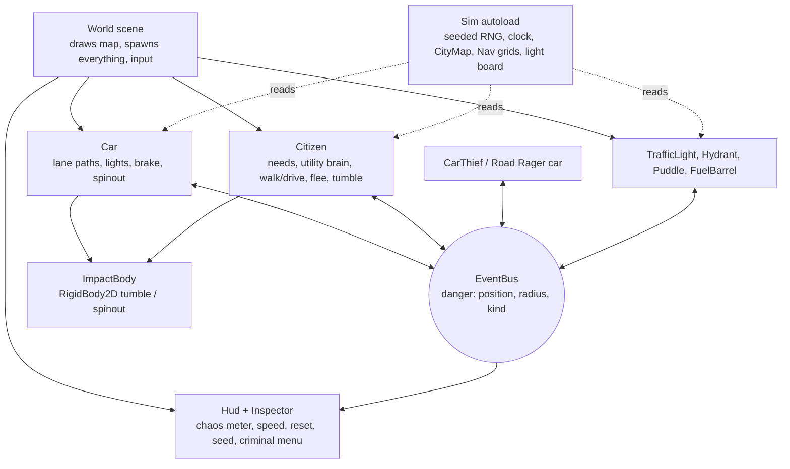

# Emergent Chaos Simulator: Implementation Plan
Spec: `docs/chaos-simulator-spec.md` v2 · Plan version: 1 · Date: Oct 16, 2026 · User level: Comfortable coder, new to Godot

> **For Claude Code:** Read `CLAUDE.md` first, then the **Progress log** at the bottom of this file, then start the first unchecked task. Follow the steps exactly. Stop at every 🧑 HUMAN task and wait for the human's reply. This file is long: read only the task you're on (use Read with an offset), not the whole plan.

## How to use this plan (for you, the human)

1. Open the `ChaosSimulator` folder in Claude Code and say: **"Read CLAUDE.md and PLAN.md and start the next task."**
2. Claude Code does the coding tasks one at a time and commits after each one. When it reaches a 🧑 task, it stops and tells you exactly what to do or look at, then waits for your reply.
3. Start a fresh Claude Code session at the end of each phase (the plan reminds you). Everything it needs to pick up again lives in this file and `CLAUDE.md`.
4. All the code in this plan was run and tested in a scratch copy of this project with Godot 4.7.2 before it was written here, so if something fails, it's most likely a setup difference. Paste the error and Claude Code will check the task's "If it fails" notes.

## Goal

A top-down 2D "god view" city sim that runs in a desktop browser on itch.io before Nov 18, 2026 (launch target Mon Nov 16). Forty citizens with jobs, schedules, needs and bios commute through a small district while twenty cars obey traffic lights. The player drops a Car Thief or a Road Rager and watches unscripted chain reactions: stolen cars, crashes, burst hydrants, exploding fuel barrels and citizens tumbling ragdoll-style, then reappearing at home. A chaos meter, speed controls, Reset and seeds round it out, and four Substack posts document the build.

## Architecture

Two autoloads hold everything shared: `Sim` (the only seeded RNG, the clock, the district map and path grids, and the traffic-light board) and `EventBus` (one signal, `danger(position, radius, kind)`). Agents (cars, citizens, criminals) and objects (lights, hydrants, barrels) never call each other. They emit danger and react to danger by their own rules, and that's what makes chains emerge. The only direct calls happen between two bodies that are physically touching (a collision or overlap callback), plus a citizen controlling its own car. Agents follow `AStarGrid2D` paths. A hard hit swaps one for an `ImpactBody` (`RigidBody2D`) until it settles.



## Tech stack (pinned)

| Tool / library | Version | Docs |
|---|---|---|
| Godot Engine (standard, not .NET) | 4.7.2-stable (`4.7.2.stable.official.ed1daf0bf`) | https://docs.godotengine.org/en/stable/ |
| Renderer | Compatibility (WebGL 2), the only one that runs in browsers | https://docs.godotengine.org/en/stable/tutorials/export/exporting_for_web.html |
| Web export templates | 4.7.2.stable, `web_nothreads_release.zip` (Thread Support OFF) | same page |
| Language | GDScript with static typing | https://docs.godotengine.org/en/stable/tutorials/scripting/gdscript/static_typing.html |
| Pathfinding | `AStarGrid2D` (built in) | https://docs.godotengine.org/en/stable/classes/class_astargrid2d.html |
| Physics bodies | `CharacterBody2D`, `RigidBody2D`, `Area2D`, `ShapeCast2D` (built in, Godot Physics 2D) | https://docs.godotengine.org/en/stable/classes/class_rigidbody2d.html |
| Art | Kenney Racing Pack, Top-down Shooter, Roguelike Modern City (CC0) | https://kenney.nl/assets |
| Git / GitHub CLI | git 2.49, gh 2.86 (already installed) | https://cli.github.com/manual/ |
| Local web server | Python 3.14 `http.server` (already installed) | https://docs.python.org/3/library/http.server.html |
| Hosting | itch.io HTML5 page | https://itch.io/docs/creators/html5 |
| OS / shell | Windows 11, PowerShell 7 | n/a |

No third-party Godot plugins, no test framework, no external services in the build.

## Assumptions

Choices made where the spec left room (agreed in the outline check-in on Oct 16, 2026):

1. **Map:** 96 × 54 cells of 32 px (about 3 × 2.4 screens). Roads are one cell wide at x = 32, x = 64, y = 18 and y = 36, running edge to edge (a tic-tac-toe grid). That gives exactly **4 signalized intersections** and 9 blocks: 2 housing blocks, office, bank, café, shop, gas station, park and a parking lot.
2. **Lanes:** one road grid. Cars draw themselves 8 px to the right of their heading, so oncoming cars never touch. A Road Rager "overtakes into the oncoming lane" by flipping that offset.
3. **Traffic lights give each approach its own green, in turn** (north, east, south, west), with a 2 s all-red. In testing, two-phase lights made turning cars T-bone oncoming traffic 70+ times in 5 minutes. With one approach at a time, a calm 5-minute run has 0–2 isolated bumps.
4. **Cars:** exactly 20. Up to 16 belong to car-owning citizens (about 40% of citizens) and park at the owner's block when not in use (`PARKED` is an extra car state). The rest are through-traffic.
5. **Art:** everything is drawn with simple shapes until Phase 10, when Kenney sprites replace cars and people. Buildings and roads stay drawn shapes in v1, because exact tile-atlas code for the city pack can't be planned without guessing.
6. **Raw Kenney packs** go in `art/kenney/`, which has a `.gdignore` file so Godot doesn't import 1,000+ files. Only the 12 sprites the game uses are copied to `art/sprites/`.
7. **Tests:** one runner scene, `tests/run_tests.tscn`, with plain `check()` asserts and no framework. It runs as a scene (not `-s`) so the autoloads exist. Pure logic (map, grids, light timing, clock, citizen generation and brain, chaos meter) gets tests. Movement and physics are checked by a headless smoke run plus your eyes.
8. **Godot command:** `C:\Godot\godot.cmd` points at the console build, so `godot ...` works in PowerShell and prints to the terminal.
9. **Repo:** public GitHub repo `chaos-simulator` under your personal account (you'll sign out of the gatech account first).
10. **Bios:** Claude Code writes the 300 bios when it reaches T025. An automated check gates them (50 per profession, 5–30 words, no duplicates, no banned words), and you skim them in T028.
11. **Title:** "Emergent Chaos Simulator" for now (open question in the spec). Changing it later only touches `project.godot`, the README and the itch page.

## Spec coverage

| Spec item | Tasks |
|---|---|
| R1 Build the district from a fixed layout, spawn 40 citizens and 20 cars | T010, T011, T012, T018, T023 |
| R2 Profession, home, workplace, schedule, needs, car, bio per citizen | T021, T025, T026 |
| R3 Clock: 1 s = 2 sim min, 12-min day, starts 06:00 | T020 |
| R4 Lights cycle; cars stop on red, brake, queue | T016, T017, T018, T019 |
| R5 Citizens pick goals by utility scoring | T021, T022, T024 |
| R6 Danger events with position, radius, kind; agents react by own rules | T003, T017, T022, T029, T030, T031, T033 |
| R7 Physics body on hard impact (ragdoll / spinout), then hand back or respawn | T034, T035, T036, T037 |
| R8 Pick a criminal from a menu and click to place | T038, T039, T040, T041 |
| R9 Chaos meter rises on events and fleeing, decays | T042, T043, T045 |
| R10 Inspector card on click | T027, T028 |
| R11 Steady frame rate with 60 agents in Chrome and Firefox | T006, T007, T008, T009, T047, T049 |
| D1 Friend opens the itch link; smooth in Chrome and Firefox | T009, T049, T052 |
| D2 Visible commute and two rush hours in a 12-minute day | T020, T021, T024 |
| D3 Click any citizen: name, profession, goal, needs, bio | T027, T028 |
| D4 Hit citizen tumbles, skids, bounces, fades, reappears at home | T034, T035, T037 |
| D5 Car Thief or Road Rager causes a chain reaction in 3 of 5 tries | T038, T039, T040, T041 |
| D6 Meter climbs, Reset calms the city, same seed = same city | T042, T043, T044, T045 |
| D7 Four Substack posts, last one the launch post | T015 (B1), T024 (B2), T037 (B3), T053 (B4) |
| S1 No GTA names, logos or look-alike art | CLAUDE.md, T048, T052 |
| S2 Skim the AI-written bios; fictional people only | T025, T028 |
| S3 No API keys or live AI in the build | CLAUDE.md, T048 |
| S4 itch.io content tag: cartoon violence | T048, T052 |
| Scope: drag-pan and scroll-zoom | T013 |
| Scope: pause / 1× / 3×, Reset, New Seed, visible seed | T043 |
| Scope: phones see a "best on desktop" note | T014 |
| Spec step 1 (setup) | T001–T005 · step 2 → T006–T009 · step 3 → T010–T015 · step 4 → T016–T019 · step 5 → T020–T024 · step 6 → T025–T028 · step 7 → T029–T033 · step 8 → T034–T037 · step 9 → T038–T041 · step 10 → T042–T045 · step 11 → T050–T051 · step 12 → T052 · B1–B4 → T015, T024, T037, T053 |

## File map

| File | Responsibility |
|---|---|
| `project.godot` | Engine settings: Compatibility renderer, 1280×720, autoloads, main scene |
| `export_presets.cfg` | The "Web" export preset (Thread Support OFF) |
| `scripts/sim.gd` | Autoload `Sim`: seeded RNG, clock, `CityMap` + `Nav`, light board, layer constants, helpers |
| `scripts/event_bus.gd` | Autoload `EventBus`: the `danger` signal |
| `scripts/city_map.gd` | `CityMap`: fixed layout, cell types, destinations, parking slots (pure data) |
| `scripts/nav.gd` | `Nav`: road, walk and jaywalk `AStarGrid2D` grids |
| `scenes/world/world.tscn` + `scripts/world.gd` | Main scene: draws the map, spawns everything, handles clicks and keys |
| `scripts/city_camera.gd` | `CityCamera`: drag-pan, wheel-zoom, clamp, follow |
| `scripts/desktop_banner.gd` | `DesktopBanner`: "best on desktop" note on phones and narrow windows |
| `scripts/traffic_light.gd` | `TrafficLight`: per-approach phases, knock-out pole |
| `scripts/car.gd` | `Car`: lane driving, lights, braking, crash, spinout, parking, theft, road rage |
| `scripts/citizen_data.gd` | `CitizenData`: one citizen's identity and needs, seeded generation, bio loading |
| `scripts/citizen_brain.gd` | `CitizenBrain`: utility scoring (pure functions) |
| `scripts/citizen.gd` | `Citizen`: walk, drive own car, flee, tumble, dazed, respawn |
| `scripts/fx_ring.gd` | `FxRing`: expanding ring effect |
| `scripts/inspector.gd` | `Inspector`: the click-to-inspect card |
| `scripts/hurtbox.gd` | `Hurtbox`: reports fast bodies that touch an object |
| `scripts/hydrant.gd`, `scripts/puddle.gd` | `Hydrant` bursts into a slippery `Puddle` |
| `scripts/fuel_barrel.gd` | `FuelBarrel`: barrels and gas pumps, fuse, explosion, chaining |
| `scripts/impact_body.gd` | `ImpactBody`: the `RigidBody2D` tumble/spinout stand-in (max 5 at once) |
| `scripts/car_thief.gd` | `CarThief`: walks to a stopped car and steals it |
| `scripts/hud.gd` | `Hud`: chaos meter, clock, speed, Reset, New Seed, seed, criminal menu, F2 FPS |
| `scripts/chaos_meter.gd` | `ChaosMeter`: meter logic (pure) |
| `scripts/art.gd` | `Art`: sprite paths and sprite helpers |
| `data/bios.json` | 300 bios, 50 per profession |
| `art/kenney/` (+ `.gdignore`) | Raw Kenney packs, ignored by Godot |
| `art/sprites/` | The 12 sprites the game uses |
| `tests/run_tests.tscn` + `tests/run_tests.gd` | Headless test runner |
| `tests/test_*.gd` | One suite per area: sim, city_map, nav, traffic_light, citizens, bios, layout, chaos_meter, reset |
| `scenes/spike/`, `scripts/spike.gd` | Throwaway performance spike (Phase 1, deleted in T048) |
| `DEVLOG.md` | Dated session entries, used as the Substack draft |
| `README.md`, `docs/itch-page.md` | Project readme and itch page copy |

## Conventions used in every task

- **Shell:** PowerShell. Every command runs from the project root, `C:\Users\phill\Desktop\ChaosSimulator`.
- **Test command (`TEST`):** `godot --headless --path . --import; godot --headless --path . res://tests/run_tests.tscn`. The import step must run first so Godot learns about new `class_name` scripts. The last line printed is `N checks, M failed`, and failures print `FAIL: ...` lines.
- **Smoke command (`SMOKE`):** `godot --headless --path . --quit-after 600`. This runs the main scene for 600 frames with no window. Expected: only the `Godot Engine v4.7.2.stable.official...` line, with no `SCRIPT ERROR` or `ERROR` lines.
- **Code steps** either create a file with exact contents, replace a whole file, or list numbered **find → replace** edits. For edits, use the Edit tool with the find block as `old_string`; each find block appears exactly once.
- **Commits:** `git add -A` then the commit message given in the task. Every commit message ends with the line `Co-Authored-By: Claude Opus 5.5 <noreply@anthropic.com>` (shown in each commit step).
- **After every task:** tick its checkboxes and add a row to the Progress log.

---

## Phase 0: Setup (spec step 1)

### T001 🧑 HUMAN: Put Godot on your PATH
**Agent: STOP here. Tell the human the steps below in plain words, then wait for their reply. Do not continue or assume it worked.**

- **Why:** every command in this plan types `godot`. Right now Godot sits in your Downloads folder and the terminal can't find it. We use the *console* build so Godot's messages show up in the terminal.

Say to the human:
1. Open a PowerShell window (or type each line in Claude Code with a `!` in front) and run these four lines one at a time:
   ```powershell
   New-Item -ItemType Directory -Force C:\Godot | Out-Null
   Copy-Item "$env:USERPROFILE\Downloads\Godot_v4.7.2-stable_win64.exe\*" C:\Godot\
   Set-Content C:\Godot\godot.cmd '@"%~dp0Godot_v4.7.2-stable_win64_console.exe" %*'
   [Environment]::SetEnvironmentVariable("Path", [Environment]::GetEnvironmentVariable("Path", "User") + ";C:\Godot", "User")
   ```
   (The last line adds `C:\Godot` to your PATH. PATH is the list of folders Windows searches when you type a command.)
2. **Close every terminal and quit Claude Code completely**, then open Claude Code again in this folder. PATH changes only reach programs started afterwards.
3. Run `godot --version` and paste the output here.

**Ask them to report:** the output of `godot --version`. Expected: `4.7.2.stable.official.ed1daf0bf`.
**If something seems wrong:**
- `godot is not recognized`: Claude Code wasn't restarted, or the PATH line didn't run. Run `$env:Path -split ';' | Select-String Godot` to check.
- `Copy-Item` can't find the files: check that `Downloads\Godot_v4.7.2-stable_win64.exe` is a *folder* containing `Godot_v4.7.2-stable_win64.exe` and `Godot_v4.7.2-stable_win64_console.exe`.

### T002 🧑 HUMAN: Install the Web export templates
**Agent: STOP here. Tell the human the steps below, then wait for their reply.**

- **Depends on:** T001
- **Why:** R11, D1. Export templates are the pre-built engine files Godot packs your game into for the browser. Without them, the web export fails.

Say to the human:
1. Run `godot --path . -e` to open this project in the Godot editor. If it asks to upgrade or convert anything, choose **OK**.
2. In the menu bar, click **Editor → Manage Export Templates…**, then **Download and Install**. It's about 1 GB, so give it a few minutes.
3. When it says the templates for **4.7.2.stable** are installed, close the editor window. If it asks to save, click **Don't Save**.
4. Run this and paste the result:
   ```powershell
   Test-Path "$env:APPDATA\Godot\export_templates\4.7.2.stable\web_nothreads_release.zip"
   ```

**Ask them to report:** the output. Expected: `True`.
**If something seems wrong:** if the download fails, use the dialog's **Install from File** option with the `.tpz` file from https://godotengine.org/download/archive/4.7.2-stable/ ("Export templates").

### T003 [R6] Project settings, autoloads, test runner, first commit
- **Owner:** Agent
- **Depends on:** T001
- **Files:** Create `scripts/sim.gd`, `scripts/event_bus.gd`, `tests/run_tests.tscn`, `tests/run_tests.gd`, `tests/test_sim.gd`, `DEVLOG.md` · Modify `project.godot`, `.gitignore`
- **Why:** spec step 1. The `Sim` autoload owns the only seeded RNG ("same seed rebuilds the same city"), and `EventBus` carries `danger` (R6).
- **Docs & gotchas:** https://docs.godotengine.org/en/stable/tutorials/scripting/singletons_autoload.html. The project was created with the **Forward+** renderer, which can't run in a browser, so this task switches it to **Compatibility**. Tests run as a scene, not with `-s`: in `-s` mode autoloads like `Sim` don't exist and scripts that use them won't compile.

- [x] **Step 1: Write the failing test and the test runner**

Create `tests/run_tests.tscn` with exactly this:

```ini
[gd_scene format=3]

[ext_resource type="Script" path="res://tests/run_tests.gd" id="1"]

[node name="RunTests" type="Node"]
script = ExtResource("1")
```

Create `tests/run_tests.gd` with exactly this:

```gdscript
extends Node
## Headless test runner. Run: godot --headless --path . res://tests/run_tests.tscn
## It runs as a scene (not with -s) so the Sim and EventBus autoloads exist.
## Each suite is a script whose func run(t) -> bool calls t.check(condition, "what")
## and returns true at the end. A suite that crashes midway counts as a failure.

const SUITES: Array[String] = [
	"res://tests/test_sim.gd",
]

var checks := 0
var failures := 0


func _ready() -> void:
	# Safety net: if a suite crashes the runner, still quit instead of hanging.
	get_tree().create_timer(60.0).timeout.connect(func() -> void:
		printerr("FAIL: test runner crashed (see SCRIPT ERROR above)")
		get_tree().quit(1))
	for path in SUITES:
		var script: Script = load(path)
		if script == null or not script.can_instantiate():
			check(false, "could not load " + path + " (see SCRIPT ERROR above)")
			continue
		var finished: Variant = script.new().call("run", self)
		check(finished == true, path + " ran to the end")
	print("%d checks, %d failed" % [checks, failures])
	get_tree().quit(1 if failures > 0 else 0)


func check(ok: bool, what: String) -> void:
	checks += 1
	if not ok:
		failures += 1
		printerr("FAIL: " + what)
```

Create `tests/test_sim.gd` with exactly this:

```gdscript
extends RefCounted

const SimScript := preload("res://scripts/sim.gd")


func run(t) -> bool:
	var a := SimScript.make_rng(42)
	var b := SimScript.make_rng(42)
	var c := SimScript.make_rng(43)
	var da: Array[int] = []
	var db: Array[int] = []
	var dc: Array[int] = []
	for i in 10:
		da.append(a.randi())
		db.append(b.randi())
		dc.append(c.randi())
	t.check(da == db, "same seed gives same draws")
	t.check(da != dc, "different seed gives different draws")
	return true
```

- [x] **Step 2: Run the test and confirm it fails**
  Run: `godot --headless --path . --import; godot --headless --path . res://tests/run_tests.tscn`
  Expected: `SCRIPT ERROR` lines about `res://scripts/sim.gd`, a line `FAIL: could not load res://tests/test_sim.gd ...`, and a last line ending in `1 failed`.

- [x] **Step 3: Write the autoloads and the project settings**

Create `scripts/sim.gd` with exactly this:

```gdscript
extends Node
## Autoload. Owns the only seeded RNG. Never call the global randi()/randf().

var seed_value: int = 2026
var rng := RandomNumberGenerator.new()


func _ready() -> void:
	start_city(seed_value)


## Same seed -> same starting city. Reset calls this with the old seed.
func start_city(new_seed: int) -> void:
	seed_value = new_seed
	rng = make_rng(new_seed)


static func make_rng(s: int) -> RandomNumberGenerator:
	var r := RandomNumberGenerator.new()
	r.seed = s
	return r
```

Create `scripts/event_bus.gd` with exactly this:

```gdscript
extends Node
## Autoload. The only way agents and objects talk to each other.
## Emit:   EventBus.danger.emit(global_position, 96.0, &"crash")
## React:  EventBus.danger.connect(_on_danger)
## Kinds: &"crash", &"explosion", &"theft", &"ragdoll", &"water", &"panic", &"test"

signal danger(position: Vector2, radius: float, kind: StringName)
```

Create `project.godot` with exactly this:

```ini
; Engine configuration file.
; It's best edited using the editor UI and not directly,
; since the parameters that go here are not all obvious.
;
; Format:
;   [section] ; section goes between []
;   param=value ; assign values to parameters

config_version=5

[application]

config/name="Chaos Simulator"
config/features=PackedStringArray("4.7", "GL Compatibility")
config/icon="res://icon.svg"

[autoload]

Sim="*res://scripts/sim.gd"
EventBus="*res://scripts/event_bus.gd"

[display]

window/size/viewport_width=1280
window/size/viewport_height=720
window/stretch/mode="canvas_items"
window/stretch/aspect="expand"

[rendering]

renderer/rendering_method="gl_compatibility"
renderer/rendering_method.mobile="gl_compatibility"
```

  Replace the whole file `.gitignore` with exactly this:

```text
# Godot 4+ specific ignores
.godot/
/android/
# Web builds
build/
```

  Create `DEVLOG.md` with exactly this:

```markdown
# Devlog

One dated entry per session: what we built, what broke, one interesting decision.
This becomes the Substack draft.

## 2026-10-16
- **Built:** Godot 4.7.2 project with the Compatibility renderer, `Sim` and `EventBus` autoloads, a headless test runner.
- **Broke:** nothing yet.
- **Interesting decision:** every random number in the game comes from one seeded generator in `Sim`, so a seed replays the same starting city.
```

- [x] **Step 4: Run the test and confirm it passes**
  Run: `godot --headless --path . --import; godot --headless --path . res://tests/run_tests.tscn`
  Expected last line: `3 checks, 0 failed`

- [x] **Step 5: Create the repo and commit**
  Run:
```powershell
git init -b main
git config user.name; git config user.email
```
  Expected: `Initialized empty Git repository ...`, then your name and email. **If either config line prints nothing, stop and ask the human for the name and email to use**, then set them with `git config --global user.name "..."` and `git config --global user.email "..."`.
  Run:
```powershell
git add -A; git commit -m "T003: project settings, Sim and EventBus autoloads, test runner" -m "Co-Authored-By: Claude Opus 5.5 <noreply@anthropic.com>"
```
  Expected: `[main (root-commit) xxxxxxx] T003: ...`

**Done when:** the test prints `3 checks, 0 failed` and the first commit exists (`git log --oneline` shows it).
**If it fails:** if the test hangs or prints nothing, the import step didn't run first. Press Ctrl+C, then run the full TEST command, import included. If you see `Identifier "Sim" not declared`, check the `[autoload]` section in `project.godot`.

### T004 🧑 HUMAN, then agent: Sign in to your personal GitHub and push
**Agent: STOP here. Tell the human the steps below, then wait for their reply.**

- **Depends on:** T003
- **Why:** you chose a public GitHub repo so the Substack posts can link to the code. `gh` (the GitHub command-line tool) is currently signed in to `github.gatech.edu` only.

Say to the human:
1. Sign out of the school account and sign in to your personal one. Run these one at a time and follow the browser prompts:
   ```powershell
   gh auth logout --hostname github.gatech.edu
   gh auth login --hostname github.com --git-protocol https --web
   ```
   When it asks "Authenticate Git with your GitHub credentials?", answer **Yes**.
2. Run `gh auth status` and paste the output.

**Ask them to report:** the `gh auth status` output. It should say `Logged in to github.com account <your-username>`.

Agent, after the human confirms:
- [x] **Step 1: Create the public repo and push**
  Run: `gh repo create chaos-simulator --public --source . --remote origin --push`
  Expected: `✓ Created repository <username>/chaos-simulator on GitHub` and a `Branch 'main' set up to track remote branch 'main'` line.
- [x] **Step 2: Note it** in the Progress log with the repo URL.

**If something seems wrong:** `gh repo create` says the name exists: ask the human for another name. A push asks for a password: run `gh auth setup-git` and push again with `git push -u origin main`.

### T005 🧑 HUMAN: Download the Kenney art packs
**Agent: STOP here. Tell the human the steps below, then wait for their reply.**

- **Depends on:** T003
- **Why:** spec shopping list: free CC0 art from day one. We store the raw packs now and use them in T046.

Say to the human:
1. Download these three packs. On each page click **Download** and then **Continue without donating** (or donate if you like). The zips land in your Downloads folder.
   - https://kenney.nl/assets/racing-pack
   - https://kenney.nl/assets/top-down-shooter
   - https://kenney.nl/assets/roguelike-modern-city
2. Run these lines from the project folder (they unzip the packs into `art/kenney/`, and the `.gdignore` file tells Godot not to import those 1,000+ files):
   ```powershell
   New-Item -ItemType Directory -Force art\kenney | Out-Null
   New-Item -ItemType File -Force art\kenney\.gdignore | Out-Null
   Expand-Archive "$env:USERPROFILE\Downloads\kenney_racing-pack.zip" art\kenney\racing -Force
   Expand-Archive "$env:USERPROFILE\Downloads\kenney_top-down-shooter.zip" art\kenney\shooter -Force
   Expand-Archive "$env:USERPROFILE\Downloads\kenney_roguelike-modern-city.zip" art\kenney\city -Force
   Test-Path "art\kenney\racing\PNG\Cars\car_red_1.png", "art\kenney\shooter\PNG\Man Blue\manBlue_stand.png"
   ```

**Ask them to report:** the output of the last line. Expected: `True` twice.
**If something seems wrong:** if a zip has a different name, use the name you see in Downloads. If `Test-Path` prints `False`, check whether the zip created an extra folder level (for example `art\kenney\racing\kenney_racing-pack\PNG\...`). If so, move the contents up one level.

Agent, after the human confirms:
- [x] **Step 1: Commit the art**
  Run: `git add -A; git commit -m "T005: Kenney CC0 art packs (ignored by Godot)" -m "Co-Authored-By: Claude Opus 5.5 <noreply@anthropic.com>"; git push`
  Expected: a commit line, then the push summary.

**Checkpoint (end of Phase 0):** run TEST → `3 checks, 0 failed`. `git log --oneline` shows the T003 and T005 commits. Add a Progress log row and a DEVLOG entry. **Suggest the human start a fresh Claude Code session.**

---

## Phase 1: Prove the biggest unknown, browser performance (spec step 2)

### T006 [R11] Performance spike: 60 dots path-finding on a grid
- **Owner:** Agent
- **Depends on:** T003
- **Files:** Create `scenes/spike/spike.tscn`, `scripts/spike.gd` · Modify `project.godot`
- **Why:** R11 / risk #1, the riskiest part of the spec, tested on its own first.
- **Docs & gotchas:** https://docs.godotengine.org/en/stable/classes/class_astargrid2d.html. Call `update()` after setting `region`, `cell_size` and `offset`, and only *then* mark cells solid (`update()` clears solidity). `get_point_path()` returns cell centers when `offset` is half a cell. Never use `Array.shuffle()` or `randi()`: use `Sim.rng`.

- [x] **Step 1: Write the spike**

Create `scenes/spike/spike.tscn` with exactly this:

```ini
[gd_scene format=3]

[ext_resource type="Script" path="res://scripts/spike.gd" id="1"]

[node name="Spike" type="Node2D"]
script = ExtResource("1")
```

Create `scripts/spike.gd` with exactly this:

```gdscript
extends Node2D
## Throwaway performance spike (T006): dots path-finding on a road grid.
## Press D to double the dot count. Delete scenes/spike/ once Phase 2 works.

const W := 64
const H := 40
const CELL := 32
const SPEED := 90.0

var grid := AStarGrid2D.new()
var road_cells: Array[Vector2i] = []
var dots: Array[Dot] = []
var label := Label.new()


class Dot extends Node2D:
	var path := PackedVector2Array()
	var i := 0
	var color := Color.WHITE

	func _draw() -> void:
		draw_circle(Vector2.ZERO, 6.0, color)


func _ready() -> void:
	grid.region = Rect2i(0, 0, W, H)
	grid.cell_size = Vector2(CELL, CELL)
	grid.offset = Vector2(CELL, CELL) / 2.0
	grid.diagonal_mode = AStarGrid2D.DIAGONAL_MODE_NEVER
	grid.default_compute_heuristic = AStarGrid2D.HEURISTIC_MANHATTAN
	grid.default_estimate_heuristic = AStarGrid2D.HEURISTIC_MANHATTAN
	grid.update()
	for y in H:
		for x in W:
			var c := Vector2i(x, y)
			if x % 6 == 0 or y % 6 == 0:
				road_cells.append(c)
			else:
				grid.set_point_solid(c)
	var cam := Camera2D.new()
	cam.position = Vector2(W, H) * CELL / 2.0
	cam.zoom = Vector2(0.55, 0.55)
	add_child(cam)
	var ui := CanvasLayer.new()
	add_child(ui)
	label.position = Vector2(10, 10)
	label.add_theme_font_size_override("font_size", 24)
	ui.add_child(label)
	spawn(60)


func spawn(count: int) -> void:
	for n in count:
		var d := Dot.new()
		d.color = Color.from_hsv(Sim.rng.randf(), 0.7, 1.0)
		d.position = grid.get_point_position(random_road_cell())
		add_child(d)
		dots.append(d)
		new_path(d)


func random_road_cell() -> Vector2i:
	return road_cells[Sim.rng.randi_range(0, road_cells.size() - 1)]


func new_path(d: Dot) -> void:
	var from := Vector2i((d.position / CELL).floor())
	d.path = grid.get_point_path(from, random_road_cell())
	d.i = 0


func _process(delta: float) -> void:
	for d in dots:
		if d.i >= d.path.size():
			new_path(d)
			continue
		d.position = d.position.move_toward(d.path[d.i], SPEED * delta)
		if d.position.distance_to(d.path[d.i]) < 0.5:
			d.i += 1
	label.text = "FPS: %d   agents: %d   (press D to double)" % [Engine.get_frames_per_second(), dots.size()]


func _unhandled_input(event: InputEvent) -> void:
	if event is InputEventKey and event.pressed and not event.echo and event.keycode == KEY_D:
		spawn(dots.size())


func _draw() -> void:
	draw_rect(Rect2(0, 0, W * CELL, H * CELL), Color("2d4a2d"))
	for c in road_cells:
		draw_rect(Rect2(Vector2(c) * CELL, Vector2(CELL, CELL)), Color("3a3a3a"))
```

- [x] **Step 2: Make the spike the main scene**

Replace the whole file `project.godot` with exactly this:

```ini
; Engine configuration file.
; It's best edited using the editor UI and not directly,
; since the parameters that go here are not all obvious.
;
; Format:
;   [section] ; section goes between []
;   param=value ; assign values to parameters

config_version=5

[application]

config/name="Chaos Simulator"
config/features=PackedStringArray("4.7", "GL Compatibility")
run/main_scene="res://scenes/spike/spike.tscn"
config/icon="res://icon.svg"

[autoload]

Sim="*res://scripts/sim.gd"
EventBus="*res://scripts/event_bus.gd"

[display]

window/size/viewport_width=1280
window/size/viewport_height=720
window/stretch/mode="canvas_items"
window/stretch/aspect="expand"

[rendering]

renderer/rendering_method="gl_compatibility"
renderer/rendering_method.mobile="gl_compatibility"
```

- [x] **Step 3: Run the tests and a headless smoke run**
  Run: `godot --headless --path . --import; godot --headless --path . res://tests/run_tests.tscn` → expected last line `3 checks, 0 failed`
  Run: `godot --headless --path . --quit-after 600` → expected: only the `Godot Engine v4.7.2...` line, no `SCRIPT ERROR`.
- [x] **Step 4: Commit**
  Run: `git add -A; git commit -m "T006: performance spike with 60 path-finding dots" -m "Co-Authored-By: Claude Opus 5.5 <noreply@anthropic.com>"`

**Done when:** tests pass and the smoke run is clean. The human looks at it in T008.
**If it fails:** `Invalid call ... get_point_path` means `update()` was called after `set_point_solid`, or never called.

### T007 [R11] Web export preset and first web build
- **Owner:** Agent
- **Depends on:** T002, T006
- **Files:** Create `export_presets.cfg`
- **Why:** R11, D1. Thread Support OFF gives a single-threaded build that needs no special server headers, which itch.io requires.
- **Docs & gotchas:** https://docs.godotengine.org/en/stable/tutorials/export/exporting_for_web.html. The output folder must exist before exporting. The preset name must be exactly `Web`. `include_filter` adds `data/*.json`, because plain JSON files aren't resources and would otherwise be left out of the build (the bios need it later).

- [x] **Step 1: Create the preset**

Create `export_presets.cfg` with exactly this:

```ini
[preset.0]

name="Web"
platform="Web"
runnable=true
advanced_options=false
dedicated_server=false
custom_features=""
export_filter="all_resources"
include_filter="data/*.json"
exclude_filter="tests/*, docs/*, build/*"
export_path="build/web/index.html"
patches=PackedStringArray()
encryption_include_filters=""
encryption_exclude_filters=""
seed=0
encrypt_pck=false
encrypt_directory=false
script_export_mode=2

[preset.0.options]

custom_template/debug=""
custom_template/release=""
variant/extensions_support=false
variant/thread_support=false
vram_texture_compression/for_desktop=true
vram_texture_compression/for_mobile=false
html/export_icon=true
html/custom_html_shell=""
html/head_include=""
html/canvas_resize_policy=2
html/focus_canvas_on_start=true
html/experimental_virtual_keyboard=false
progressive_web_app/enabled=false
```

- [x] **Step 2: Export**
  Run:
```powershell
New-Item -ItemType Directory -Force build\web | Out-Null
godot --headless --path . --export-release "Web" build/web/index.html
Get-ChildItem build\web | Select-Object Name, Length
```
  Expected: the export finishes without `ERROR: Cannot export project`, and `build\web` contains at least `index.html`, `index.js`, `index.wasm` and `index.pck`.
- [x] **Step 3: Commit** (the build folder is git-ignored; only the preset is committed)
  Run: `git add -A; git commit -m "T007: Web export preset (single-threaded)" -m "Co-Authored-By: Claude Opus 5.5 <noreply@anthropic.com>"`

**Done when:** `build\web\index.html` exists.
**If it fails:** `No export template found at the expected path`: T002 isn't done. Go back to the human.

### T008 🧑 HUMAN: Check the frame rate in Chrome and Firefox
**Agent: first start the local server in the background (`python -m http.server -d build/web 8000`, using `run_in_background`). Then STOP, tell the human the steps below, and wait for their reply.**

- **Depends on:** T007
- **Why:** R11, risk #1. If 60 moving things already stutter in a browser, we find out now, not in week 4.

Say to the human:
1. Desktop first: run `godot --path .` in a terminal. You should see a dark green grid with gray streets and 60 colored dots wandering the streets. The top-left shows `FPS: 60  agents: 60`. Close the window.
2. Open **http://localhost:8000** in **Chrome**. Click on the page once, wait 10 seconds, and note the FPS. Press **D** (doubles the dots to 120), wait, note the FPS. Press **D** again (240), note the FPS.
3. Do the same in **Firefox**.
4. Reply with six numbers, like: `Chrome 60/60/58, Firefox 60/59/55`.

**Ask them to report:** FPS at 60, 120 and 240 dots for each browser.
**Decision (agent):** at 60 dots, both browsers at 55 FPS or more is a **PASS**: write it in the Progress log. Below 55 is a **FALLBACK**: write `FALLBACK: 30 citizens + 15 cars` in the Progress log and tell the human the spec's plan B will be used. T016 then sets `CITIZEN_COUNT := 30` and `CAR_COUNT := 15` in `scripts/sim.gd` instead of 40 and 20. Either way, stop the server task when done.
**If something seems wrong:** a blank page usually means the page was opened as a file (`file://`) instead of through the server. A frozen page is often a browser extension; try a private window.

### T009 🧑 HUMAN: Draft itch.io page with the spike
**Agent: first make the upload zip:**
```powershell
Compress-Archive -Path build\web\* -DestinationPath build\chaos-web.zip -Force
```
**Then STOP, tell the human the steps below, and wait for their reply.**

- **Depends on:** T008
- **Why:** D1. Hosting can behave differently from localhost, so we test the real host early.

Say to the human:
1. Sign in at https://itch.io (create a free account if you need one). Go to **Dashboard → Create new project**.
2. Title: `Emergent Chaos Simulator` (no GTA words anywhere). **Kind of project: HTML**.
3. Under **Uploads**, upload `build\chaos-web.zip` from the project folder and tick **This file will be played in the browser**.
4. **Embed options:** size **1280 × 720**, tick **Fullscreen button**, leave **SharedArrayBuffer support** unticked.
5. **Visibility: Draft**, then **Save**. Open the page with **View page** and try it in Chrome and Firefox on your laptop: note the FPS at 60 dots in each.
6. Paste the page's URL and the two FPS numbers here.

**Ask them to report:** the draft URL and the FPS in each browser.
**If something seems wrong:** "index.html not found" means the zip has a folder inside it. Re-run the `Compress-Archive` line exactly as written (`build\web\*` zips the files, not the folder).

**Checkpoint (end of Phase 1):** run TEST → `3 checks, 0 failed`. The human confirmed FPS in both browsers, locally and on itch. Commit any changes and add Progress log and DEVLOG entries (include the FPS numbers; they're good blog material). **Suggest a fresh session.**

---

## Phase 2: The district (spec step 3)

### T010 [R1] District layout: `CityMap`
- **Owner:** Agent
- **Depends on:** T003
- **Files:** Create `scripts/city_map.gd`, `tests/test_city_map.gd` · Modify `tests/run_tests.gd`
- **Why:** R1 ("build the district from a fixed layout"), spec scope ("8 destinations").
- **Docs & gotchas:** this is pure data (`RefCounted`, no nodes) so it can be tested. Destinations have an `entrance` (sidewalk cell where citizens go in), a `curb` (road cell where cars stop), a `lot` (parking cell inside the block) and 16 parking slots.

- [x] **Step 1: Write the failing test and register it**

Create `tests/test_city_map.gd` with exactly this:

```gdscript
extends RefCounted


func run(t) -> bool:
	var m := CityMap.new()
	t.check(m.intersections().size() == 4, "4 intersections")
	t.check(m.destinations.size() == 9, "9 blocks")
	t.check(m.destinations_of(&"home").size() == 2, "2 housing blocks")
	for type in [&"office", &"bank", &"cafe", &"shop", &"gas", &"park"]:
		t.check(m.destinations_of(type).size() == 1, "one %s" % type)
	for d in m.destinations:
		t.check(m.is_walkable(d.entrance), "%s entrance is on a sidewalk" % d.label)
		t.check(m.is_road(d.curb), "%s curb is on a road" % d.label)
		t.check(m.cell(d.lot) == CityMap.Cell.BLOCK, "%s lot is inside its block" % d.label)
		t.check(d.rect.has_point(d.lot), "%s lot is inside its rect" % d.label)
	t.check(m.cell(Vector2i(32, 16)) == CityMap.Cell.CROSSWALK, "crosswalk north of (32,18)")
	t.check(m.cell(Vector2i(31, 17)) == CityMap.Cell.SIDEWALK, "corner is sidewalk")
	t.check(m.cell(Vector2i(5, 5)) == CityMap.Cell.BLOCK, "block interior")
	t.check(m.edge_exits().size() == 8, "8 edge exits")
	for e in m.edge_exits():
		t.check(m.is_road(e), "exit %s is road" % e)
	t.check(m.nearest_road_cell(Vector2i(30, 5)) == Vector2i(32, 5), "nearest road to (30,5)")
	t.check(m.nearest_road_cell(Vector2i(50, 20)) == Vector2i(50, 18), "nearest road to (50,20)")
	t.check(m.is_walkable(m.nearest_walkable_cell(Vector2i(5, 5))), "nearest walkable is walkable")
	t.check(CityMap.world_to_cell(CityMap.cell_to_world(Vector2i(7, 9))) == Vector2i(7, 9), "cell<->world round trip")
	t.check(m.index_of(&"bank") >= 0 and m.destinations[m.index_of(&"bank")].type == &"bank", "index_of finds the bank")
	for i in m.destinations.size():
		var seen := {}
		for slot in 16:
			var p := m.parking_slot(i, slot)
			seen[p] = true
			t.check(m.cell(p) == CityMap.Cell.BLOCK, "parking slot %d of %s is inside the block" % [slot, m.destinations[i].label])
		t.check(seen.size() == 16, "16 distinct parking slots at %s" % m.destinations[i].label)
	return true
```

Replace the whole file `tests/run_tests.gd` with exactly this:

```gdscript
extends Node
## Headless test runner. Run: godot --headless --path . res://tests/run_tests.tscn
## It runs as a scene (not with -s) so the Sim and EventBus autoloads exist.
## Each suite is a script whose func run(t) -> bool calls t.check(condition, "what")
## and returns true at the end. A suite that crashes midway counts as a failure.

const SUITES: Array[String] = [
	"res://tests/test_sim.gd",
	"res://tests/test_city_map.gd",
]

var checks := 0
var failures := 0


func _ready() -> void:
	# Safety net: if a suite crashes the runner, still quit instead of hanging.
	get_tree().create_timer(60.0).timeout.connect(func() -> void:
		printerr("FAIL: test runner crashed (see SCRIPT ERROR above)")
		get_tree().quit(1))
	for path in SUITES:
		var script: Script = load(path)
		if script == null or not script.can_instantiate():
			check(false, "could not load " + path + " (see SCRIPT ERROR above)")
			continue
		var finished: Variant = script.new().call("run", self)
		check(finished == true, path + " ran to the end")
	print("%d checks, %d failed" % [checks, failures])
	get_tree().quit(1 if failures > 0 else 0)


func check(ok: bool, what: String) -> void:
	checks += 1
	if not ok:
		failures += 1
		printerr("FAIL: " + what)
```

- [x] **Step 2: Run and confirm it fails**
  Run TEST. Expected: `FAIL: could not load res://tests/test_city_map.gd ...` and a last line ending in `1 failed`.
- [x] **Step 3: Write `CityMap`**

Create `scripts/city_map.gd` with exactly this:

```gdscript
class_name CityMap
extends RefCounted
## The fixed district layout. Pure data, no randomness, no nodes.
## Roads are 1 cell wide and run edge to edge: x=32, x=64, y=18, y=36.
## That makes a tic-tac-toe grid: 4 signalized intersections, 9 blocks.

enum Cell { BLOCK, ROAD, SIDEWALK, CROSSWALK }

const W := 96
const H := 54
const CELL := 32
const ROAD_X: Array[int] = [32, 64]
const ROAD_Y: Array[int] = [18, 36]
## Block spans between the sidewalks, inclusive [first, last].
const BLOCK_X: Array[Vector2i] = [Vector2i(0, 30), Vector2i(34, 62), Vector2i(66, 95)]
const BLOCK_Y: Array[Vector2i] = [Vector2i(0, 16), Vector2i(20, 34), Vector2i(38, 53)]
## [block col, block row, type, label, entrance side (-1 = north, 1 = south)]
const LAYOUT := [
	[0, 0, &"home", "Maple Flats", 1],
	[1, 0, &"office", "Tower One", 1],
	[2, 0, &"home", "Birch Court", 1],
	[0, 1, &"cafe", "Bean There", -1],
	[1, 1, &"park", "Central Park", -1],
	[2, 1, &"bank", "First Bank", -1],
	[0, 2, &"shop", "Corner Shop", -1],
	[1, 2, &"gas", "Gas & Go", -1],
	[2, 2, &"lot", "Parking", -1],
]

var cells := PackedByteArray()
## Each: {type, label, rect: Rect2i, entrance, curb, lot: Vector2i, side: int}
## lot = parking spot just inside the block; side = -1 entrance faces north, 1 south.
var destinations: Array[Dictionary] = []


func _init() -> void:
	cells.resize(W * H)
	for y in H:
		for x in W:
			cells[y * W + x] = Cell.ROAD if (x in ROAD_X or y in ROAD_Y) else Cell.BLOCK
	for y in H:
		for x in W:
			if cells[y * W + x] == Cell.BLOCK and _touches_road(Vector2i(x, y)):
				cells[y * W + x] = Cell.SIDEWALK
	for i in intersections():
		for d in [Vector2i(0, -2), Vector2i(0, 2), Vector2i(-2, 0), Vector2i(2, 0)]:
			cells[(i.y + d.y) * W + i.x + d.x] = Cell.CROSSWALK
	for row in LAYOUT:
		var bx: Vector2i = BLOCK_X[row[0]]
		var by: Vector2i = BLOCK_Y[row[1]]
		var rect := Rect2i(bx.x, by.x, bx.y - bx.x + 1, by.y - by.x + 1)
		var mid_x := bx.x + (bx.y - bx.x) / 2
		var side: int = row[4]
		var edge_y := by.y if side == 1 else by.x  # last block row on the entrance side
		destinations.append({
			"type": row[2],
			"label": row[3],
			"rect": rect,
			"lot": Vector2i(mid_x, edge_y),
			"entrance": Vector2i(mid_x, edge_y + side),
			"curb": Vector2i(mid_x, edge_y + side * 2),
			"side": side,
		})


func _touches_road(c: Vector2i) -> bool:
	for dy in [-1, 0, 1]:
		for dx in [-1, 0, 1]:
			if is_road(c + Vector2i(dx, dy)):
				return true
	return false


func in_bounds(c: Vector2i) -> bool:
	return c.x >= 0 and c.y >= 0 and c.x < W and c.y < H


func cell(c: Vector2i) -> int:
	return cells[c.y * W + c.x] if in_bounds(c) else Cell.BLOCK


## Cars drive on ROAD and CROSSWALK cells.
func is_road(c: Vector2i) -> bool:
	if not in_bounds(c):
		return false
	var k := cells[c.y * W + c.x]
	return k == Cell.ROAD or k == Cell.CROSSWALK


## Walkers use SIDEWALK and CROSSWALK cells.
func is_walkable(c: Vector2i) -> bool:
	var k := cell(c)
	return in_bounds(c) and (k == Cell.SIDEWALK or k == Cell.CROSSWALK)


func intersections() -> Array[Vector2i]:
	var out: Array[Vector2i] = []
	for y in ROAD_Y:
		for x in ROAD_X:
			out.append(Vector2i(x, y))
	return out


func is_intersection(c: Vector2i) -> bool:
	return c.x in ROAD_X and c.y in ROAD_Y


## Index of the first destination of this type (-1 if none).
func index_of(type: StringName) -> int:
	for i in destinations.size():
		if destinations[i].type == type:
			return i
	return -1


## One of 16 parking slots in a destination's block (two rows of 8 near the entrance).
func parking_slot(dest_index: int, slot: int) -> Vector2i:
	var d: Dictionary = destinations[dest_index]
	var s := slot % 16
	return d.lot + Vector2i((s % 8) - 4, -(s / 8) * d.side)


func destinations_of(type: StringName) -> Array[Dictionary]:
	var out: Array[Dictionary] = []
	for d in destinations:
		if d.type == type:
			out.append(d)
	return out


## Road cells on the map border, where the Car Thief leaves the map.
func edge_exits() -> Array[Vector2i]:
	var out: Array[Vector2i] = []
	for x in ROAD_X:
		out.append(Vector2i(x, 0))
		out.append(Vector2i(x, H - 1))
	for y in ROAD_Y:
		out.append(Vector2i(0, y))
		out.append(Vector2i(W - 1, y))
	return out


func nearest_road_cell(c: Vector2i) -> Vector2i:
	var best := Vector2i(ROAD_X[0], clampi(c.y, 0, H - 1))
	for x in ROAD_X:
		var cand := Vector2i(x, clampi(c.y, 0, H - 1))
		if absi(cand.x - c.x) < absi(best.x - c.x) + absi(best.y - c.y):
			best = cand
	for y in ROAD_Y:
		var cand := Vector2i(clampi(c.x, 0, W - 1), y)
		if absi(cand.y - c.y) < absi(best.x - c.x) + absi(best.y - c.y):
			best = cand
	return best


func nearest_walkable_cell(c: Vector2i) -> Vector2i:
	for r in range(0, 12):
		for dy in range(-r, r + 1):
			for dx in range(-r, r + 1):
				if maxi(absi(dx), absi(dy)) == r and is_walkable(c + Vector2i(dx, dy)):
					return c + Vector2i(dx, dy)
	return destinations[0].entrance


static func cell_to_world(c: Vector2i) -> Vector2:
	return Vector2(c) * CELL + Vector2(CELL, CELL) / 2.0


static func world_to_cell(p: Vector2) -> Vector2i:
	return Vector2i((p / CELL).floor())


static func map_rect() -> Rect2:
	return Rect2(0, 0, W * CELL, H * CELL)
```

- [x] **Step 4: Run and confirm it passes**
  Run TEST. Expected last line: `219 checks, 0 failed`
- [x] **Step 5: Commit**
  Run: `git add -A; git commit -m "T010: CityMap district layout" -m "Co-Authored-By: Claude Opus 5.5 <noreply@anthropic.com>"`

**Done when:** the test passes.
**If it fails:** a `FAIL: ... entrance is on a sidewalk` line means a `BLOCK_X`/`BLOCK_Y` span overlaps a sidewalk. The spans must stop one cell short of each road.

### T011 [R1] Road and sidewalk grids: `Nav`
- **Owner:** Agent
- **Depends on:** T010
- **Files:** Create `scripts/nav.gd`, `tests/test_nav.gd` · Modify `tests/run_tests.gd`
- **Why:** R1, spec step 3 ("separate AStarGrid2D grids for road lanes and sidewalks"), plus a jaywalk grid for impatient walkers (R5).
- **Docs & gotchas:** https://docs.godotengine.org/en/stable/classes/class_astargrid2d.html. Use `DIAGONAL_MODE_NEVER` with the Manhattan heuristic. If the start cell is solid, the path comes back empty.

- [x] **Step 1: Write the failing test and register it**

Create `tests/test_nav.gd` with exactly this:

```gdscript
extends RefCounted


func run(t) -> bool:
	var m := CityMap.new()
	var nav := Nav.new(m)
	for a in m.destinations:
		for b in m.destinations:
			if a == b:
				continue
			t.check(nav.road_path(a.curb, b.curb).size() > 0, "road path %s -> %s" % [a.label, b.label])
			var wp := nav.walk_path(a.entrance, b.entrance)
			t.check(wp.size() > 0, "walk path %s -> %s" % [a.label, b.label])
			var ok := true
			for p in wp:
				var c := CityMap.world_to_cell(p)
				if m.is_road(c) and m.cell(c) != CityMap.Cell.CROSSWALK:
					ok = false
			t.check(ok, "walk path %s -> %s only crosses roads at crosswalks" % [a.label, b.label])
	var home: Dictionary = m.destinations_of(&"home")[0]
	var cafe: Dictionary = m.destinations_of(&"cafe")[0]
	t.check(nav.walk_path(home.entrance, cafe.entrance, true).size() <= nav.walk_path(home.entrance, cafe.entrance).size(), "jaywalking is never longer")
	var p := nav.road_path(Vector2i(32, 0), Vector2i(32, 5))
	t.check(p.size() == 6 and p[0] == CityMap.cell_to_world(Vector2i(32, 0)), "road path returns cell centers")
	return true
```

Replace the whole file `tests/run_tests.gd` with exactly this:

```gdscript
extends Node
## Headless test runner. Run: godot --headless --path . res://tests/run_tests.tscn
## It runs as a scene (not with -s) so the Sim and EventBus autoloads exist.
## Each suite is a script whose func run(t) -> bool calls t.check(condition, "what")
## and returns true at the end. A suite that crashes midway counts as a failure.

const SUITES: Array[String] = [
	"res://tests/test_sim.gd",
	"res://tests/test_city_map.gd",
	"res://tests/test_nav.gd",
]

var checks := 0
var failures := 0


func _ready() -> void:
	# Safety net: if a suite crashes the runner, still quit instead of hanging.
	get_tree().create_timer(60.0).timeout.connect(func() -> void:
		printerr("FAIL: test runner crashed (see SCRIPT ERROR above)")
		get_tree().quit(1))
	for path in SUITES:
		var script: Script = load(path)
		if script == null or not script.can_instantiate():
			check(false, "could not load " + path + " (see SCRIPT ERROR above)")
			continue
		var finished: Variant = script.new().call("run", self)
		check(finished == true, path + " ran to the end")
	print("%d checks, %d failed" % [checks, failures])
	get_tree().quit(1 if failures > 0 else 0)


func check(ok: bool, what: String) -> void:
	checks += 1
	if not ok:
		failures += 1
		printerr("FAIL: " + what)
```

- [x] **Step 2: Run and confirm it fails**: TEST → `FAIL: could not load res://tests/test_nav.gd ...`
- [x] **Step 3: Write `Nav`**

Create `scripts/nav.gd` with exactly this:

```gdscript
class_name Nav
extends RefCounted
## Three AStarGrid2D grids over the CityMap. Paths come back as world positions
## (cell centers). Orthogonal moves only.
##   road:     cars (road + crosswalk cells)
##   walk:     citizens (sidewalk + crosswalk cells)
##   jaywalk:  impatient citizens (sidewalk + crosswalk + road cells)

var city: CityMap
var road := AStarGrid2D.new()
var walk := AStarGrid2D.new()
var jaywalk := AStarGrid2D.new()


func _init(c: CityMap) -> void:
	city = c
	for g: AStarGrid2D in [road, walk, jaywalk]:
		g.region = Rect2i(0, 0, CityMap.W, CityMap.H)
		g.cell_size = Vector2(CityMap.CELL, CityMap.CELL)
		g.offset = Vector2(CityMap.CELL, CityMap.CELL) / 2.0
		g.diagonal_mode = AStarGrid2D.DIAGONAL_MODE_NEVER
		g.default_compute_heuristic = AStarGrid2D.HEURISTIC_MANHATTAN
		g.default_estimate_heuristic = AStarGrid2D.HEURISTIC_MANHATTAN
		g.update()
	for y in CityMap.H:
		for x in CityMap.W:
			var p := Vector2i(x, y)
			road.set_point_solid(p, not city.is_road(p))
			walk.set_point_solid(p, not city.is_walkable(p))
			jaywalk.set_point_solid(p, not (city.is_walkable(p) or city.is_road(p)))


func road_path(from: Vector2i, to: Vector2i) -> PackedVector2Array:
	return road.get_point_path(from, to)


func walk_path(from: Vector2i, to: Vector2i, impatient := false) -> PackedVector2Array:
	return (jaywalk if impatient else walk).get_point_path(from, to)
```

- [x] **Step 4: Run and confirm it passes**: TEST → `438 checks, 0 failed`
- [x] **Step 5: Commit**: `git add -A; git commit -m "T011: Nav road, walk and jaywalk grids" -m "Co-Authored-By: Claude Opus 5.5 <noreply@anthropic.com>"`

**Done when:** every destination pair is reachable by road and on foot (the test checks all 72 pairs).
**If it fails:** `walk path ... only crosses roads at crosswalks` failing means `is_walkable` includes `ROAD` cells.

### T012 [R1] World scene: draw the district, entrance markers
- **Owner:** Agent
- **Depends on:** T011
- **Files:** Create `scenes/world/world.tscn`, `scripts/world.gd` · Modify `scripts/sim.gd`, `project.godot`
- **Why:** R1, spec step 3 ("every destination has a marked entrance").
- **Docs & gotchas:** `_draw()` runs once and is cached until `queue_redraw()`, so drawing 5,184 cells costs nothing per frame. `Sim` now owns the shared `CityMap` and `Nav`, so agents don't need references to the world.

- [x] **Step 1: Give `Sim` the map**

Replace the whole file `scripts/sim.gd` with exactly this:

```gdscript
extends Node
## Autoload. Owns the only seeded RNG and the shared district map + grids.
## Never call the global randi()/randf().

var seed_value: int = 2026
var rng := RandomNumberGenerator.new()
var city := CityMap.new()
var nav := Nav.new(city)


func _ready() -> void:
	start_city(seed_value)


## Same seed -> same starting city. Reset calls this with the old seed.
func start_city(new_seed: int) -> void:
	seed_value = new_seed
	rng = make_rng(new_seed)


static func make_rng(s: int) -> RandomNumberGenerator:
	var r := RandomNumberGenerator.new()
	r.seed = s
	return r
```

- [x] **Step 2: Create the world scene**

Create `scenes/world/world.tscn` with exactly this:

```ini
[gd_scene format=3]

[ext_resource type="Script" path="res://scripts/world.gd" id="1"]

[node name="World" type="Node2D"]
script = ExtResource("1")
```

Create `scripts/world.gd` with exactly this:

```gdscript
extends Node2D
## Root of the game. Draws the district and spawns everything in it.

const COLORS := {
	CityMap.Cell.BLOCK: Color("3f6b3a"),
	CityMap.Cell.ROAD: Color("3b3b40"),
	CityMap.Cell.SIDEWALK: Color("a9a9a2"),
	CityMap.Cell.CROSSWALK: Color("3b3b40"),
}
const BLOCK_COLORS := {
	&"home": Color("b5835a"),
	&"office": Color("6c7a89"),
	&"bank": Color("c9b458"),
	&"cafe": Color("a0522d"),
	&"shop": Color("7b68ae"),
	&"gas": Color("c0392b"),
	&"park": Color("4e9a3f"),
	&"lot": Color("55555c"),
}


func _ready() -> void:
	queue_redraw()


func _draw() -> void:
	var city := Sim.city
	var cs := Vector2(CityMap.CELL, CityMap.CELL)
	for y in CityMap.H:
		for x in CityMap.W:
			var c := Vector2i(x, y)
			draw_rect(Rect2(Vector2(c) * cs, cs), COLORS[city.cell(c)])
			if city.cell(c) == CityMap.Cell.CROSSWALK:
				_draw_crosswalk(c)
	_draw_lane_lines()
	var font := ThemeDB.fallback_font
	for d in city.destinations:
		var r: Rect2i = d.rect
		var px := Rect2(Vector2(r.position) * cs, Vector2(r.size) * cs).grow(-12)
		draw_rect(px, BLOCK_COLORS[d.type])
		draw_string(font, px.position + Vector2(12, 34), d.label, HORIZONTAL_ALIGNMENT_LEFT, -1, 28)
		# Entrance marker (debug): yellow door on the sidewalk, curb dot on the road.
		draw_rect(Rect2(Vector2(d.entrance) * cs + Vector2(6, 6), cs - Vector2(12, 12)), Color.YELLOW)
		draw_circle(CityMap.cell_to_world(d.curb), 4.0, Color.YELLOW)


func _draw_crosswalk(c: Vector2i) -> void:
	var o := Vector2(c) * CityMap.CELL
	var vertical_road := c.x in CityMap.ROAD_X
	for i in 4:
		var k := 2.0 + i * 8.0
		if vertical_road:
			draw_rect(Rect2(o + Vector2(k, 4), Vector2(4, 24)), Color.WHITE)
		else:
			draw_rect(Rect2(o + Vector2(4, k), Vector2(24, 4)), Color.WHITE)


func _draw_lane_lines() -> void:
	var half := CityMap.CELL / 2.0
	for x in CityMap.ROAD_X:
		for y in range(0, CityMap.H * CityMap.CELL, 24):
			draw_line(Vector2(x * CityMap.CELL + half, y), Vector2(x * CityMap.CELL + half, y + 10), Color("e0c050"), 1.5)
	for y in CityMap.ROAD_Y:
		for x in range(0, CityMap.W * CityMap.CELL, 24):
			draw_line(Vector2(x, y * CityMap.CELL + half), Vector2(x + 10, y * CityMap.CELL + half), Color("e0c050"), 1.5)
```

- [x] **Step 3: Make it the main scene**

Replace the whole file `project.godot` with exactly this:

```ini
; Engine configuration file.
; It's best edited using the editor UI and not directly,
; since the parameters that go here are not all obvious.
;
; Format:
;   [section] ; section goes between []
;   param=value ; assign values to parameters

config_version=5

[application]

config/name="Chaos Simulator"
config/features=PackedStringArray("4.7", "GL Compatibility")
run/main_scene="res://scenes/world/world.tscn"
config/icon="res://icon.svg"

[autoload]

Sim="*res://scripts/sim.gd"
EventBus="*res://scripts/event_bus.gd"

[display]

window/size/viewport_width=1280
window/size/viewport_height=720
window/stretch/mode="canvas_items"
window/stretch/aspect="expand"

[rendering]

renderer/rendering_method="gl_compatibility"
renderer/rendering_method.mobile="gl_compatibility"
```

- [x] **Step 4: Run tests and smoke**: TEST → `438 checks, 0 failed`. SMOKE → clean.
- [x] **Step 5: Commit**: `git add -A; git commit -m "T012: World scene draws the district and entrances" -m "Co-Authored-By: Claude Opus 5.5 <noreply@anthropic.com>"`

**Done when:** tests and smoke pass. (You can't scroll yet; that's T013.)
**If it fails:** `Invalid access to property or key 'home'` in `_draw` means a `LAYOUT` type is missing from `BLOCK_COLORS`.

### T013 Drag-to-pan and scroll-to-zoom camera
- **Owner:** Agent
- **Depends on:** T012
- **Files:** Create `scripts/city_camera.gd` · Modify `scripts/world.gd`
- **Why:** spec scope: "scrolling district with drag-to-pan and scroll-to-zoom", clamped to the map.
- **Docs & gotchas:** https://docs.godotengine.org/en/stable/classes/class_camera2d.html. Divide mouse motion by `zoom` so panning matches the cursor at any zoom level.

- [x] **Step 1: Write the camera**

Create `scripts/city_camera.gd` with exactly this:

```gdscript
class_name CityCamera
extends Camera2D
## Drag (left or middle mouse) to pan, wheel to zoom toward the mouse.
## The view never leaves the map.

const MIN_ZOOM := 0.42
const MAX_ZOOM := 2.0

var _dragging := false


func _ready() -> void:
	zoom = Vector2(0.6, 0.6)
	position = CityMap.map_rect().get_center()
	_clamp()


func _unhandled_input(event: InputEvent) -> void:
	if event is InputEventMouseButton:
		var mb := event as InputEventMouseButton
		if mb.button_index in [MOUSE_BUTTON_LEFT, MOUSE_BUTTON_MIDDLE]:
			_dragging = mb.pressed
		elif mb.pressed and mb.button_index in [MOUSE_BUTTON_WHEEL_UP, MOUSE_BUTTON_WHEEL_DOWN]:
			var before := get_global_mouse_position()
			var f := 1.1 if mb.button_index == MOUSE_BUTTON_WHEEL_UP else 1.0 / 1.1
			zoom = (zoom * f).clamp(Vector2(MIN_ZOOM, MIN_ZOOM), Vector2(MAX_ZOOM, MAX_ZOOM))
			position += before - get_global_mouse_position()
			_clamp()
	elif event is InputEventMouseMotion and _dragging:
		position -= (event as InputEventMouseMotion).relative / zoom
		_clamp()


func _clamp() -> void:
	var half := get_viewport_rect().size / zoom / 2.0
	var m := CityMap.map_rect()
	position.x = clampf(position.x, m.position.x + half.x, maxf(m.end.x - half.x, m.position.x + half.x))
	position.y = clampf(position.y, m.position.y + half.y, maxf(m.end.y - half.y, m.position.y + half.y))
```

- [x] **Step 2: Add it to the world**

Edit `scripts/world.gd` (1 change). Use the Edit tool: each **find** block appears exactly once in the file; replace it with the **replace** block. Apply them in order.

Change 1, find:

```gdscript
func _ready() -> void:
```

replace with:

```gdscript
func _ready() -> void:
	add_child(CityCamera.new())
```

- [x] **Step 3: Run tests and smoke**: TEST → `438 checks, 0 failed`. SMOKE → clean.
- [x] **Step 4: Commit**: `git add -A; git commit -m "T013: pan and zoom camera" -m "Co-Authored-By: Claude Opus 5.5 <noreply@anthropic.com>"`

**Done when:** tests and smoke pass.
**If it fails:** if the view jumps when zooming, check that `position += before - get_global_mouse_position()` runs *after* the zoom changes.

### T014 "Best on desktop" banner
- **Owner:** Agent
- **Depends on:** T013
- **Files:** Create `scripts/desktop_banner.gd` · Modify `scripts/world.gd`
- **Why:** spec scope: "phones see a 'best on desktop' note".
- **Docs & gotchas:** in a web build, `OS.has_feature("web_android")` and `OS.has_feature("web_ios")` detect phones and tablets. A window narrower than 900 px at startup also shows it. Use `get_window().size`, not the viewport: with stretch aspect "expand" the viewport never gets narrower than 1280.

- [x] **Step 1: Write the banner**

Create `scripts/desktop_banner.gd` with exactly this:

```gdscript
class_name DesktopBanner
extends CanvasLayer
## "Best on desktop" note for phones, tablets and narrow windows. Click to dismiss.


func _ready() -> void:
	layer = 10
	var narrow := get_window().size.x < 900  # real pixels; the stretched viewport never drops below 1280
	if not (narrow or OS.has_feature("web_android") or OS.has_feature("web_ios")):
		queue_free()
		return
	var b := Button.new()
	b.text = "Best on desktop: open this on a laptop or PC with a mouse. (tap to hide)"
	b.set_anchors_and_offsets_preset(Control.PRESET_TOP_WIDE)
	b.custom_minimum_size.y = 48
	b.pressed.connect(queue_free)
	add_child(b)
```

- [x] **Step 2: Add it to the world**

Edit `scripts/world.gd` (1 change). Use the Edit tool: each **find** block appears exactly once in the file; replace it with the **replace** block. Apply them in order.

Change 1, find:

```gdscript
	add_child(CityCamera.new())
```

replace with:

```gdscript
	add_child(CityCamera.new())
	add_child(DesktopBanner.new())
```

- [x] **Step 3: Run tests and smoke**: TEST → `438 checks, 0 failed`. SMOKE → clean.
- [x] **Step 4: Commit**: `git add -A; git commit -m "T014: best-on-desktop banner" -m "Co-Authored-By: Claude Opus 5.5 <noreply@anthropic.com>"`

### T015 🧑 HUMAN: Scroll the district, then write Substack post 1
**Agent: STOP here. Tell the human the steps below, then wait for their reply.**

- **Depends on:** T014, T009
- **Why:** the spec step 3 check: "you can scroll everywhere; every destination has a marked entrance". Also D7, post B1.

Say to the human:
1. Run `godot --path .`. You should see a green city with gray sidewalks, dark roads with yellow dashed center lines, white crosswalk stripes near the 4 intersections, and 9 colored blocks with names: Maple Flats, Tower One, Birch Court, Bean There, Central Park, First Bank, Corner Shop, Gas & Go, Parking.
2. **Drag** with the left mouse button to pan and **scroll** to zoom. Check that you can reach all four edges, and that the view stops at the map edge instead of showing empty space.
3. Every block has a **yellow square** on the sidewalk (its entrance) and a **yellow dot** on the road (its curb).
4. Close the game and start it narrow: `godot --path . --resolution 800x720`. A "Best on desktop" bar appears at the top. Click it to hide it. (The check runs once at startup, so dragging the window narrower later does nothing.)
5. Reply "looks good", or describe what's off. A screenshot helps.
6. **Substack post 1** (spec timeline, week 1): *"Why I'm building a chaos sim before GTA 6 + the stress test."* Ask Claude Code: "Draft Substack post 1 from DEVLOG.md and the T008/T009 FPS numbers." Edit it in your own voice, add a screenshot of the district, and publish. Mentioning GTA 6 is fine in the post itself; keep it out of the game and the itch page.

**Ask them to report:** "looks good" (or what's wrong), and later the post URL.

**Checkpoint (end of Phase 2):** TEST → `438 checks, 0 failed`. Human check passed. Commit, push (`git push`), add Progress log and DEVLOG entries. **Suggest a fresh session.**

---

## Phase 3: Cars and traffic lights (spec step 4)

### T016 [R4] Traffic lights and the light board
- **Owner:** Agent
- **Depends on:** T012
- **Files:** Create `scripts/traffic_light.gd`, `tests/test_traffic_light.gd` · Modify `scripts/sim.gd`, `scripts/world.gd`, `tests/run_tests.gd`
- **Why:** R4, spec step 4 ("4 intersections cycling green/yellow/red with offsets so cross traffic alternates").
- **Docs & gotchas:** lights write their colors into `Sim.lights` each frame and cars read them there, so no car ever holds a reference to a light (CLAUDE.md rule). Each approach gets its own green in turn (Assumption 3). This version of `sim.gd` also adds the collision-layer constants, agent counts and helpers that later tasks use. **If the Progress log says `FALLBACK` (from T008), set `CITIZEN_COUNT := 30` and `CAR_COUNT := 15` in the new `sim.gd`.**

- [x] **Step 1: Write the failing test and register it**

Create `tests/test_traffic_light.gd` with exactly this:

```gdscript
extends RefCounted


func run(t) -> bool:
	var G := TrafficLight.Light.GREEN
	var Y := TrafficLight.Light.YELLOW
	var R := TrafficLight.Light.RED
	t.check(TrafficLight.approach(Vector2.DOWN) == 0, "moving south = from north")
	t.check(TrafficLight.approach(Vector2.LEFT) == 1, "moving west = from east")
	t.check(TrafficLight.approach(Vector2.UP) == 2, "moving north = from south")
	t.check(TrafficLight.approach(Vector2.RIGHT) == 3, "moving east = from west")
	t.check(TrafficLight.color_at(0.0, 0) == G, "north green at t=0")
	t.check(TrafficLight.color_at(0.0, 1) == R, "east red at t=0")
	t.check(TrafficLight.color_at(6.5, 0) == Y, "north yellow at t=6.5")
	t.check(TrafficLight.color_at(8.0, 0) == R, "north all-red at t=8")
	t.check(TrafficLight.color_at(8.0, 1) == R, "east still red during all-red")
	t.check(TrafficLight.color_at(9.6, 1) == G, "east green at t=9.6")
	var one_at_a_time := true
	for i in 800:
		var s := i * 0.05
		var moving := 0
		for a in 4:
			if TrafficLight.color_at(s, a) != R:
				moving += 1
		if moving > 1:
			one_at_a_time = false
	t.check(one_at_a_time, "only one approach is ever non-red")
	return true
```

Replace the whole file `tests/run_tests.gd` with exactly this:

```gdscript
extends Node
## Headless test runner. Run: godot --headless --path . res://tests/run_tests.tscn
## It runs as a scene (not with -s) so the Sim and EventBus autoloads exist.
## Each suite is a script whose func run(t) -> bool calls t.check(condition, "what")
## and returns true at the end. A suite that crashes midway counts as a failure.

const SUITES: Array[String] = [
	"res://tests/test_sim.gd",
	"res://tests/test_city_map.gd",
	"res://tests/test_nav.gd",
	"res://tests/test_traffic_light.gd",
]

var checks := 0
var failures := 0


func _ready() -> void:
	# Safety net: if a suite crashes the runner, still quit instead of hanging.
	get_tree().create_timer(60.0).timeout.connect(func() -> void:
		printerr("FAIL: test runner crashed (see SCRIPT ERROR above)")
		get_tree().quit(1))
	for path in SUITES:
		var script: Script = load(path)
		if script == null or not script.can_instantiate():
			check(false, "could not load " + path + " (see SCRIPT ERROR above)")
			continue
		var finished: Variant = script.new().call("run", self)
		check(finished == true, path + " ran to the end")
	print("%d checks, %d failed" % [checks, failures])
	get_tree().quit(1 if failures > 0 else 0)


func check(ok: bool, what: String) -> void:
	checks += 1
	if not ok:
		failures += 1
		printerr("FAIL: " + what)
```

- [x] **Step 2: Run and confirm it fails**: TEST → `FAIL: could not load res://tests/test_traffic_light.gd ...`
- [x] **Step 3: Write the light, the light board and spawn the lights**

Create `scripts/traffic_light.gd` with exactly this:

```gdscript
class_name TrafficLight
extends Node2D
## One per intersection. Each approach (from north, east, south, west) gets its
## own green in turn, so turning cars never cross a moving stream. Each frame it
## writes its colors to Sim.lights so cars never need a reference to it.

enum Light { GREEN, YELLOW, RED, FLASHING }

const GREEN_S := 6.0
const YELLOW_S := 1.5
const ALL_RED_S := 2.0  # slow turning cars need time to clear the junction
const PHASE := GREEN_S + YELLOW_S + ALL_RED_S
const CYCLE := 4.0 * PHASE
const LAMP_COLORS := [Color.GREEN, Color.YELLOW, Color.RED, Color.YELLOW]

var cell := Vector2i.ZERO
var offset_s := 0.0
var knocked_out := false
var _t := 0.0


## Approach index for a car moving along dir: 0 = from north (moving south),
## 1 = from east (moving west), 2 = from south (moving north), 3 = from west.
static func approach(dir: Vector2) -> int:
	if absf(dir.y) > absf(dir.x):
		return 0 if dir.y > 0.0 else 2
	return 1 if dir.x < 0.0 else 3


## Color for one approach at time t (seconds).
static func color_at(t: float, approach_i: int) -> int:
	var p := fposmod(t - approach_i * PHASE, CYCLE)
	if p < GREEN_S:
		return Light.GREEN
	if p < GREEN_S + YELLOW_S:
		return Light.YELLOW
	return Light.RED


func _ready() -> void:
	position = CityMap.cell_to_world(cell)


func _process(delta: float) -> void:
	_t += delta
	var colors: Array[int] = []
	for i in 4:
		colors.append(Light.FLASHING if knocked_out else color_at(_t + offset_s, i))
	Sim.lights[cell] = colors
	queue_redraw()


func _draw() -> void:
	var colors: Array = Sim.lights.get(cell, [Light.GREEN, Light.GREEN, Light.GREEN, Light.GREEN])
	var blink_off := knocked_out and fmod(_t, 1.0) > 0.5
	var k := CityMap.CELL * 1.0
	# Lamp i sits on the corner at its drivers' near right: NW, NE, SE, SW.
	var at: Array[Vector2] = [Vector2(-k, -k), Vector2(k, -k), Vector2(k, k), Vector2(-k, k)]
	for i in 4:
		draw_circle(at[i], 5.0, Color.BLACK)
		if not blink_off:
			draw_circle(at[i], 4.0, LAMP_COLORS[colors[i]])
```

Replace the whole file `scripts/sim.gd` with exactly this:

```gdscript
extends Node
## Autoload. Owns the only seeded RNG, the shared district map + grids, and the
## traffic light board. Never call the global randi()/randf().

## Collision layer bits (use in collision_layer / collision_mask).
const L_CARS := 1
const L_CITIZENS := 2
const L_OBJECTS := 4
const L_RAGDOLLS := 8
const L_WALLS := 16

## Agent counts. Spec fallback if the web build stutters: 30 citizens, 15 cars.
const CITIZEN_COUNT := 40
const CAR_COUNT := 20

var seed_value: int = 2026
var rng := RandomNumberGenerator.new()
var city := CityMap.new()
var nav := Nav.new(city)
## Traffic light board, written by TrafficLight, read by cars.
## Vector2i intersection cell -> [from_north, from_east, from_south, from_west] colors
var lights: Dictionary = {}


func _ready() -> void:
	start_city(seed_value)


## Same seed -> same starting city. Reset calls this with the old seed.
func start_city(new_seed: int) -> void:
	seed_value = new_seed
	rng = make_rng(new_seed)
	lights.clear()


static func make_rng(s: int) -> RandomNumberGenerator:
	var r := RandomNumberGenerator.new()
	r.seed = s
	return r


## Light color for a car entering intersection `cell` while moving along `dir`.
func light_for(cell: Vector2i, dir: Vector2) -> int:
	if not lights.has(cell):
		return TrafficLight.Light.GREEN
	return lights[cell][TrafficLight.approach(dir)]


## Velocity of any body we touch (cars, ragdolls, static objects).
static func body_velocity(body: Object) -> Vector2:
	if body.has_method("lane_velocity"):
		return body.call("lane_velocity")
	if body is CharacterBody2D:
		return (body as CharacterBody2D).velocity
	if body is RigidBody2D:
		return (body as RigidBody2D).linear_velocity
	return Vector2.ZERO


## A random road cell (not an intersection) with no car within 2 cells.
func free_road_cell() -> Vector2i:
	for attempt in 50:
		var c := Vector2i(rng.randi_range(0, CityMap.W - 1), rng.randi_range(0, CityMap.H - 1))
		c = city.nearest_road_cell(c)
		if city.is_intersection(c):
			continue
		var p := CityMap.cell_to_world(c)
		var clear := true
		for car: Node2D in get_tree().get_nodes_in_group("cars"):
			if car.global_position.distance_to(p) < CityMap.CELL * 2.5:
				clear = false
				break
		if clear:
			return c
	return city.nearest_road_cell(Vector2i(rng.randi_range(0, CityMap.W - 1), 0))
```

Edit `scripts/world.gd` (1 change). Use the Edit tool: each **find** block appears exactly once in the file; replace it with the **replace** block. Apply them in order.

Change 1, find:

```gdscript
	queue_redraw()
```

replace with:

```gdscript
	_spawn_lights()
	queue_redraw()


func _spawn_lights() -> void:
	var i := 0
	for cell in Sim.city.intersections():
		var light := TrafficLight.new()
		light.cell = cell
		light.offset_s = i * 6.5
		add_child(light)
		i += 1
```

- [x] **Step 4: Run and confirm it passes**: TEST → `450 checks, 0 failed`. SMOKE → clean.
- [x] **Step 5: Commit**: `git add -A; git commit -m "T016: per-approach traffic lights and light board" -m "Co-Authored-By: Claude Opus 5.5 <noreply@anthropic.com>"`

**Done when:** tests pass, including "only one approach is ever non-red".
**If it fails:** `Identifier "TrafficLight" not declared` in `sim.gd` means the import step was skipped. Run the full TEST command.

### T017 [R4] [R6] The `Car`: lane driving, lights, braking, crashes
- **Owner:** Agent
- **Depends on:** T016
- **Files:** Create `scripts/car.gd`
- **Why:** R4, R6, spec step 4 (state machine DRIVING, STOPPED_AT_LIGHT, BRAKING, CRASHED, FLEEING; a crash emits `EventBus.danger`).
- **Docs & gotchas:** https://docs.godotengine.org/en/stable/classes/class_shapecast2d.html and https://docs.godotengine.org/en/stable/classes/class_characterbody2d.html. Lessons from testing are built into this code:
  - `motion_mode` must be FLOATING for top-down movement.
  - The forward sensor is a `ShapeCast2D` as wide as the lane (a thin ray missed angled cars). It's rotated to the *path* heading, not the body's rotation.
  - Cars slow down for corners and U-turns.
  - Crash speed is measured along the lane, so a U-turn's sideways slide isn't a "crash".
  - If the body gets shoved more than 10 px off its path point, the car waits for it to catch up.
  - A car stuck for 40 s reroutes.

- [x] **Step 1: Write the car**

Create `scripts/car.gd` with exactly this:

```gdscript
class_name Car
extends CharacterBody2D
## A lane-following car. It drives along a road path of cell centers and sits
## LANE_OFFSET px to the right of its heading, so oncoming cars never touch.
## A forward shape sensor brakes for anything ahead; Sim.lights says when to stop.

enum State { DRIVING, STOPPED_AT_LIGHT, BRAKING, CRASHED, FLEEING, PARKED }

const SIZE := Vector2(20, 12)
const CRUISE := 90.0
const ACCEL := 120.0
const DECEL := 260.0
const LANE_OFFSET := 8.0
const TURN_SPEED := 40.0
const CRASH_SPEED := 75.0
const CRASH_SECONDS := 20.0   # 40 sim minutes, then the car is towed
const STUCK_SECONDS := 40.0   # longer than a full light cycle (38 s)
const FLEE_SECONDS := 3.0

var state: State = State.DRIVING
var color := Color.WHITE
var speed := 0.0
var center := Vector2.ZERO    # position on the lane centerline
var heading := Vector2.RIGHT
var path := PackedVector2Array()
var path_i := 0
var lane_side := 1.0          # +1 = right lane, -1 = oncoming lane
var patience := 100.0
var _lane_offset := Vector2.ZERO
var _state_time := 0.0
var _flee_left := 0.0
var _stuck := 0.0
var _drawn_state := -1
var _sensor := ShapeCast2D.new()


func _ready() -> void:
	add_to_group("cars")
	motion_mode = CharacterBody2D.MOTION_MODE_FLOATING
	collision_layer = Sim.L_CARS
	collision_mask = Sim.L_CARS | Sim.L_OBJECTS | Sim.L_RAGDOLLS
	var shape := CollisionShape2D.new()
	var rect := RectangleShape2D.new()
	rect.size = SIZE
	shape.shape = rect
	add_child(shape)
	var probe := RectangleShape2D.new()
	probe.size = Vector2(4, SIZE.y + 2)
	_sensor.shape = probe
	_sensor.position = Vector2(SIZE.x / 2.0 + 3.0, 0)
	_sensor.collision_mask = Sim.L_CARS | Sim.L_CITIZENS | Sim.L_RAGDOLLS
	_sensor.add_exception(self)
	add_child(_sensor)
	EventBus.danger.connect(_on_danger)


## Put the car on a road cell and give it a route.
func place(cell: Vector2i) -> void:
	center = CityMap.cell_to_world(cell)
	global_position = center
	new_route()


## Pick a random road cell and path to it. Prefer routes that don't start
## with a U-turn (dead ends at the map edge still need one).
func new_route() -> void:
	var from := CityMap.world_to_cell(center)
	for attempt in 10:
		var goal := Sim.free_road_cell()
		path = Sim.nav.road_path(from, goal)
		if path.size() > 1 and (path[1] - center).normalized().dot(heading) > -0.5:
			break
	path_i = 1


func _physics_process(delta: float) -> void:
	_state_time += delta
	match state:
		State.PARKED:
			return
		State.CRASHED:
			if _state_time > CRASH_SECONDS:
				_tow()
			_redraw_if_changed()
			return
	if path_i >= path.size():
		new_route()
	_flee_left = maxf(0.0, _flee_left - delta)
	var target := _target_speed()
	if global_position.distance_to(center + _lane_offset) > 10.0:
		target = 0.0  # body got shoved or blocked: let it catch up before moving on
	speed = move_toward(speed, target, (ACCEL if target > speed else DECEL) * delta)
	_advance(speed * delta)
	var right := Vector2(-heading.y, heading.x)
	_lane_offset = _lane_offset.lerp(right * LANE_OFFSET * lane_side, minf(1.0, 8.0 * delta))
	# Capped so a shove from a collision doesn't snap back at crazy speed.
	velocity = ((center + _lane_offset - global_position) / delta).limit_length(250.0)
	move_and_slide()
	rotation = lerp_angle(rotation, heading.angle(), minf(1.0, 10.0 * delta))
	_check_crash()
	_update_patience(delta)
	_redraw_if_changed()


## Lowest of: cruise speed, the light limit, the obstacle limit. Sets the state.
func _target_speed() -> float:
	var t := CRUISE * (1.5 if _flee_left > 0.0 else 1.0)
	_set_state(State.FLEEING if _flee_left > 0.0 else State.DRIVING)
	t = minf(t, _turn_limit())
	var light := _light_limit()
	if light < t:
		t = light
		_set_state(State.STOPPED_AT_LIGHT)
	var look := 30.0 + speed * 0.6
	_sensor.rotation = heading.angle() - rotation  # look where we're going, not where we point
	_sensor.target_position = Vector2(look, 0)
	_sensor.force_shapecast_update()
	if _sensor.is_colliding():
		var gap := _sensor.get_closest_collision_safe_fraction() * look - 4.0
		var obstacle := maxf(0.0, gap) * 3.0
		if obstacle < t:
			t = obstacle
			_set_state(State.BRAKING)
	return t


## Slow down for corners and U-turns coming up on the path.
func _turn_limit() -> float:
	if path_i >= path.size():
		return INF
	if Vector2.from_angle(rotation).dot(heading) < 0.3:
		return 15.0  # still swinging round a U-turn or tight corner
	var to_next := path[path_i] - center
	if path_i + 1 < path.size() and to_next.length() < 40.0:
		var after := (path[path_i + 1] - path[path_i]).normalized()
		if after.dot(heading) < 0.9:
			return TURN_SPEED
	return INF


## Speed limit from the next traffic light. INF when there is nothing to obey.
func _light_limit() -> float:
	if Sim.city.is_intersection(CityMap.world_to_cell(center)):
		return INF  # already inside: keep going
	for k in range(path_i, mini(path_i + 6, path.size())):
		var cell := CityMap.world_to_cell(path[k])
		if not Sim.city.is_intersection(cell):
			continue
		var to_light := path[k] - center
		var dir := to_light.normalized()
		# Stop line is before the crosswalk (2 cells before the intersection center).
		var dist := to_light.length() - CityMap.CELL * 2.5
		if dist < -8.0:
			return INF  # already over the stop line: clear the junction
		match Sim.light_for(cell, dir):
			TrafficLight.Light.RED:
				return _stop_speed(dist) if _flee_left <= 0.0 else INF
			TrafficLight.Light.YELLOW:
				if patience < 30.0 or _flee_left > 0.0 or dist < 12.0:
					return INF  # run the yellow
				return _stop_speed(dist)
			TrafficLight.Light.FLASHING:
				return 40.0
		return INF
	return INF


func _stop_speed(dist: float) -> float:
	return sqrt(maxf(0.0, 2.0 * DECEL * 0.6 * maxf(0.0, dist)))


func _advance(dist: float) -> void:
	while dist > 0.0 and path_i < path.size():
		var to := path[path_i] - center
		var l := to.length()
		if l < 0.001:
			path_i += 1
			continue
		heading = to / l
		if l <= dist:
			center = path[path_i]
			dist -= l
			path_i += 1
		else:
			center += heading * dist
			dist = 0.0


## Impact uses speed along the lane (not the sideways lane-change slide),
## so a U-turn that brushes a queued car doesn't count as a crash.
func _check_crash() -> void:
	for i in get_slide_collision_count():
		var col := get_slide_collision(i)
		var impact := (lane_velocity() - Sim.body_velocity(col.get_collider())).length()
		if impact >= CRASH_SPEED:
			crash(impact)
			return


## Velocity along the lane, ignoring the sideways slide of lane changes.
func lane_velocity() -> Vector2:
	return heading * speed


func crash(_impact: float) -> void:
	if state == State.CRASHED:
		return
	_set_state(State.CRASHED)
	speed = 0.0
	velocity = Vector2.ZERO
	EventBus.danger.emit(global_position, 110.0, &"crash")


## Clear a crashed car: it reappears on a free road cell and drives on.
func _tow() -> void:
	_set_state(State.DRIVING)
	lane_side = 1.0
	_lane_offset = Vector2.ZERO
	rotation = 0.0
	place(Sim.free_road_cell())


## Patience drains while stuck and recovers while moving. When it has been
## stuck too long it gives up and reroutes (often a U-turn).
func _update_patience(delta: float) -> void:
	if speed < 5.0:
		patience = maxf(0.0, patience - 4.0 * delta)
		if state == State.BRAKING:
			_stuck += delta
	else:
		patience = minf(100.0, patience + 1.0 * delta)
		_stuck = 0.0
	if _stuck > STUCK_SECONDS:
		_stuck = 0.0
		new_route()


func _on_danger(pos: Vector2, radius: float, kind: StringName) -> void:
	if state in [State.CRASHED, State.PARKED]:
		return
	if kind in [&"crash", &"explosion", &"theft"] and global_position.distance_to(pos) < radius * 1.5:
		_flee_left = FLEE_SECONDS


func _set_state(s: State) -> void:
	if s != state:
		state = s
		_state_time = 0.0


func _redraw_if_changed() -> void:
	if _drawn_state != state:
		_drawn_state = state
		queue_redraw()


func _draw() -> void:
	var body := color.darkened(0.55) if state == State.CRASHED else color
	draw_rect(Rect2(-SIZE / 2.0, SIZE), body)
	draw_rect(Rect2(Vector2(2, -5), Vector2(5, 10)), Color(0.75, 0.9, 1.0))
	if state == State.BRAKING or state == State.STOPPED_AT_LIGHT:
		draw_rect(Rect2(Vector2(-10, -6), Vector2(2, 3)), Color.RED)
		draw_rect(Rect2(Vector2(-10, 3), Vector2(2, 3)), Color.RED)
	if state == State.CRASHED:
		draw_circle(Vector2(0, 0), 7.0, Color(0.3, 0.3, 0.3, 0.7))
```

- [x] **Step 2: Run tests and smoke**: TEST → `450 checks, 0 failed`. SMOKE → clean. (No cars are spawned yet.)
- [x] **Step 3: Commit**: `git add -A; git commit -m "T017: Car with lane driving, lights, braking and crashes" -m "Co-Authored-By: Claude Opus 5.5 <noreply@anthropic.com>"`

**Done when:** it compiles (tests and smoke clean).
**If it fails:** `Invalid call. Nonexistent function 'body_velocity'` means `sim.gd` isn't the T016 version.

### T018 [R1] [R4] Spawn 20 cars
- **Owner:** Agent
- **Depends on:** T017
- **Files:** Modify `scripts/world.gd`
- **Why:** R1 ("spawn 20 cars"), R4, spec step 4 ("random routes from the Sim seed").
- **Docs & gotchas:** cars spawn on `Sim.free_road_cell()` (never an intersection, never within 1.5 cells of another car).

- [x] **Step 1: Spawn the cars**

Edit `scripts/world.gd` (3 changes). Use the Edit tool: each **find** block appears exactly once in the file; replace it with the **replace** block. Apply them in order.

Change 1, find:

```gdscript
	&"lot": Color("55555c"),
}

```

replace with:

```gdscript
	&"lot": Color("55555c"),
}
const CAR_COLORS: Array[Color] = [
	Color("e74c3c"), Color("3498db"), Color("f1c40f"), Color("ecf0f1"),
	Color("2ecc71"), Color("e67e22"), Color("9b59b6"), Color("1abc9c"),
]

```

Change 2, find:

```gdscript
	_spawn_lights()
```

replace with:

```gdscript
	_spawn_lights()
	_spawn_cars()
```

Change 3, find:

```gdscript
		add_child(light)
		i += 1

```

replace with:

```gdscript
		add_child(light)
		i += 1


func _spawn_cars() -> void:
	for n in Sim.CAR_COUNT:
		var car := Car.new()
		car.color = CAR_COLORS[Sim.rng.randi_range(0, CAR_COLORS.size() - 1)]
		add_child(car)
		car.place(Sim.free_road_cell())

```

- [x] **Step 2: Run tests and smoke**: TEST → `450 checks, 0 failed`. SMOKE → clean.
- [x] **Step 3: Commit**: `git add -A; git commit -m "T018: spawn 20 cars with seeded routes" -m "Co-Authored-By: Claude Opus 5.5 <noreply@anthropic.com>"`

### T019 🧑 HUMAN: Five minutes of traffic, no pile-ups
**Agent: STOP here. Tell the human the steps below, then wait for their reply.**

- **Depends on:** T018
- **Why:** the spec step 4 check: "20 cars drive 5 minutes with no pile-ups when nothing goes wrong".

Say to the human:
1. Run `godot --path .` and zoom in on an intersection. You'll see small colored cars driving on the right-hand side of each road. Each intersection has four lamp dots: one approach is green at a time, then yellow, then red.
2. Watch for 5 minutes (a timer helps). Cars should stop at red lamps, queue behind each other with red brake lights, turn at corners, and sometimes U-turn at a map edge.
3. A crashed car goes dark gray and sits there for about 20 seconds, then vanishes and reappears elsewhere. In testing, a calm 5 minutes had 0–2 isolated bumps. A **pile-up** (three or more cars crashing into each other, or a crash that keeps spreading) is a fail.
4. Reply with: how many crashes you saw, and whether any pile-up happened.

**Ask them to report:** the crash count and "no pile-ups" (or describe the pile-up and where).
**If something seems wrong:** for repeated crashes at one intersection, ask Claude Code to compare `TrafficLight` `GREEN_S`/`ALL_RED_S` with this plan. For cars that freeze forever, note where and when.

**Checkpoint (end of Phase 3):** TEST → `450 checks, 0 failed`. Human check passed. Commit, push, add Progress log and DEVLOG entries. **Suggest a fresh session.**

---

## Phase 4: Citizens with jobs and goals (spec step 5)

### T020 [R3] Sim clock
- **Owner:** Agent
- **Depends on:** T016
- **Files:** Modify `scripts/sim.gd`, `tests/test_sim.gd`
- **Why:** R3: "1 real second = 2 sim minutes (a full day in 12 real minutes), starting at 6:00".
- **Docs & gotchas:** the clock adds the scaled `delta`, so pause (time scale 0) and 3× speed (T043) apply to it automatically.

- [x] **Step 1: Add the failing clock tests**

Replace the whole file `tests/test_sim.gd` with exactly this:

```gdscript
extends RefCounted

const SimScript := preload("res://scripts/sim.gd")


func run(t) -> bool:
	var a := SimScript.make_rng(42)
	var b := SimScript.make_rng(42)
	var c := SimScript.make_rng(43)
	var da: Array[int] = []
	var db: Array[int] = []
	var dc: Array[int] = []
	for i in 10:
		da.append(a.randi())
		db.append(b.randi())
		dc.append(c.randi())
	t.check(da == db, "same seed gives same draws")
	t.check(da != dc, "different seed gives different draws")
	t.check(SimScript.format_clock(SimScript.DAY_START) == "06:00", "day starts at 06:00")
	t.check(SimScript.format_clock(6 * 60 + 125) == "08:05", "06:00 + 125 min = 08:05")
	t.check(SimScript.format_clock(SimScript.DAY_MINUTES + 30) == "00:30", "clock wraps after midnight")
	t.check(is_equal_approx(SimScript.sim_to_seconds(SimScript.DAY_MINUTES), 720.0), "a full day is 12 real minutes")
	t.check(is_equal_approx(SimScript.sim_to_seconds(60.0), 30.0), "60 sim minutes = 30 real seconds")
	return true
```

- [x] **Step 2: Run and confirm it fails**: TEST → `FAIL: could not load res://tests/test_sim.gd ...` (`format_clock` doesn't exist yet).
- [x] **Step 3: Add the clock**

Edit `scripts/sim.gd` (3 changes). Use the Edit tool: each **find** block appears exactly once in the file; replace it with the **replace** block. Apply them in order.

Change 1, find:

```gdscript
## Autoload. Owns the only seeded RNG, the shared district map + grids, and the
## traffic light board. Never call the global randi()/randf().
```

replace with:

```gdscript
## Autoload. Owns the only seeded RNG, the sim clock, the shared district map +
## grids, and the traffic light board. Never call the global randi()/randf().
```

Change 2, find:

```gdscript
var seed_value: int = 2026
```

replace with:

```gdscript
## Clock: 1 real second = 2 sim minutes, so a full day takes 12 real minutes.
const SIM_MINUTES_PER_SECOND := 2.0
const DAY_START := 6 * 60
const DAY_MINUTES := 24 * 60

var seed_value: int = 2026
## Sim minutes since midnight of day 1. Engine.time_scale (pause, 1x, 3x) scales it.
var minutes: float = DAY_START
```

Change 3, find:

```gdscript
	lights.clear()
```

replace with:

```gdscript
	lights.clear()
	minutes = DAY_START
	Engine.time_scale = 1.0


func _process(delta: float) -> void:
	minutes += delta * SIM_MINUTES_PER_SECOND


func minute_of_day() -> float:
	return fposmod(minutes, DAY_MINUTES)


func clock_text() -> String:
	return format_clock(minutes)


static func format_clock(m: float) -> String:
	var d := int(fposmod(m, DAY_MINUTES))
	return "%02d:%02d" % [d / 60, d % 60]


## Real seconds for a span of sim minutes (at 1x speed).
static func sim_to_seconds(sim_minutes: float) -> float:
	return sim_minutes / SIM_MINUTES_PER_SECOND
```

- [x] **Step 4: Run and confirm it passes**: TEST → `455 checks, 0 failed`
- [x] **Step 5: Commit**: `git add -A; git commit -m "T020: sim clock, 06:00 start, 12-minute day" -m "Co-Authored-By: Claude Opus 5.5 <noreply@anthropic.com>"`

### T021 [R2] [R5] Citizen data and the utility brain
- **Owner:** Agent
- **Depends on:** T020
- **Files:** Create `scripts/citizen_data.gd`, `scripts/citizen_brain.gd`, `tests/test_citizens.gd` · Modify `tests/run_tests.gd`
- **Why:** R2 (profession, home, matching workplace, schedule, needs, car ownership), R5 (utility scoring), D2 (two rush hours).
- **Docs & gotchas:**
  - Professions use a fixed mix (12 office workers, 5 tellers, 5 baristas, 5 clerks, 5 delivery drivers, 8 retirees), shuffled with the seeded RNG, so every workplace has staff.
  - `Array.shuffle()` uses the global RNG, so the code has its own Fisher-Yates shuffle.
  - Shifts start between 06:30 and 09:00 (±20 min jitter), and workers leave 45 minutes early. That makes the morning rush. The evening rush comes from shifts ending around 16:30–18:00.

- [x] **Step 1: Write the failing test and register it**

Create `tests/test_citizens.gd` with exactly this:

```gdscript
extends RefCounted


func run(t) -> bool:
	var city := CityMap.new()
	var people := CitizenData.generate_all(40, city, Sim.make_rng(7), 16)
	t.check(people.size() == 40, "40 citizens")
	var counts := {}
	var cars := 0
	for d in people:
		counts[d.profession] = counts.get(d.profession, 0) + 1
		if d.has_car:
			cars += 1
		t.check(city.destinations[d.home].type == &"home", "%s lives in a housing block" % d.name)
		if d.profession != &"retiree":
			t.check(city.destinations[d.work].type == CitizenData.WORKPLACE[d.profession], "%s works at the right place" % d.name)
	for p in CitizenData.PROFESSION_MIX:
		t.check(counts.get(p, 0) == CitizenData.PROFESSION_MIX[p], "%d %s" % [CitizenData.PROFESSION_MIX[p], p])
	t.check(cars > 5 and cars <= 16, "about 40%% own a car (got %d)" % cars)
	var again := CitizenData.generate_all(40, city, Sim.make_rng(7), 16)
	var same := true
	for i in 40:
		if people[i].summary() != again[i].summary():
			same = false
	t.check(same, "same seed gives the same citizens")
	t.check(CitizenData.generate_all(30, city, Sim.make_rng(7), 11).size() == 30, "fallback count of 30 works")

	var d := CitizenData.new()
	d.profession = &"office_worker"
	d.shift_start = 480
	d.shift_end = 1020
	d.money = 70.0
	d.hunger = 10.0
	t.check(CitizenBrain.choose(d, 6 * 60 + 10) == &"home", "office worker home at 06:10")
	t.check(CitizenBrain.choose(d, 7 * 60 + 30) == &"work", "office worker commutes at 07:30")
	d.hunger = 95.0
	t.check(CitizenBrain.choose(d, 12 * 60) == &"work", "shift beats hunger")
	t.check(CitizenBrain.choose(d, 17 * 60 + 30) == &"cafe", "hungry after work -> cafe")
	d.hunger = 0.0
	d.money = 10.0
	t.check(CitizenBrain.choose(d, 17 * 60 + 30) == &"bank", "broke after work -> bank")
	t.check(CitizenBrain.choose(d, 22 * 60) == &"home", "home at night")
	d.profession = &"retiree"
	d.shift_start = -1
	d.shift_end = -1
	d.money = 40.0
	t.check(CitizenBrain.choose(d, 10 * 60) == &"park", "retiree in the park at 10:00")
	d.profession = &"delivery_driver"
	d.shift_start = 480
	d.shift_end = 960
	t.check(CitizenBrain.choose(d, 9 * 60) == &"deliver", "driver delivers during shift")
	return true
```

Replace the whole file `tests/run_tests.gd` with exactly this:

```gdscript
extends Node
## Headless test runner. Run: godot --headless --path . res://tests/run_tests.tscn
## It runs as a scene (not with -s) so the Sim and EventBus autoloads exist.
## Each suite is a script whose func run(t) -> bool calls t.check(condition, "what")
## and returns true at the end. A suite that crashes midway counts as a failure.

const SUITES: Array[String] = [
	"res://tests/test_sim.gd",
	"res://tests/test_city_map.gd",
	"res://tests/test_nav.gd",
	"res://tests/test_traffic_light.gd",
	"res://tests/test_citizens.gd",
]

var checks := 0
var failures := 0


func _ready() -> void:
	# Safety net: if a suite crashes the runner, still quit instead of hanging.
	get_tree().create_timer(60.0).timeout.connect(func() -> void:
		printerr("FAIL: test runner crashed (see SCRIPT ERROR above)")
		get_tree().quit(1))
	for path in SUITES:
		var script: Script = load(path)
		if script == null or not script.can_instantiate():
			check(false, "could not load " + path + " (see SCRIPT ERROR above)")
			continue
		var finished: Variant = script.new().call("run", self)
		check(finished == true, path + " ran to the end")
	print("%d checks, %d failed" % [checks, failures])
	get_tree().quit(1 if failures > 0 else 0)


func check(ok: bool, what: String) -> void:
	checks += 1
	if not ok:
		failures += 1
		printerr("FAIL: " + what)
```

- [x] **Step 2: Run and confirm it fails**: TEST → `FAIL: could not load res://tests/test_citizens.gd ...`
- [x] **Step 3: Write the data and the brain**

Create `scripts/citizen_data.gd` with exactly this:

```gdscript
class_name CitizenData
extends RefCounted
## Everything that makes one citizen who they are, generated from the seed.
## Pure data (no nodes) so it can be tested and compared between runs.

const PROFESSION_MIX := {
	&"office_worker": 12,
	&"bank_teller": 5,
	&"barista": 5,
	&"shop_clerk": 5,
	&"delivery_driver": 5,
	&"retiree": 8,
}
const WORKPLACE := {
	&"office_worker": &"office",
	&"bank_teller": &"bank",
	&"barista": &"cafe",
	&"shop_clerk": &"shop",
	&"delivery_driver": &"shop",
	&"retiree": &"",
}
## Shift [start, end] in minutes after midnight. Retirees have none.
const SHIFTS := {
	&"office_worker": [480, 1020],
	&"bank_teller": [510, 990],
	&"barista": [390, 870],
	&"shop_clerk": [540, 1080],
	&"delivery_driver": [480, 960],
	&"retiree": [-1, -1],
}
const FIRST_NAMES: Array[String] = [
	"Ada", "Bo", "Cleo", "Dev", "Eli", "Fern", "Gus", "Hana", "Ira", "Jun",
	"Kit", "Lena", "Milo", "Nia", "Otto", "Pia", "Quinn", "Rosa", "Sol", "Tess",
	"Uma", "Vic", "Wren", "Xavi", "Yara", "Zed", "Abe", "Bea", "Cyd", "Dot",
]
const LAST_NAMES: Array[String] = [
	"Applebaum", "Birch", "Cobble", "Dimsdale", "Eckles", "Fiddler", "Gumm",
	"Hollow", "Inkwell", "Jumble", "Kettle", "Lumpkin", "Muddle", "Nettles",
	"Oddsworth", "Puddle", "Quill", "Rumble", "Snickett", "Thimble", "Umber",
	"Varnish", "Wobble", "Yarrow", "Zing", "Bramble", "Crumb", "Dabble",
	"Fumble", "Grizzle",
]

var id := 0
var name := ""
var profession: StringName = &"retiree"
var home := 0          # destination index in Sim.city.destinations
var work := -1         # destination index, -1 for retirees
var has_car := false
var shift_start := -1  # minutes after midnight, -1 = no shift
var shift_end := -1
var money := 50.0      # 0-100, spent at the cafe and shop, refilled at the bank
var hunger := 0.0      # 0-100, rises over time, reset at the cafe
var patience := 100.0  # 0-100, drains when stuck, low = jaywalk / run yellows
var bio := ""


## Build `count` citizens. At most `max_cars` of them own a car (~40% chance each).
static func generate_all(count: int, city: CityMap, rng: RandomNumberGenerator, max_cars: int) -> Array[CitizenData]:
	var jobs: Array[StringName] = []
	for p: StringName in PROFESSION_MIX:
		for n in roundi(PROFESSION_MIX[p] * count / 40.0):
			jobs.append(p)
	while jobs.size() < count:
		jobs.append(&"office_worker")
	jobs.resize(count)
	shuffle(jobs, rng)
	var homes := [city.index_of(&"home")]
	for i in city.destinations.size():
		if city.destinations[i].type == &"home" and i != homes[0]:
			homes.append(i)
	var out: Array[CitizenData] = []
	var cars := 0
	for i in count:
		var d := CitizenData.new()
		d.id = i
		d.name = "%s %s" % [FIRST_NAMES[rng.randi_range(0, FIRST_NAMES.size() - 1)], LAST_NAMES[rng.randi_range(0, LAST_NAMES.size() - 1)]]
		d.profession = jobs[i]
		d.home = homes[rng.randi_range(0, homes.size() - 1)]
		var wp: StringName = WORKPLACE[d.profession]
		d.work = city.index_of(wp) if wp != &"" else -1
		d.has_car = rng.randf() < 0.4 and cars < max_cars
		if d.has_car:
			cars += 1
		var shift: Array = SHIFTS[d.profession]
		if shift[0] >= 0:
			var jitter := rng.randi_range(-20, 20)
			d.shift_start = shift[0] + jitter
			d.shift_end = shift[1] + jitter
		d.money = rng.randf_range(30.0, 90.0)
		d.hunger = rng.randf_range(0.0, 40.0)
		d.patience = rng.randf_range(70.0, 100.0)
		out.append(d)
	return out


## Fisher-Yates shuffle with our seeded RNG (Array.shuffle() uses the global one).
static func shuffle(arr: Array, rng: RandomNumberGenerator) -> void:
	for i in range(arr.size() - 1, 0, -1):
		var j := rng.randi_range(0, i)
		var tmp: Variant = arr[i]
		arr[i] = arr[j]
		arr[j] = tmp


## One line that captures the starting state, for determinism checks.
func summary() -> String:
	return "%d|%s|%s|%d|%d|%s|%d|%.2f|%.2f|%.2f|%s" % [id, name, profession, home, work, has_car, shift_start, money, hunger, patience, bio]


func profession_label() -> String:
	return String(profession).replace("_", " ").capitalize()
```

Create `scripts/citizen_brain.gd` with exactly this:

```gdscript
class_name CitizenBrain
extends RefCounted
## Utility scoring: every goal gets a score from the citizen's needs and the
## clock, and the highest score wins. Pure functions, no randomness.

const GOALS: Array[StringName] = [&"work", &"deliver", &"home", &"cafe", &"bank", &"shop", &"park"]


static func scores(d: CitizenData, minute: float) -> Dictionary:
	var s := {}
	for g in GOALS:
		s[g] = 0.0
	var in_shift := d.shift_start >= 0 and minute >= d.shift_start - 45 and minute < d.shift_end
	if in_shift:
		s[&"deliver" if d.profession == &"delivery_driver" else &"work"] = 100.0
	var night := minute >= 21 * 60 or minute < 6 * 60 + 30
	s[&"home"] = 90.0 if night else 15.0
	if minute >= 6 * 60 + 30 and minute < 20 * 60:
		s[&"cafe"] = d.hunger * 0.9
	if d.money < 60.0 and minute >= 8 * 60 and minute < 18 * 60:
		s[&"bank"] = (60.0 - d.money) * 1.5
	if d.money > 50.0 and minute >= 9 * 60 and minute < 20 * 60:
		s[&"shop"] = 30.0
	if minute >= 8 * 60 and minute < 19 * 60:
		s[&"park"] = 45.0 if d.profession == &"retiree" else 25.0
	return s


static func choose(d: CitizenData, minute: float) -> StringName:
	var s := scores(d, minute)
	var best: StringName = &"home"
	for g in GOALS:
		if s[g] > s[best]:
			best = g
	return best
```

- [x] **Step 4: Run and confirm it passes**: TEST → `546 checks, 0 failed`
- [x] **Step 5: Commit**: `git add -A; git commit -m "T021: seeded citizen data and utility-scoring brain" -m "Co-Authored-By: Claude Opus 5.5 <noreply@anthropic.com>"`

### T022 [R5] [R6] The `Citizen`: walk, drive own car, flee
- **Owner:** Agent
- **Depends on:** T021, T018
- **Files:** Create `scripts/citizen.gd` · Modify `scripts/car.gd`, `scripts/sim.gd`
- **Why:** R5, R6, spec step 5 (car owners drive, others walk on sidewalks and use crosswalks, low patience makes walkers jaywalk and drivers run yellows, citizens flee from `danger` inside the radius and then resume).
- **Docs & gotchas:**
  - A citizen controls its own car (`drive_to()`, the `arrived` signal). That's the one allowed exception to "no direct references".
  - Panic spreads exactly one step: a citizen fleeing a real danger emits a small `panic` danger, but citizens fleeing `panic` don't emit another. That keeps it from looping forever.
  - Owned cars pull out only when `Sim.is_road_clear()` says the curb is free.

- [x] **Step 1: Give cars owners and parking**

Edit `scripts/car.gd` (6 changes). Use the Edit tool: each **find** block appears exactly once in the file; replace it with the **replace** block. Apply them in order.

Change 1, find:

```gdscript
## A forward shape sensor brakes for anything ahead; Sim.lights says when to stop.
```

replace with:

```gdscript
## A forward shape sensor brakes for anything ahead; Sim.lights says when to stop.
## Ambient cars wander. An owned car stays PARKED until its owner calls drive_to().

signal arrived  # an owned car reached its goal and parked
```

Change 2, find:

```gdscript
var patience := 100.0
```

replace with:

```gdscript
var patience := 100.0
var owner_id := -1            # citizen id, -1 = ambient traffic
var parked_at := -1           # destination index while PARKED
var _goal_dest := -1          # destination index an owner asked for
```

Change 3, find:

```gdscript
	global_position = center
	new_route()
```

replace with:

```gdscript
	global_position = center
	_route()


## Park in this destination's lot (slot picked by owner id).
func park(dest_index: int) -> void:
	_set_state(State.PARKED)
	parked_at = dest_index
	_goal_dest = -1
	center = CityMap.cell_to_world(Sim.city.parking_slot(dest_index, maxi(owner_id, 0)))
	global_position = center
	rotation = 0.0
	speed = 0.0
	velocity = Vector2.ZERO
	_lane_offset = Vector2.ZERO
	_redraw_if_changed()


## Owner asks to be driven to a destination. The car pulls out once the curb is clear.
func drive_to(dest_index: int, driver_patience: float) -> void:
	_goal_dest = dest_index
	patience = driver_patience


## Route to the owner's goal if there is one, otherwise wander.
func _route() -> void:
	if _goal_dest < 0:
		new_route()
		return
	path = Sim.nav.road_path(CityMap.world_to_cell(center), Sim.city.destinations[_goal_dest].curb)
	path_i = 1
```

Change 4, find:

```gdscript
		State.PARKED:
```

replace with:

```gdscript
		State.PARKED:
			if _goal_dest >= 0 and Sim.is_road_clear(Sim.city.destinations[parked_at].curb):
				center = CityMap.cell_to_world(Sim.city.destinations[parked_at].curb)
				parked_at = -1
				_set_state(State.DRIVING)
				_route()
```

Change 5, find:

```gdscript
	if path_i >= path.size():
		new_route()
```

replace with:

```gdscript
	if path_i >= path.size():
		if _goal_dest >= 0:
			park(_goal_dest)
			arrived.emit()
			return
		new_route()
```

Change 6, find:

```gdscript
		_stuck = 0.0
		new_route()
```

replace with:

```gdscript
		_stuck = 0.0
		_route()
```

Edit `scripts/sim.gd` (2 changes). Use the Edit tool: each **find** block appears exactly once in the file; replace it with the **replace** block. Apply them in order.

Change 1, find:

```gdscript
## A random road cell (not an intersection) with no car within 2 cells.
```

replace with:

```gdscript
## True when no car is within 1.5 cells of this cell's center.
func is_road_clear(c: Vector2i) -> bool:
	var p := CityMap.cell_to_world(c)
	for car: Node2D in get_tree().get_nodes_in_group("cars"):
		if car.global_position.distance_to(p) < CityMap.CELL * 1.5:
			return false
	return true


## A random clear road cell that is not an intersection.
```

Change 2, find:

```gdscript
		if city.is_intersection(c):
			continue
		var p := CityMap.cell_to_world(c)
		var clear := true
		for car: Node2D in get_tree().get_nodes_in_group("cars"):
			if car.global_position.distance_to(p) < CityMap.CELL * 2.5:
				clear = false
				break
		if clear:
```

replace with:

```gdscript
		if not city.is_intersection(c) and is_road_clear(c):
```

- [x] **Step 2: Write the citizen**

Create `scripts/citizen.gd` with exactly this:

```gdscript
class_name Citizen
extends CharacterBody2D
## A citizen with a job, needs and a schedule. Every couple of sim minutes it
## asks CitizenBrain what to do next, then walks (or drives its own car) there.
## It reacts to EventBus.danger by fleeing; nothing else tells it what to do.

enum Mode { INSIDE, WALKING, DRIVING, FLEEING }

const WALK_SPEED := 45.0
const FLEE_SPEED := 95.0
const FLEE_SECONDS := 2.5
const THINK_SECONDS := 1.0    # 2 sim minutes between decisions
const DWELL_SECONDS := 10.0   # stay at least 20 sim minutes after arriving
const HUNGER_PER_SIM_MINUTE := 100.0 / 480.0  # starving after 8 sim hours
const PROFESSION_COLORS := {
	&"office_worker": Color("5dade2"),
	&"bank_teller": Color("f4d03f"),
	&"barista": Color("dc7633"),
	&"shop_clerk": Color("af7ac5"),
	&"delivery_driver": Color("58d68d"),
	&"retiree": Color("f5f5f5"),
}

## F3 toggles goal labels on every citizen.
static var show_debug := false

var data: CitizenData
var car: Car                  # this citizen's own car, or null
var goal: StringName = &"home"
var mode: Mode = Mode.INSIDE
var at_dest := -1             # destination index while INSIDE
var target_dest := -1         # destination index while travelling
var path := PackedVector2Array()
var path_i := 0
var _think := 0.0
var _dwell := 0.0
var _flee_left := 0.0
var _flee_dir := Vector2.ZERO
var _deliver_i := 0
var _drawn := ""


func _ready() -> void:
	add_to_group("citizens")
	motion_mode = CharacterBody2D.MOTION_MODE_FLOATING
	collision_layer = Sim.L_CITIZENS
	collision_mask = 0
	var shape := CollisionShape2D.new()
	var circle := CircleShape2D.new()
	circle.radius = 5.0
	shape.shape = circle
	add_child(shape)
	EventBus.danger.connect(_on_danger)
	if car:
		car.arrived.connect(_on_car_arrived)
	_enter(data.home)
	_think = Sim.rng.randf() * THINK_SECONDS  # don't all think on the same frame


func _process(delta: float) -> void:
	data.hunger = minf(100.0, data.hunger + delta * Sim.SIM_MINUTES_PER_SECOND * HUNGER_PER_SIM_MINUTE)
	data.patience = minf(100.0, data.patience + delta * 0.5)
	match mode:
		Mode.INSIDE:
			_dwell -= delta
			_think -= delta
			if _think <= 0.0:
				_think = THINK_SECONDS
				_decide()
		Mode.WALKING:
			_walk(delta)
		Mode.FLEEING:
			_flee(delta)
	_redraw_if_changed()


func _decide() -> void:
	var g := CitizenBrain.choose(data, Sim.minute_of_day())
	var dest := _dest_for(g)
	if dest == at_dest or dest < 0:
		goal = g
		return
	if _dwell > 0.0 and g != &"work" and g != &"deliver":
		return  # finish the coffee first
	goal = g
	_travel(dest)


func _dest_for(g: StringName) -> int:
	match g:
		&"work":
			return data.work
		&"home":
			return data.home
		&"deliver":
			var stops: Array[StringName] = [&"shop", &"cafe", &"office", &"bank"]
			if _deliver_i % 5 == 4:
				return data.home  # drop a parcel at their own block
			return Sim.city.index_of(stops[_deliver_i % 5])
	return Sim.city.index_of(g)


## Leave the current place for `dest`: drive if our car is parked right here.
func _travel(dest: int) -> void:
	target_dest = dest
	if car and is_instance_valid(car) and car.parked_at == at_dest and at_dest >= 0:
		mode = Mode.DRIVING
		at_dest = -1
		car.drive_to(dest, data.patience)
		return
	var from: Vector2i
	if at_dest >= 0:
		from = Sim.city.destinations[at_dest].entrance
	else:
		from = Sim.city.nearest_walkable_cell(CityMap.world_to_cell(global_position))
	global_position = CityMap.cell_to_world(from)
	at_dest = -1
	path = Sim.nav.walk_path(from, Sim.city.destinations[dest].entrance, data.patience < 30.0)
	path_i = 1
	mode = Mode.WALKING
	_show(true)


func _walk(delta: float) -> void:
	if path_i >= path.size():
		_enter(target_dest)
		return
	global_position = global_position.move_toward(path[path_i], WALK_SPEED * delta)
	if global_position.distance_to(path[path_i]) < 0.5:
		path_i += 1


## Arrive somewhere: go inside and apply what the place does for our needs.
func _enter(dest: int) -> void:
	mode = Mode.INSIDE
	at_dest = dest
	target_dest = -1
	global_position = CityMap.cell_to_world(Sim.city.destinations[dest].entrance)
	_dwell = DWELL_SECONDS
	_show(false)
	match Sim.city.destinations[dest].type:
		&"cafe":
			data.hunger = 0.0
			data.money = maxf(0.0, data.money - 8.0)
		&"shop":
			data.money = maxf(0.0, data.money - 12.0)
		&"bank":
			data.money = 90.0
		&"park":
			data.patience = minf(100.0, data.patience + 30.0)
	if goal == &"deliver":
		_deliver_i += 1
		_dwell = 3.0


func _on_car_arrived() -> void:
	data.patience = car.patience
	_enter(target_dest)


func _on_danger(pos: Vector2, radius: float, kind: StringName) -> void:
	if mode != Mode.WALKING and mode != Mode.FLEEING:
		return
	var away := global_position - pos
	if away.length() > radius:
		return
	_flee_dir = away.normalized() if away.length() > 1.0 else Vector2.from_angle(Sim.rng.randf() * TAU)
	_flee_left = FLEE_SECONDS
	if mode != Mode.FLEEING:
		mode = Mode.FLEEING
		add_to_group("fleeing")
		data.patience = maxf(0.0, data.patience - 15.0)
		if kind != &"panic":
			# Panic spreads one step: bystanders who see us run also run.
			EventBus.danger.emit.call_deferred(global_position, 50.0, &"panic")


func _flee(delta: float) -> void:
	# Stop at building edges (off-map counts as a building) instead of running through.
	var next := global_position + _flee_dir * FLEE_SPEED * delta
	if Sim.city.cell(CityMap.world_to_cell(next)) != CityMap.Cell.BLOCK:
		global_position = next
	_flee_left -= delta
	if _flee_left <= 0.0:
		remove_from_group("fleeing")
		mode = Mode.WALKING
		_travel(target_dest if target_dest >= 0 else data.home)


func _show(on: bool) -> void:
	visible = on
	collision_layer = Sim.L_CITIZENS if on else 0


func _redraw_if_changed() -> void:
	var key := "%s%s%s" % [mode, goal, show_debug]
	if key != _drawn:
		_drawn = key
		queue_redraw()


func _draw() -> void:
	draw_circle(Vector2.ZERO, 5.0, Color.BLACK)
	draw_circle(Vector2.ZERO, 4.0, PROFESSION_COLORS[data.profession])
	if mode == Mode.FLEEING:
		draw_arc(Vector2.ZERO, 8.0, 0.0, TAU, 12, Color.RED, 1.5)
	if show_debug:
		draw_string(ThemeDB.fallback_font, Vector2(-20, -10), "%s %s" % [goal, Mode.keys()[mode].to_lower()], HORIZONTAL_ALIGNMENT_LEFT, -1, 10)
```

- [x] **Step 3: Run tests and smoke**: TEST → `546 checks, 0 failed`. SMOKE → clean.
- [x] **Step 4: Commit**: `git add -A; git commit -m "T022: Citizen walks, drives own car, flees danger" -m "Co-Authored-By: Claude Opus 5.5 <noreply@anthropic.com>"`

### T023 [R1] Spawn 40 citizens and their cars, debug labels, test danger
- **Owner:** Agent
- **Depends on:** T022
- **Files:** Create `scripts/fx_ring.gd` · Modify `scripts/world.gd`
- **Why:** R1 ("spawn 40 citizens"), spec step 5 ("toggleable debug label with the current goal", "a test danger I trigger with right-click").
- **Docs & gotchas:** citizens are generated first, so the seed decides who owns a car. Owned cars start parked at home, and ambient traffic fills the rest up to `Sim.CAR_COUNT`. F3 toggles labels; right-click emits `danger(…, 150, &"test")`.

- [x] **Step 1: Write the ring effect**

Create `scripts/fx_ring.gd` with exactly this:

```gdscript
class_name FxRing
extends Node2D
## A ring that grows and fades, then frees itself. Pure decoration.
## FxRing.spawn(parent, position, radius, color)

var radius := 50.0
var color := Color.WHITE
var duration := 0.5
var _t := 0.0


static func spawn(parent: Node, at: Vector2, r: float, c: Color, seconds := 0.5) -> void:
	var ring := FxRing.new()
	ring.position = at
	ring.radius = r
	ring.color = c
	ring.duration = seconds
	parent.add_child(ring)


func _process(delta: float) -> void:
	_t += delta
	if _t >= duration:
		queue_free()
	queue_redraw()


func _draw() -> void:
	var k := _t / duration
	draw_arc(Vector2.ZERO, radius * k, 0.0, TAU, 32, Color(color, 1.0 - k), 3.0)
```

- [x] **Step 2: Spawn people and cars, add F3 and right-click**

Edit `scripts/world.gd` (3 changes). Use the Edit tool: each **find** block appears exactly once in the file; replace it with the **replace** block. Apply them in order.

Change 1, find:

```gdscript
## Root of the game. Draws the district and spawns everything in it.
```

replace with:

```gdscript
## Root of the game. Draws the district and spawns everything in it.
## Keys: F3 toggles citizen goal labels. Right-click drops a test danger.
```

Change 2, find:

```gdscript
	_spawn_cars()
```

replace with:

```gdscript
	_spawn_people_and_cars()
```

Change 3, find:

```gdscript
func _spawn_cars() -> void:
	for n in Sim.CAR_COUNT:
		var car := Car.new()
		car.color = CAR_COLORS[Sim.rng.randi_range(0, CAR_COLORS.size() - 1)]
		add_child(car)
		car.place(Sim.free_road_cell())
```

replace with:

```gdscript
## Citizens first (so the seed decides who owns a car), then their cars parked
## at home, then ambient traffic to make up Sim.CAR_COUNT.
func _spawn_people_and_cars() -> void:
	var people := CitizenData.generate_all(Sim.CITIZEN_COUNT, Sim.city, Sim.rng, Sim.CAR_COUNT - 4)
	var cars := 0
	for d in people:
		var c := Citizen.new()
		c.data = d
		if d.has_car:
			var car := _new_car()
			car.owner_id = d.id
			car.park(d.home)
			c.car = car
			cars += 1
		add_child(c)
	for n in Sim.CAR_COUNT - cars:
		_new_car().place(Sim.free_road_cell())


func _new_car() -> Car:
	var car := Car.new()
	car.color = CAR_COLORS[Sim.rng.randi_range(0, CAR_COLORS.size() - 1)]
	add_child(car)
	return car


func _unhandled_input(event: InputEvent) -> void:
	if event is InputEventKey and event.pressed and not event.echo and event.keycode == KEY_F3:
		Citizen.show_debug = not Citizen.show_debug
	elif event is InputEventMouseButton and event.pressed and event.button_index == MOUSE_BUTTON_RIGHT:
		var at := get_global_mouse_position()
		EventBus.danger.emit(at, 150.0, &"test")
		FxRing.spawn(self, at, 150.0, Color.ORANGE_RED)
```

- [x] **Step 3: Run tests and smoke**: TEST → `546 checks, 0 failed`. SMOKE → clean.
- [x] **Step 4: Commit**: `git add -A; git commit -m "T023: spawn 40 citizens, owned cars, F3 labels, right-click danger" -m "Co-Authored-By: Claude Opus 5.5 <noreply@anthropic.com>"`

### T024 🧑 HUMAN: Two rush hours and a scatter test, then post 2
**Agent: STOP here. Tell the human the steps below, then wait for their reply.**

- **Depends on:** T023
- **Why:** the spec step 5 check: "debug labels show goals changing; two visible rush hours per day; people scatter from a test danger". Also D2 and D7 (post B2).

Say to the human:
1. Run `godot --path .`. The day starts at 06:00 and a full day takes 12 real minutes. (There's no clock on screen until T043. Use a phone timer: 1 real minute = 2 sim hours.)
2. Press **F3**: every citizen shows a label like `work walking` or `cafe inside`. Citizens are small colored dots: blue office workers, yellow tellers, orange baristas, purple clerks, green delivery drivers, white retirees.
3. **Morning rush:** about 0:30–1:30 real minutes in (07:00–09:00 sim), the sidewalks fill and parked cars pull out. Many labels say `work`, and a coffee crowd heads to Bean There first.
4. **Midday:** most people are inside (`inside` labels and empty sidewalks), with retirees in the park.
5. **Evening rush:** about 5:00–6:00 real minutes in (16:00–18:00), people leave work for the café, shop, bank and home. By about 7:30 (21:00) everyone heads home.
6. **Right-click** near a group of walkers: an orange ring appears, they get red rings and run away, then go back to what they were doing.
7. Reply with what you saw for each of steps 3–6.
8. **Substack post 2** (week 2): *"Giving 40 NPCs jobs, needs, and a clock."* Ask Claude Code to draft it from DEVLOG.md, then edit and publish.

**Ask them to report:** yes/no for the morning rush, midday quiet, evening rush and the scatter, plus later the post URL.
**If something seems wrong:** if no one leaves home even after 06:30 (15 real seconds), the clock isn't running: check that `Sim._process` exists. A crowd heading to Bean There at 06:30 is expected (the café opens and hungry people go first).

**Checkpoint (end of Phase 4):** TEST → `546 checks, 0 failed`. Human check passed. Commit, push, add Progress log and DEVLOG entries. **Suggest a fresh session.**

---

## Phase 5: Bios and the inspector (spec step 6)

### T025 [R2] [S2] Write the 300 bios
- **Owner:** Agent
- **Depends on:** T021
- **Files:** Create `tests/test_bios.gd`, `data/bios.json` · Modify `tests/run_tests.gd`
- **Why:** R2 ("a bio from a pre-written pool of ~300"), S2.
- **Docs & gotchas:** JSON keys must match the profession names exactly. The test checks the count, length, uniqueness and a banned-word list; the human skims the bios in T028. The banned-word pattern is a GDScript **raw string** (`r"..."`) so `\b` (word boundary) reaches the regex engine intact. Without it, "skill" would trip "kill".

- [x] **Step 1: Write the failing test and register it**

Create `tests/test_bios.gd` with exactly this:

```gdscript
extends RefCounted

## Whole words only, so "skill" doesn't trip "kill".
const BANNED := r"(?i)\b(gta|grand theft|rockstar|vice city|liberty city|los santos|blood|bloody|kill|killed|gun|guns)\b"


func run(t) -> bool:
	var text := FileAccess.get_file_as_string("res://data/bios.json")
	t.check(text != "", "data/bios.json exists")
	var bios: Variant = JSON.parse_string(text)
	t.check(bios is Dictionary, "bios.json is a JSON object")
	if not bios is Dictionary:
		return true
	var banned := RegEx.create_from_string(BANNED)
	t.check(banned.search("big GTA fan") != null and banned.search("great skill") == null, "banned-word filter works")
	var seen := {}
	for p in CitizenData.PROFESSION_MIX:
		var list: Array = bios.get(String(p), [])
		t.check(list.size() == 50, "50 bios for %s (got %d)" % [p, list.size()])
		for b in list:
			var words := String(b).split(" ", false).size()
			t.check(words >= 5 and words <= 30, "5-30 words: %s" % b)
			t.check(not seen.has(b), "unique: %s" % b)
			seen[b] = true
			t.check(banned.search(b) == null, "no banned words in: %s" % b)
	t.check(seen.size() == 300, "300 bios in total")
	return true
```

Replace the whole file `tests/run_tests.gd` with exactly this:

```gdscript
extends Node
## Headless test runner. Run: godot --headless --path . res://tests/run_tests.tscn
## It runs as a scene (not with -s) so the Sim and EventBus autoloads exist.
## Each suite is a script whose func run(t) -> bool calls t.check(condition, "what")
## and returns true at the end. A suite that crashes midway counts as a failure.

const SUITES: Array[String] = [
	"res://tests/test_sim.gd",
	"res://tests/test_city_map.gd",
	"res://tests/test_nav.gd",
	"res://tests/test_traffic_light.gd",
	"res://tests/test_citizens.gd",
	"res://tests/test_bios.gd",
]

var checks := 0
var failures := 0


func _ready() -> void:
	# Safety net: if a suite crashes the runner, still quit instead of hanging.
	get_tree().create_timer(60.0).timeout.connect(func() -> void:
		printerr("FAIL: test runner crashed (see SCRIPT ERROR above)")
		get_tree().quit(1))
	for path in SUITES:
		var script: Script = load(path)
		if script == null or not script.can_instantiate():
			check(false, "could not load " + path + " (see SCRIPT ERROR above)")
			continue
		var finished: Variant = script.new().call("run", self)
		check(finished == true, path + " ran to the end")
	print("%d checks, %d failed" % [checks, failures])
	get_tree().quit(1 if failures > 0 else 0)


func check(ok: bool, what: String) -> void:
	checks += 1
	if not ok:
		failures += 1
		printerr("FAIL: " + what)
```

- [x] **Step 2: Run and confirm it fails**: TEST → `FAIL: data/bios.json exists` (and more), last line ending in `failed` with a non-zero count.
- [x] **Step 3: Write `data/bios.json`**
  Write the file yourself (no script, no external service), following these rules exactly:
  - A JSON object with exactly six keys: `"office_worker"`, `"bank_teller"`, `"barista"`, `"shop_clerk"`, `"delivery_driver"`, `"retiree"`. Each value is an array of **exactly 50** strings.
  - Each bio is one or two sentences, **5 to 30 words**, PG-13, funny, in the voice of a quirky small city. It fits the profession.
  - Fictional people only. No real people, no real brands or products, no game franchises, no other city names. None of these words: GTA, Grand Theft, Rockstar, Vice City, Liberty City, Los Santos, blood, bloody, kill, killed, gun, guns. No slurs, nothing sexual, no politics or religion.
  - All 300 strings unique. Vary the openings, so no more than 5 bios per profession start with the same word.
  - Plain ASCII quotes and apostrophes only.
  - Style examples (you may use these as 1 of the 50 in their profession):
    - office_worker: `"Has a standing desk, a sitting desk, and a secret third desk nobody has ever seen."`
    - bank_teller: `"Counts every coin twice and every compliment three times, just to be sure."`
    - barista: `"Writes customers' names wrong on purpose and calls it performance art."`
    - shop_clerk: `"Knows exactly which aisle everything is in except the thing you're holding."`
    - delivery_driver: `"Has a personal rivalry with one specific mailbox on Birch Court."`
    - retiree: `"Feeds the park pigeons on a strict schedule and keeps a spreadsheet of their moods."`
- [x] **Step 4: Run and confirm it passes**: TEST → `1457 checks, 0 failed`
- [x] **Step 5: Commit**: `git add -A; git commit -m "T025: 300 citizen bios" -m "Co-Authored-By: Claude Opus 5.5 <noreply@anthropic.com>"`

**Done when:** the bios test passes with 0 failures.
**If it fails:** each `FAIL:` line quotes the bio that broke a rule. Fix those lines and re-run TEST. A JSON parse failure (`bios.json is a JSON object` failing) is usually a trailing comma or a curly quote.

### T026 [R2] Give every citizen a bio
- **Owner:** Agent
- **Depends on:** T025, T023
- **Files:** Modify `scripts/citizen_data.gd`, `tests/test_citizens.gd`, `scripts/world.gd`
- **Why:** R2: "assign bios at random by profession on spawn".
- **Docs & gotchas:** bios are drawn *after* the other fields with the same seeded RNG, without repeats. `FileAccess` + `JSON.parse_string` works in web builds because `export_presets.cfg` includes `data/*.json` (T007).

- [x] **Step 1: Add the failing test lines**

Edit `tests/test_citizens.gd` (1 change). Use the Edit tool: each **find** block appears exactly once in the file; replace it with the **replace** block. Apply them in order.

Change 1, find:

```gdscript
	t.check(CitizenData.generate_all(30, city, Sim.make_rng(7), 11).size() == 30, "fallback count of 30 works")
```

replace with:

```gdscript
	t.check(CitizenData.generate_all(30, city, Sim.make_rng(7), 11).size() == 30, "fallback count of 30 works")
	var with_bios := CitizenData.generate_all(40, city, Sim.make_rng(7), 16, CitizenData.load_bios())
	var bios_seen := {}
	for p in with_bios:
		t.check(p.bio != "", "%s has a bio" % p.name)
		bios_seen[p.bio] = true
	t.check(bios_seen.size() == 40, "no two citizens share a bio")
```

- [x] **Step 2: Run and confirm it fails**: TEST → `FAIL: could not load res://tests/test_citizens.gd ...` (`load_bios` doesn't exist yet).
- [x] **Step 3: Load and assign bios**

Edit `scripts/citizen_data.gd` (3 changes). Use the Edit tool: each **find** block appears exactly once in the file; replace it with the **replace** block. Apply them in order.

Change 1, find:

```gdscript
static func generate_all(count: int, city: CityMap, rng: RandomNumberGenerator, max_cars: int) -> Array[CitizenData]:
```

replace with:

```gdscript
## `bios` maps profession name -> Array of bio strings (see load_bios()).
static func generate_all(count: int, city: CityMap, rng: RandomNumberGenerator, max_cars: int, bios := {}) -> Array[CitizenData]:
```

Change 2, find:

```gdscript
			homes.append(i)
```

replace with:

```gdscript
			homes.append(i)
	var pools := {}
	for p in bios:
		pools[p] = (bios[p] as Array).duplicate()
```

Change 3, find:

```gdscript
		out.append(d)
	return out
```

replace with:

```gdscript
		var pool: Array = pools.get(String(d.profession), [])
		if not pool.is_empty():
			d.bio = pool.pop_at(rng.randi_range(0, pool.size() - 1))  # no repeats
		out.append(d)
	return out


## {"office_worker": ["...", ...], ...} from data/bios.json, or {} if missing.
static func load_bios(path := "res://data/bios.json") -> Dictionary:
	var parsed: Variant = JSON.parse_string(FileAccess.get_file_as_string(path))
	return parsed if parsed is Dictionary else {}
```

Edit `scripts/world.gd` (1 change). Use the Edit tool: each **find** block appears exactly once in the file; replace it with the **replace** block. Apply them in order.

Change 1, find:

```gdscript
	var people := CitizenData.generate_all(Sim.CITIZEN_COUNT, Sim.city, Sim.rng, Sim.CAR_COUNT - 4)
```

replace with:

```gdscript
	var people := CitizenData.generate_all(Sim.CITIZEN_COUNT, Sim.city, Sim.rng, Sim.CAR_COUNT - 4, CitizenData.load_bios())
```

- [x] **Step 4: Run and confirm it passes**: TEST → `1498 checks, 0 failed`. SMOKE → clean.
- [x] **Step 5: Commit**: `git add -A; git commit -m "T026: assign bios by profession" -m "Co-Authored-By: Claude Opus 5.5 <noreply@anthropic.com>"`

### T027 [R10] Click-to-inspect card
- **Owner:** Agent
- **Depends on:** T026
- **Files:** Create `scripts/inspector.gd` · Modify `scripts/citizen.gd`, `scripts/city_camera.gd`, `scripts/world.gd`
- **Why:** R10, D3, spec step 6 ("name, profession, current goal, needs bars, and bio; it follows the selected citizen until closed").
- **Docs & gotchas:** the card is a `CanvasLayer`, so it stays put while the camera moves. The camera follows the selected citizen until you drag or close the card. A driving citizen tracks its car's position so the follow still works. Clicks land within 14 screen pixels of a citizen.

- [x] **Step 1: Write the inspector**

Create `scripts/inspector.gd` with exactly this:

```gdscript
class_name Inspector
extends CanvasLayer
## Click-to-inspect card: name, profession, goal, needs bars and bio.
## It updates live while open; the camera follows the citizen until it's closed.

signal closed

var citizen: Citizen
var _panel := PanelContainer.new()
var _title := Label.new()
var _job := Label.new()
var _goal := Label.new()
var _bars := {}
var _bio := Label.new()


func _ready() -> void:
	layer = 5
	_panel.set_anchors_and_offsets_preset(Control.PRESET_TOP_RIGHT)
	_panel.position = Vector2(-330, 60)
	_panel.custom_minimum_size = Vector2(310, 0)
	add_child(_panel)
	var box := VBoxContainer.new()
	_panel.add_child(box)
	var head := HBoxContainer.new()
	box.add_child(head)
	_title.add_theme_font_size_override("font_size", 20)
	_title.size_flags_horizontal = Control.SIZE_EXPAND_FILL
	head.add_child(_title)
	var close := Button.new()
	close.text = "X"
	close.pressed.connect(hide_card)
	head.add_child(close)
	box.add_child(_job)
	box.add_child(_goal)
	for need in ["money", "hunger", "patience"]:
		var row := HBoxContainer.new()
		var l := Label.new()
		l.text = need.capitalize()
		l.custom_minimum_size.x = 80
		row.add_child(l)
		var bar := ProgressBar.new()
		bar.size_flags_horizontal = Control.SIZE_EXPAND_FILL
		bar.show_percentage = false
		bar.custom_minimum_size.y = 16
		row.add_child(bar)
		box.add_child(row)
		_bars[need] = bar
	_bio.autowrap_mode = TextServer.AUTOWRAP_WORD_SMART
	_bio.custom_minimum_size.x = 290
	box.add_child(_bio)
	hide_card()


func show_citizen(c: Citizen) -> void:
	citizen = c
	Citizen.selected_id = c.data.id
	_title.text = c.data.name
	_job.text = c.data.profession_label() + (" (has a car)" if c.data.has_car else "")
	_bio.text = "\"%s\"" % c.data.bio
	_panel.visible = true


func hide_card() -> void:
	citizen = null
	Citizen.selected_id = -1
	_panel.visible = false
	closed.emit()


func _process(_delta: float) -> void:
	if citizen == null:
		return
	if not is_instance_valid(citizen):
		hide_card()
		return
	var where := citizen.where_text()
	_goal.text = "Goal: %s  (%s)" % [citizen.goal, where]
	_bars["money"].value = citizen.data.money
	_bars["hunger"].value = citizen.data.hunger
	_bars["patience"].value = citizen.data.patience
```

- [x] **Step 2: Selection ring and status text on the citizen**

Edit `scripts/citizen.gd` (5 changes). Use the Edit tool: each **find** block appears exactly once in the file; replace it with the **replace** block. Apply them in order.

Change 1, find:

```gdscript
static var show_debug := false
```

replace with:

```gdscript
static var show_debug := false
## Id of the citizen open in the inspector (-1 = none). It gets a ring.
static var selected_id := -1
```

Change 2, find:

```gdscript
			_flee(delta)
```

replace with:

```gdscript
			_flee(delta)
		Mode.DRIVING:
			if is_instance_valid(car):
				global_position = car.global_position  # so the camera can follow
```

Change 3, find:

```gdscript

func _show(on: bool) -> void:
```

replace with:

```gdscript

## Short status for the inspector card.
func where_text() -> String:
	match mode:
		Mode.INSIDE:
			return "at " + Sim.city.destinations[at_dest].label
		Mode.DRIVING:
			return "driving to " + Sim.city.destinations[target_dest].label
		Mode.FLEEING:
			return "running away!"
	return "walking to " + Sim.city.destinations[target_dest].label


func _show(on: bool) -> void:
```

Change 4, find:

```gdscript
	var key := "%s%s%s" % [mode, goal, show_debug]
```

replace with:

```gdscript
	var key := "%s%s%s%s" % [mode, goal, show_debug, selected_id == data.id]
```

Change 5, find:

```gdscript
		draw_arc(Vector2.ZERO, 8.0, 0.0, TAU, 12, Color.RED, 1.5)
```

replace with:

```gdscript
		draw_arc(Vector2.ZERO, 8.0, 0.0, TAU, 12, Color.RED, 1.5)
	if selected_id == data.id:
		draw_arc(Vector2.ZERO, 11.0, 0.0, TAU, 16, Color.YELLOW, 2.0)
```

- [x] **Step 3: Camera follow**

Edit `scripts/city_camera.gd` (3 changes). Use the Edit tool: each **find** block appears exactly once in the file; replace it with the **replace** block. Apply them in order.

Change 1, find:

```gdscript
## The view never leaves the map.
```

replace with:

```gdscript
## The view never leaves the map. Set `follow` to track a node; dragging stops it.
```

Change 2, find:

```gdscript

var _dragging := false
```

replace with:

```gdscript

var follow: Node2D
var _dragging := false
```

Change 3, find:

```gdscript
		position -= (event as InputEventMouseMotion).relative / zoom
```

replace with:

```gdscript
		var rel := (event as InputEventMouseMotion).relative
		if rel.length() > 2.0:
			follow = null
		position -= rel / zoom
		_clamp()


func _process(delta: float) -> void:
	if follow and is_instance_valid(follow):
		position = position.lerp(follow.global_position, minf(1.0, 5.0 * delta))
```

- [x] **Step 4: Click to select in the world**

Edit `scripts/world.gd` (4 changes). Use the Edit tool: each **find** block appears exactly once in the file; replace it with the **replace** block. Apply them in order.

Change 1, find:

```gdscript
## Keys: F3 toggles citizen goal labels. Right-click drops a test danger.
```

replace with:

```gdscript
## Left-click a citizen to inspect them. F3 toggles goal labels.
## Right-click drops a test danger.
```

Change 2, find:

```gdscript
func _ready() -> void:
	add_child(CityCamera.new())
	add_child(DesktopBanner.new())
```

replace with:

```gdscript
var camera := CityCamera.new()
var inspector := Inspector.new()


func _ready() -> void:
	add_child(camera)
	add_child(DesktopBanner.new())
	add_child(inspector)
	inspector.closed.connect(func() -> void: camera.follow = null)
```

Change 3, find:

```gdscript
		Citizen.show_debug = not Citizen.show_debug
```

replace with:

```gdscript
		Citizen.show_debug = not Citizen.show_debug
	elif event is InputEventMouseButton and event.pressed and event.button_index == MOUSE_BUTTON_LEFT:
		var c := _citizen_at(get_global_mouse_position())
		if c:
			inspector.show_citizen(c)
			camera.follow = c
```

Change 4, find:

```gdscript
		FxRing.spawn(self, at, 150.0, Color.ORANGE_RED)
```

replace with:

```gdscript
		FxRing.spawn(self, at, 150.0, Color.ORANGE_RED)


## Nearest visible citizen within a few screen pixels of `at`.
func _citizen_at(at: Vector2) -> Citizen:
	var best: Citizen = null
	var best_d := 14.0 / camera.zoom.x
	for c: Citizen in get_tree().get_nodes_in_group("citizens"):
		var d := c.global_position.distance_to(at)
		if c.visible and d < best_d:
			best = c
			best_d = d
	return best
```

- [x] **Step 5: Run tests and smoke**: TEST → `1498 checks, 0 failed`. SMOKE → clean.
- [x] **Step 6: Commit**: `git add -A; git commit -m "T027: click-to-inspect card with camera follow" -m "Co-Authored-By: Claude Opus 5.5 <noreply@anthropic.com>"`

### T028 🧑 HUMAN: Skim the bios and try the inspector
**Agent: STOP here. Tell the human the steps below, then wait for their reply.**

- **Depends on:** T027
- **Why:** S2 ("skim the bio file once before launch"), D3, the spec step 6 check.

Say to the human:
1. Open `data/bios.json` and skim all 300 bios (about 10 minutes). Note any that aren't funny, feel mean, mention something real, or that you just don't like. List them by their first few words.
2. Run `godot --path .`, wait until people are walking (about 15 seconds), and **click a walking citizen**. A card appears top-right with their name, job (and "has a car" if they do), goal and where they're headed, three bars (money, hunger, patience) and their bio in quotes. A yellow ring circles them and the camera follows.
3. Drag the map: the follow stops. Click **X**: the card closes. Click a few more citizens: every card should be filled in.
4. Reply with the bio lines to replace (or "bios OK") and "inspector works" (or what's wrong).

**Ask them to report:** bios to replace, and the inspector result.
**Agent, afterwards:** replace any bios the human flagged with new ones that follow the T025 rules, re-run TEST (expected `1498 checks, 0 failed`), and commit with `T028: bio edits from review`.

### T028b [R2] Bios carry traits: needs and courage (added in v1.5)
- **Owner:** Agent, then 🧑 HUMAN look
- **Depends on:** T028
- **Files:** Modify `data/bios.json`, `tests/test_bios.gd`, `scripts/citizen_data.gd`, `scripts/citizen_brain.gd`, `scripts/citizen.gd`, `scripts/inspector.gd`, `tests/test_citizens.gd`
- **Why:** human request at T028: bios should change how citizens act, and citizens should sit somewhere between fight and flight.
- **Docs & gotchas:** each bio is now `{"trait": "...", "text": "..."}`; the text is unchanged and the trait was picked by hand from it. `CitizenData.TRAITS` holds the six traits: a courage range (0 = flight, 100 = fight) plus multipliers for knobs that already exist. Everything reads them through `CitizenData.trait_value(key, default)`. The field is called `personality`, not `trait`, to stay clear of a possible future GDScript `trait` keyword. Courage is drawn with the seeded RNG right after the bio, so same seed = same courage. Courage doesn't change behavior until T039c.

| Trait | Changes (now) | Courage |
|---|---|---|
| `hothead` | patience refills 0.4x, scares cost 2x patience (jaywalks, runs yellows, tailgates sooner) | 70-95 |
| `hero` | none | 80-100 |
| `nervous` | none until T039c (scared from farther, runs longer) | 0-15 |
| `snacker` | hunger rises 1.5x | 20-60 |
| `penny_pincher` | bank below 80 money (default 60), shop score 15 (default 30) | 20-60 |
| `chill` | patience refills 2x | 30-70 |

- [x] **Step 1: Tag the 300 bios** (about 6 hero + 7 hothead per 50, so roughly a quarter are fighters), add `TRAITS`, `personality`, `courage`, `trait_value()`, and add trait and courage to `summary()`.
- [x] **Step 2: Use the traits** in `CitizenBrain.scores` (bank, shop) and `Citizen._process` / `_on_danger` (hunger rate, patience refill, scare cost). The card shows the trait label and a 4th bar, **Courage**.
- [x] **Step 3: Tests:** every bio has a known trait; every profession has 3+ of each trait; every citizen's courage is inside its trait's range; same seed = same traits; a penny pincher with 70 money wants the bank and a default citizen doesn't. TEST → `1877 checks, 0 failed`. SMOKE → clean.
- [x] **Step 4: Commit**: `git add -A; git commit -m "T028b: bios carry traits that tune needs and courage" -m "Co-Authored-By: Claude Opus 5.5 <noreply@anthropic.com>"`
- [x] **Step 5: Human look:** run `godot --path .`, click a few citizens. Under the job line is a trait (for example "Hothead: short fuse"), and there's a 4th bar, Courage. Wait for their reply.

**Checkpoint (end of Phase 5):** TEST → `1877 checks, 0 failed`. Human check passed. Commit, push, add Progress log and DEVLOG entries. **Suggest a fresh session.**

---

## Phase 6: Event bus and reactive objects (spec step 7)

### T029 [R6] Hydrants and slippery puddles
- **Owner:** Agent
- **Depends on:** T023
- **Files:** Create `scripts/hurtbox.gd`, `scripts/puddle.gd`, `scripts/hydrant.gd` · Modify `scripts/car.gd`
- **Why:** R6, spec step 7 ("Hydrant (hit hard → bursts into a water puddle Area2D for 60 sim minutes; cars inside lose grip and drift; emits a small danger)").
- **Docs & gotchas:** https://docs.godotengine.org/en/stable/classes/class_area2d.html.
  - A `Hurtbox` is an `Area2D` that reports fast bodies touching an object. Keep its radius only a few px bigger than the object: in testing, 16–18 px hurtboxes on the sidewalk got clipped by cars passing in their own lane.
  - A puddle calls `set_slippery()` on cars that enter and leave. That's allowed, because the two bodies are touching.
  - Before a puddle frees itself, it un-slips any car still inside, because `body_exited` isn't guaranteed when an area is freed.

- [x] **Step 1: Write the hurtbox, puddle and hydrant**

Create `scripts/hurtbox.gd` with exactly this:

```gdscript
class_name Hurtbox
extends Area2D
## Reports bodies that touch it faster than `min_speed`. Objects use it to
## notice hard hits from cars and tumbling bodies. Keep it only a few px bigger
## than the object, so cars passing in their lane never touch it.

signal hit(body: Node2D, speed: float)

var min_speed := 60.0


static func make(radius: float, speed: float) -> Hurtbox:
	var h := Hurtbox.new()
	h.min_speed = speed
	var shape := CollisionShape2D.new()
	var circle := CircleShape2D.new()
	circle.radius = radius
	shape.shape = circle
	h.add_child(shape)
	return h


func _ready() -> void:
	collision_layer = 0
	collision_mask = Sim.L_CARS | Sim.L_RAGDOLLS
	monitorable = false
	body_entered.connect(_on_body_entered)


func _on_body_entered(body: Node2D) -> void:
	var v := Sim.body_velocity(body).length()
	if v >= min_speed:
		hit.emit(body, v)
```

Create `scripts/puddle.gd` with exactly this:

```gdscript
class_name Puddle
extends Area2D
## Slippery water from a burst hydrant. Cars inside lose grip. Dries up after
## 60 sim minutes.

const RADIUS := 44.0
const LIFETIME := 30.0  # real seconds = 60 sim minutes

var _t := 0.0


func _ready() -> void:
	add_to_group("puddles")
	collision_layer = 0
	collision_mask = Sim.L_CARS
	monitorable = false
	var shape := CollisionShape2D.new()
	var circle := CircleShape2D.new()
	circle.radius = RADIUS
	shape.shape = circle
	add_child(shape)
	body_entered.connect(func(b: Node2D) -> void: _set_slippery(b, true))
	body_exited.connect(func(b: Node2D) -> void: _set_slippery(b, false))


func _set_slippery(body: Node2D, on: bool) -> void:
	if body.has_method("set_slippery"):
		body.call("set_slippery", on)


func _process(delta: float) -> void:
	_t += delta
	if _t >= LIFETIME:
		for b in get_overlapping_bodies():
			_set_slippery(b, false)
		queue_free()
	modulate.a = clampf((LIFETIME - _t) / 5.0, 0.0, 1.0)


func _draw() -> void:
	draw_circle(Vector2.ZERO, RADIUS, Color(0.3, 0.55, 1.0, 0.45))
	draw_circle(Vector2(10, -8), RADIUS * 0.4, Color(0.6, 0.8, 1.0, 0.35))
```

Create `scripts/hydrant.gd` with exactly this:

```gdscript
class_name Hydrant
extends StaticBody2D
## Hit it hard and it bursts: a slippery puddle appears and a small "water"
## danger goes out. One burst per hydrant until Reset.

var burst := false


func _ready() -> void:
	add_to_group("objects")
	collision_layer = Sim.L_OBJECTS
	collision_mask = 0
	var shape := CollisionShape2D.new()
	var circle := CircleShape2D.new()
	circle.radius = 6.0
	shape.shape = circle
	add_child(shape)
	var hurt := Hurtbox.make(10.0, 60.0)
	hurt.hit.connect(func(_b: Node2D, _v: float) -> void: burst_open())
	add_child(hurt)


func burst_open() -> void:
	if burst:
		return
	burst = true
	var p := Puddle.new()
	p.position = position
	get_parent().add_child.call_deferred(p)
	EventBus.danger.emit(global_position, 60.0, &"water")
	FxRing.spawn(get_parent(), global_position, 50.0, Color.DEEP_SKY_BLUE)
	queue_redraw()


func _draw() -> void:
	draw_circle(Vector2.ZERO, 6.0, Color("c0392b"))
	draw_circle(Vector2.ZERO, 3.0, Color("e6b0aa"))
	if burst:
		for i in 6:
			draw_line(Vector2.ZERO, Vector2.from_angle(i * TAU / 6.0) * 12.0, Color.DEEP_SKY_BLUE, 2.0)
```

- [x] **Step 2: Wet roads in the car (weak brakes, fishtailing)**

Edit `scripts/car.gd` (3 changes). Use the Edit tool: each **find** block appears exactly once in the file; replace it with the **replace** block. Apply them in order.

Change 1, find:

```gdscript
var _stuck := 0.0
```

replace with:

```gdscript
var _stuck := 0.0
var _slippery := 0            # how many puddles we're in
```

Change 2, find:

```gdscript
	speed = move_toward(speed, target, (ACCEL if target > speed else DECEL) * delta)
	_advance(speed * delta)
	var right := Vector2(-heading.y, heading.x)
	_lane_offset = _lane_offset.lerp(right * LANE_OFFSET * lane_side, minf(1.0, 8.0 * delta))
```

replace with:

```gdscript
	var grip := 0.25 if _slippery > 0 else 1.0  # wet road: weak brakes
	speed = move_toward(speed, target, (ACCEL if target > speed else DECEL * grip) * delta)
	_advance(speed * delta)
	var right := Vector2(-heading.y, heading.x)
	var drift := 0.0
	if _slippery > 0 and speed > 30.0:
		drift = sin(_state_time * 9.0) * 12.0  # fishtail across the lane
	_lane_offset = _lane_offset.lerp(right * (LANE_OFFSET * lane_side + drift), minf(1.0, 8.0 * delta))
```

Change 3, find:

```gdscript

func _set_state(s: State) -> void:
```

replace with:

```gdscript

## Called by a Puddle when we drive in or out of it.
func set_slippery(on: bool) -> void:
	_slippery = maxi(0, _slippery + (1 if on else -1))


func _set_state(s: State) -> void:
```

- [x] **Step 3: Run tests and smoke**: TEST → `1877 checks, 0 failed`. SMOKE → clean.
- [x] **Step 4: Commit**: `git add -A; git commit -m "T029: hydrants burst into slippery puddles" -m "Co-Authored-By: Claude Opus 5.5 <noreply@anthropic.com>"`

### T030 [R6] Fuel barrels and gas pumps that chain-explode
- **Owner:** Agent
- **Depends on:** T029
- **Files:** Create `scripts/fuel_barrel.gd` · Modify `scripts/car.gd`
- **Why:** R6, spec step 7 ("explode after a short fuse with a knockback impulse, a large-radius danger, and chaining to other barrels in range").
- **Docs & gotchas:** chaining isn't scripted. A barrel ignites when it hears an `explosion` danger whose radius reaches it. Cars inside 60% of a blast radius crash (T036 upgrades this to a spinout).

- [x] **Step 1: Write the barrel**

Create `scripts/fuel_barrel.gd` with exactly this:

```gdscript
class_name FuelBarrel
extends StaticBody2D
## A fuel barrel (or a gas pump when is_pump). A hard hit, or an explosion that
## reaches it, lights a short fuse; then it explodes with a big "explosion"
## danger. That danger is what lights the next barrel, so chains emerge.

const FUSE_SECONDS := 0.6

var is_pump := false
var _fuse := -1.0
var exploded := false


func _ready() -> void:
	add_to_group("objects")
	collision_layer = Sim.L_OBJECTS
	collision_mask = 0
	var shape := CollisionShape2D.new()
	var rect := RectangleShape2D.new()
	rect.size = Vector2(14, 20) if is_pump else Vector2(12, 12)
	shape.shape = rect
	add_child(shape)
	var hurt := Hurtbox.make(12.0, 60.0)
	hurt.hit.connect(func(_b: Node2D, _v: float) -> void: ignite())
	add_child(hurt)
	EventBus.danger.connect(_on_danger)


func blast_radius() -> float:
	return 170.0 if is_pump else 140.0


func ignite() -> void:
	if _fuse < 0.0 and not exploded:
		_fuse = FUSE_SECONDS


func _on_danger(pos: Vector2, radius: float, kind: StringName) -> void:
	if kind == &"explosion" and global_position.distance_to(pos) < radius:
		ignite()


func _process(delta: float) -> void:
	if _fuse < 0.0 or exploded:
		return
	_fuse -= delta
	queue_redraw()
	if _fuse <= 0.0:
		_explode()


func _explode() -> void:
	exploded = true
	collision_layer = 0
	remove_from_group("objects")
	FxRing.spawn(get_parent(), global_position, blast_radius(), Color.ORANGE, 0.6)
	FxRing.spawn(get_parent(), global_position, blast_radius() * 0.5, Color.YELLOW, 0.4)
	EventBus.danger.emit(global_position, blast_radius(), &"explosion")
	queue_redraw()


func _draw() -> void:
	if exploded:
		draw_circle(Vector2.ZERO, 14.0, Color(0.1, 0.1, 0.1, 0.6))  # scorch mark
		return
	var flashing := _fuse > 0.0 and fmod(_fuse, 0.2) < 0.1
	var body := Color.WHITE if flashing else (Color("7f8c8d") if is_pump else Color("d35400"))
	if is_pump:
		draw_rect(Rect2(-7, -10, 14, 20), body)
		draw_rect(Rect2(-4, -7, 8, 5), Color("2c3e50"))
	else:
		draw_rect(Rect2(-6, -6, 12, 12), body)
		draw_line(Vector2(-6, -2), Vector2(6, -2), Color.BLACK, 1.0)
		draw_line(Vector2(-6, 2), Vector2(6, 2), Color.BLACK, 1.0)
```

- [x] **Step 2: Cars caught in a blast**

Edit `scripts/car.gd` (1 change). Use the Edit tool: each **find** block appears exactly once in the file; replace it with the **replace** block. Apply them in order.

Change 1, find:

```gdscript
	if kind in [&"crash", &"explosion", &"theft"] and global_position.distance_to(pos) < radius * 1.5:
```

replace with:

```gdscript
	var d := global_position.distance_to(pos)
	if kind == &"explosion" and d < radius * 0.6:
		crash(250.0)  # caught in the blast
		return
	if kind in [&"crash", &"explosion", &"theft"] and d < radius * 1.5:
```

- [x] **Step 3: Run tests and smoke**: TEST → `1877 checks, 0 failed`. SMOKE → clean.
- [x] **Step 4: Commit**: `git add -A; git commit -m "T030: fuel barrels and gas pumps chain-explode" -m "Co-Authored-By: Claude Opus 5.5 <noreply@anthropic.com>"`

### T031 [R6] Traffic lights get knocked out
- **Owner:** Agent
- **Depends on:** T029
- **Files:** Modify `scripts/traffic_light.gd`
- **Why:** R6, spec step 4/7 ("traffic lights become KNOCKED_OUT when hit"; flashing yellow, cars slow down but don't stop).
- **Docs & gotchas:** each light gets a pole on its north-east sidewalk corner. The pole has a `take_hit()` method for cars that run into it (used from T036 on) plus a hurtbox. Knocked-out lights publish `FLASHING`, and cars cap their speed at 40 near them.

- [x] **Step 1: Add the pole and knock-out**

Edit `scripts/traffic_light.gd` (4 changes). Use the Edit tool: each **find** block appears exactly once in the file; replace it with the **replace** block. Apply them in order.

Change 1, find:

```gdscript
## writes its colors to Sim.lights so cars never need a reference to it.
```

replace with:

```gdscript
## writes its colors to Sim.lights so cars never need a reference to it.
## Hit its pole hard (or blast it) and it's KNOCKED_OUT: all lamps flash yellow.
```

Change 2, find:

```gdscript
const LAMP_COLORS := [Color.GREEN, Color.YELLOW, Color.RED, Color.YELLOW]
```

replace with:

```gdscript
const LAMP_COLORS := [Color.GREEN, Color.YELLOW, Color.RED, Color.YELLOW]

## The light's pole. Cars that run into it call take_hit().
class Pole extends StaticBody2D:
	signal hit

	func take_hit(v: Vector2) -> void:
		if v.length() >= 60.0:
			hit.emit()

```

Change 3, find:

```gdscript
	position = CityMap.cell_to_world(cell)
```

replace with:

```gdscript
	position = CityMap.cell_to_world(cell)
	# The pole stands on the north-east sidewalk corner.
	var pole := Pole.new()
	pole.position = Vector2(CityMap.CELL, -CityMap.CELL)
	pole.collision_layer = Sim.L_OBJECTS
	pole.collision_mask = 0
	pole.add_to_group("objects")
	var shape := CollisionShape2D.new()
	var circle := CircleShape2D.new()
	circle.radius = 4.0
	shape.shape = circle
	pole.add_child(shape)
	var hurt := Hurtbox.make(10.0, 60.0)
	hurt.hit.connect(func(_b: Node2D, _v: float) -> void: knock_out())
	pole.add_child(hurt)
	pole.hit.connect(knock_out)
	add_child(pole)
	EventBus.danger.connect(_on_danger)


func knock_out() -> void:
	knocked_out = true


func _on_danger(pos: Vector2, radius: float, kind: StringName) -> void:
	if kind == &"explosion" and global_position.distance_to(pos) < radius:
		knock_out()
```

Change 4, find:

```gdscript
	var at: Array[Vector2] = [Vector2(0, -k), Vector2(k, 0), Vector2(0, k), Vector2(-k, 0)]
```

replace with:

```gdscript
	var at: Array[Vector2] = [Vector2(0, -k), Vector2(k, 0), Vector2(0, k), Vector2(-k, 0)]
	draw_circle(Vector2(k, -k), 4.0, Color("2c3e50") if not knocked_out else Color("7f8c8d"))  # pole
```

- [x] **Step 2: Run tests and smoke**: TEST → `1877 checks, 0 failed`. SMOKE → clean.
- [x] **Step 3: Commit**: `git add -A; git commit -m "T031: traffic lights can be knocked out" -m "Co-Authored-By: Claude Opus 5.5 <noreply@anthropic.com>"`

### T032 [R6] Place the objects; F launches a debug car
- **Owner:** Agent
- **Depends on:** T030, T031
- **Files:** Create `tests/test_layout.gd` · Modify `scripts/car.gd`, `scripts/world.gd`, `tests/run_tests.gd`
- **Why:** spec step 7 ("place ~6 hydrants and ~5 barrels plus the pumps; a debug key that drops a speeding car at the mouse aimed at the nearest object").
- **Docs & gotchas:** debug cars are `temporary`: they vanish instead of being towed. Right after a crash, a car keeps reporting its impact velocity for 0.2 s, so whatever it hit still knows how hard the hit was even if its hurtbox checks a frame late.

- [x] **Step 1: Write the failing layout test and register it**

Create `tests/test_layout.gd` with exactly this:

```gdscript
extends RefCounted

const World := preload("res://scripts/world.gd")


func run(t) -> bool:
	var m := CityMap.new()
	for c in World.HYDRANT_CELLS + World.BARREL_CELLS:
		t.check(m.cell(c) == CityMap.Cell.SIDEWALK, "object at %s is on a sidewalk" % c)
	var gas: Dictionary = m.destinations_of(&"gas")[0]
	for c in World.PUMP_CELLS:
		t.check(gas.rect.has_point(c), "pump at %s is inside the gas station" % c)
	t.check(Vector2(World.BARREL_CELLS[1]).distance_to(Vector2(World.BARREL_CELLS[2])) * CityMap.CELL < 140.0, "the barrel pair is close enough to chain")
	return true
```

Replace the whole file `tests/run_tests.gd` with exactly this:

```gdscript
extends Node
## Headless test runner. Run: godot --headless --path . res://tests/run_tests.tscn
## It runs as a scene (not with -s) so the Sim and EventBus autoloads exist.
## Each suite is a script whose func run(t) -> bool calls t.check(condition, "what")
## and returns true at the end. A suite that crashes midway counts as a failure.

const SUITES: Array[String] = [
	"res://tests/test_sim.gd",
	"res://tests/test_city_map.gd",
	"res://tests/test_nav.gd",
	"res://tests/test_traffic_light.gd",
	"res://tests/test_citizens.gd",
	"res://tests/test_bios.gd",
	"res://tests/test_layout.gd",
]

var checks := 0
var failures := 0


func _ready() -> void:
	# Safety net: if a suite crashes the runner, still quit instead of hanging.
	get_tree().create_timer(60.0).timeout.connect(func() -> void:
		printerr("FAIL: test runner crashed (see SCRIPT ERROR above)")
		get_tree().quit(1))
	for path in SUITES:
		var script: Script = load(path)
		if script == null or not script.can_instantiate():
			check(false, "could not load " + path + " (see SCRIPT ERROR above)")
			continue
		var finished: Variant = script.new().call("run", self)
		check(finished == true, path + " ran to the end")
	print("%d checks, %d failed" % [checks, failures])
	get_tree().quit(1 if failures > 0 else 0)


func check(ok: bool, what: String) -> void:
	checks += 1
	if not ok:
		failures += 1
		printerr("FAIL: " + what)
```

- [x] **Step 2: Run and confirm it fails**: TEST → `FAIL: could not load res://tests/test_layout.gd ...`
- [x] **Step 3: Debug launch in the car**

Edit `scripts/car.gd` (7 changes). Use the Edit tool: each **find** block appears exactly once in the file; replace it with the **replace** block. Apply them in order.

Change 1, find:

```gdscript
var owner_id := -1            # citizen id, -1 = ambient traffic
```

replace with:

```gdscript
var owner_id := -1            # citizen id, -1 = ambient traffic
var temporary := false        # debug cars vanish instead of being towed
```

Change 2, find:

```gdscript
var _slippery := 0            # how many puddles we're in
```

replace with:

```gdscript
var _slippery := 0            # how many puddles we're in
var _launch_left := 0.0       # seconds left flying straight (debug launch)
var _impact_velocity := Vector2.ZERO
```

Change 3, find:

```gdscript

## Route to the owner's goal if there is one, otherwise wander.
```

replace with:

```gdscript

## Debug: fly straight along `dir`, ignoring lanes and lights, for 3 seconds.
func launch(dir: Vector2, launch_speed: float) -> void:
	heading = dir.normalized()
	speed = launch_speed
	rotation = heading.angle()
	_launch_left = 3.0
	_set_state(State.FLEEING)


## Route to the owner's goal if there is one, otherwise wander.
```

Change 4, find:

```gdscript
			return
	if path_i >= path.size():
```

replace with:

```gdscript
			return
	if _launch_left > 0.0:
		_launch_left -= delta
		velocity = heading * speed
		move_and_slide()
		_check_crash()
		if _launch_left <= 0.0 and state != State.CRASHED:
			queue_free()
		return
	if path_i >= path.size():
```

Change 5, find:

```gdscript
func lane_velocity() -> Vector2:
```

replace with:

```gdscript
## Just after a crash it still reports the impact speed, so whatever we hit
## notices how hard it was hit even if it checks a frame late.
func lane_velocity() -> Vector2:
	if state == State.CRASHED and _state_time < 0.2:
		return _impact_velocity
```

Change 6, find:

```gdscript
	_set_state(State.CRASHED)
```

replace with:

```gdscript
	_impact_velocity = heading * speed
	_set_state(State.CRASHED)
	_launch_left = 0.0
```

Change 7, find:

```gdscript
func _tow() -> void:
```

replace with:

```gdscript
func _tow() -> void:
	if temporary:
		queue_free()
		return
```

- [x] **Step 4: Place objects and add the F key**

Edit `scripts/world.gd` (6 changes). Use the Edit tool: each **find** block appears exactly once in the file; replace it with the **replace** block. Apply them in order.

Change 1, find:

```gdscript
## Right-click drops a test danger.
```

replace with:

```gdscript
## Right-click drops a test danger. F launches a speeding debug car from the
## mouse at the nearest object.
```

Change 2, find:

```gdscript
}
const CAR_COLORS: Array[Color] = [
```

replace with:

```gdscript
}
const HYDRANT_CELLS: Array[Vector2i] = [
	Vector2i(31, 15), Vector2i(65, 21), Vector2i(33, 39),
	Vector2i(63, 33), Vector2i(20, 19), Vector2i(80, 35),
]
const BARREL_CELLS: Array[Vector2i] = [
	Vector2i(41, 37), Vector2i(56, 37), Vector2i(58, 37), Vector2i(31, 25), Vector2i(65, 10),
]
const PUMP_CELLS: Array[Vector2i] = [Vector2i(44, 40), Vector2i(48, 40), Vector2i(52, 40)]
const CAR_COLORS: Array[Color] = [
```

Change 3, find:

```gdscript
	_spawn_lights()
```

replace with:

```gdscript
	_spawn_lights()
	_spawn_objects()
```

Change 4, find:

```gdscript
		add_child(light)
		i += 1

```

replace with:

```gdscript
		add_child(light)
		i += 1


func _spawn_objects() -> void:
	for cell in HYDRANT_CELLS:
		var h := Hydrant.new()
		h.position = CityMap.cell_to_world(cell)
		add_child(h)
	for cell in BARREL_CELLS + PUMP_CELLS:
		var b := FuelBarrel.new()
		b.is_pump = cell in PUMP_CELLS
		b.position = CityMap.cell_to_world(cell)
		add_child(b)

```

Change 5, find:

```gdscript
		Citizen.show_debug = not Citizen.show_debug
```

replace with:

```gdscript
		Citizen.show_debug = not Citizen.show_debug
	elif event is InputEventKey and event.pressed and not event.echo and event.keycode == KEY_F:
		_launch_debug_car(get_global_mouse_position())
```

Change 6, find:

```gdscript
		FxRing.spawn(self, at, 150.0, Color.ORANGE_RED)
```

replace with:

```gdscript
		FxRing.spawn(self, at, 150.0, Color.ORANGE_RED)


## Debug: a speeding car from `at` aimed at the nearest object.
func _launch_debug_car(at: Vector2) -> void:
	var target: Node2D = null
	for o: Node2D in get_tree().get_nodes_in_group("objects"):
		if target == null or o.global_position.distance_to(at) < target.global_position.distance_to(at):
			target = o
	if target == null:
		return
	var car := _new_car()
	car.temporary = true
	car.global_position = at
	car.center = at
	car.launch(target.global_position - at, 220.0)
```

- [x] **Step 5: Run and confirm it passes**: TEST → `1893 checks, 0 failed`. SMOKE → clean.
- [x] **Step 6: Commit**: `git add -A; git commit -m "T032: place hydrants, barrels, pumps; F launches a debug car" -m "Co-Authored-By: Claude Opus 5.5 <noreply@anthropic.com>"`

### T033 🧑 HUMAN: Hydrant puddle and a double explosion
**Agent: STOP here. Tell the human the steps below, then wait for their reply.**

- **Depends on:** T032
- **Why:** the spec step 7 check: "a debug car hitting a hydrant makes a puddle", and "hitting one barrel near another causes a double explosion and nearby citizens flee".

Say to the human:
1. Run `godot --path .`. Hydrants are small red circles on the sidewalks, barrels are small orange squares, and the three gray boxes inside Gas & Go are pumps.
2. **Hydrant:** zoom in near one, put the mouse about two car-lengths away from it, and press **F**. A car shoots at it, crashes (dark gray), the hydrant sprays blue spokes, and a blue puddle appears. Watch passing cars: in the puddle they brake badly and fishtail.
3. **Double explosion:** find the two barrels close together on the sidewalk just north of Gas & Go (to the right of its yellow entrance). Mouse just above them, press **F**. One barrel flashes white, explodes (orange ring), and the second follows a moment later. Walkers nearby get red rings and run. Cars close to the blast crash.
4. **Light:** put the mouse near the dark dot at an intersection's north-east corner (the light pole) and press **F**. That intersection's lamps start flashing yellow, and cars slow down through it.
5. Reply with what happened in steps 2–4.

**Ask them to report:** results of the three checks.
**If something seems wrong:** if F does nothing, the mouse may be closest to an object that already exploded (exploded barrels drop out of the target list). Try near a different object.

**Checkpoint (end of Phase 6):** TEST → `1893 checks, 0 failed`. Human check passed. Commit, push, add Progress log and DEVLOG entries. **Suggest a fresh session.**

---

## Phase 7: Tumble ragdoll, spinout, respawn (spec step 8)

### T034 [R7] The `ImpactBody` and map walls
- **Owner:** Agent
- **Depends on:** T032
- **Files:** Create `scripts/impact_body.gd` · Modify `scripts/world.gd`
- **Why:** R7, spec step 8 ("RigidBody2D, no gravity, moderate linear and angular damping, bouncy physics material"), risk #5 ("cap impulse strength, clamp to map bounds, force-settle after 4 seconds"), web constraint "at most about 5 ragdolls at once".
- **Docs & gotchas:** https://docs.godotengine.org/en/stable/classes/class_rigidbody2d.html. Use impulses for one-time hits, never every frame. `apply_torque_impulse` uses the inertia computed from the shape. A static `active` counter enforces the limit of 5. Invisible walls around the map (layer `L_WALLS`) keep bodies inside.

- [x] **Step 1: Write the body**

Create `scripts/impact_body.gd` with exactly this:

```gdscript
class_name ImpactBody
extends RigidBody2D
## The physics stand-in for a hard hit: a citizen tumble (small circle) or a
## car spinout (rectangle). No gravity, damped, bouncy. It emits `settled` once
## it stops (or after 4 s) and frees itself; the agent takes over again.

signal settled(at: Vector2, angle: float)

const MAX_ACTIVE := 5        # spec: at most about 5 ragdolls at once
const FORCE_SETTLE := 4.0
const MAX_IMPULSE := 450.0

static var active := 0

var is_car := false
var size := Vector2(10, 10)
var color := Color.WHITE
var _t := 0.0
var _still := 0.0
var _done := false


static func can_spawn() -> bool:
	return active < MAX_ACTIVE


func _enter_tree() -> void:
	active += 1


func _exit_tree() -> void:
	active -= 1


func _ready() -> void:
	gravity_scale = 0.0
	linear_damp = 1.5 if is_car else 2.5
	angular_damp = 2.0 if is_car else 3.0
	mass = 4.0 if is_car else 1.0
	collision_layer = Sim.L_RAGDOLLS
	collision_mask = Sim.L_CARS | Sim.L_OBJECTS | Sim.L_RAGDOLLS | Sim.L_WALLS
	var mat := PhysicsMaterial.new()
	mat.bounce = 0.6
	mat.friction = 0.3
	physics_material_override = mat
	var shape := CollisionShape2D.new()
	if is_car:
		var rect := RectangleShape2D.new()
		rect.size = size
		shape.shape = rect
	else:
		var circle := CircleShape2D.new()
		circle.radius = size.x / 2.0
		shape.shape = circle
	add_child(shape)


## Launch it: a capped impulse plus a spin.
func kick(impulse: Vector2, spin: float) -> void:
	apply_central_impulse(impulse.limit_length(MAX_IMPULSE) * mass)
	apply_torque_impulse(spin * mass * 40.0)


func _physics_process(delta: float) -> void:
	_t += delta
	if linear_velocity.length() < 8.0 and absf(angular_velocity) < 0.5:
		_still += delta
	else:
		_still = 0.0
	if not _done and (_still > 0.3 or _t > FORCE_SETTLE):
		_done = true
		settled.emit(global_position, rotation)
		queue_free()


func _draw() -> void:
	if is_car:
		draw_rect(Rect2(-size / 2.0, size), color)
		draw_rect(Rect2(Vector2(2, -5), Vector2(5, 10)), Color(0.75, 0.9, 1.0))
	else:
		# A little starfish of limbs so the spin is easy to see.
		for i in 4:
			draw_line(Vector2.ZERO, Vector2.from_angle(i * TAU / 4.0 + 0.4) * 8.0, Color.BLACK, 2.0)
		draw_circle(Vector2.ZERO, 5.0, Color.BLACK)
		draw_circle(Vector2.ZERO, 4.0, color)
```

- [x] **Step 2: Add walls around the map**

Edit `scripts/world.gd` (2 changes). Use the Edit tool: each **find** block appears exactly once in the file; replace it with the **replace** block. Apply them in order.

Change 1, find:

```gdscript
	inspector.closed.connect(func() -> void: camera.follow = null)
```

replace with:

```gdscript
	inspector.closed.connect(func() -> void: camera.follow = null)
	_spawn_walls()
```

Change 2, find:

```gdscript
	queue_redraw()
```

replace with:

```gdscript
	queue_redraw()


## Invisible walls around the map so tumbling bodies bounce back in.
func _spawn_walls() -> void:
	var m := CityMap.map_rect()
	var t := 64.0
	for r: Rect2 in [
		Rect2(m.position.x - t, m.position.y - t, m.size.x + 2 * t, t),
		Rect2(m.position.x - t, m.end.y, m.size.x + 2 * t, t),
		Rect2(m.position.x - t, m.position.y, t, m.size.y),
		Rect2(m.end.x, m.position.y, t, m.size.y),
	]:
		var wall := StaticBody2D.new()
		wall.collision_layer = Sim.L_WALLS
		wall.collision_mask = 0
		wall.position = r.get_center()
		var shape := CollisionShape2D.new()
		var rect := RectangleShape2D.new()
		rect.size = r.size
		shape.shape = rect
		wall.add_child(shape)
		add_child(wall)
```

- [x] **Step 3: Run tests and smoke**: TEST → `1893 checks, 0 failed`. SMOKE → clean.
- [x] **Step 4: Commit**: `git add -A; git commit -m "T034: ImpactBody tumble/spinout body and map walls" -m "Co-Authored-By: Claude Opus 5.5 <noreply@anthropic.com>"`

### T035 [R7] Citizens tumble, lie dazed, fade, respawn at home
- **Owner:** Agent
- **Depends on:** T034
- **Files:** Modify `scripts/citizen.gd`
- **Why:** R7, D4, spec step 8 ("hit by a car above a speed threshold or caught in an explosion's knockback radius… dazed stars for 3 seconds, fade out, respawn the same citizen at their home after 60 sim minutes").
- **Docs & gotchas:** the citizen hides and hands its motion to an `ImpactBody`, then takes back over on `settled`. Bodies are added with `call_deferred`, because adding physics bodies during a physics callback is not allowed. If 5 bodies already exist, the citizen just falls over where it stands.

- [x] **Step 1: Add tumbling, dazed, fade and respawn**

Edit `scripts/citizen.gd` (11 changes). Use the Edit tool: each **find** block appears exactly once in the file; replace it with the **replace** block. Apply them in order.

Change 1, find:

```gdscript

enum Mode { INSIDE, WALKING, DRIVING, FLEEING }
```

replace with:

```gdscript
## A fast car or a blast sends it tumbling (an ImpactBody); then it lies dazed,
## fades out, and reappears at home 60 sim minutes later.

enum Mode { INSIDE, WALKING, DRIVING, FLEEING, TUMBLING, DAZED, DOWN }
```

Change 2, find:

```gdscript
const HUNGER_PER_SIM_MINUTE := 100.0 / 480.0  # starving after 8 sim hours
```

replace with:

```gdscript
const HUNGER_PER_SIM_MINUTE := 100.0 / 480.0  # starving after 8 sim hours
const HIT_SPEED := 40.0       # a car this fast knocks us over
const DAZED_SECONDS := 3.0
const FADE_SECONDS := 1.0
const RESPAWN_SECONDS := 30.0  # 60 sim minutes
```

Change 3, find:

```gdscript
var _drawn := ""
```

replace with:

```gdscript
var _drawn := ""
var _down_left := 0.0
var _lying_angle := 0.0
var _hurt := Hurtbox.make(7.0, HIT_SPEED)
```

Change 4, find:

```gdscript
	add_child(shape)
```

replace with:

```gdscript
	add_child(shape)
	_hurt.hit.connect(func(body: Node2D, _v: float) -> void: tumble(Sim.body_velocity(body) * 1.3))
	add_child(_hurt)
```

Change 5, find:

```gdscript
				global_position = car.global_position  # so the camera can follow
```

replace with:

```gdscript
				global_position = car.global_position  # so the camera can follow
		Mode.DAZED, Mode.DOWN:
			_recover(delta)
```

Change 6, find:

```gdscript
		return
	_flee_dir = away.normalized() if away.length() > 1.0 else Vector2.from_angle(Sim.rng.randf() * TAU)
```

replace with:

```gdscript
		return
	if kind == &"explosion" and away.length() < radius * 0.6:
		tumble(away.normalized() * 420.0)  # knocked flat by the blast
		return
	_flee_dir = away.normalized() if away.length() > 1.0 else Vector2.from_angle(Sim.rng.randf() * TAU)
```

Change 7, find:

```gdscript
			EventBus.danger.emit.call_deferred(global_position, 50.0, &"panic")
```

replace with:

```gdscript
			EventBus.danger.emit.call_deferred(global_position, 50.0, &"panic")


## Knocked over: hand our body to the physics engine for a tumble.
func tumble(impulse: Vector2) -> void:
	if mode != Mode.WALKING and mode != Mode.FLEEING:
		return
	remove_from_group("fleeing")
	_show(false)
	EventBus.danger.emit.call_deferred(global_position, 70.0, &"ragdoll")
	if not ImpactBody.can_spawn():
		_on_settled(global_position, 0.0)  # too many ragdolls: just fall over
		return
	mode = Mode.TUMBLING
	var body := ImpactBody.new()
	body.color = PROFESSION_COLORS[data.profession]
	body.position = global_position
	body.settled.connect(_on_settled)
	get_parent().add_child.call_deferred(body)
	body.kick.call_deferred(impulse, Sim.rng.randf_range(-8.0, 8.0))


func _on_settled(at: Vector2, angle: float) -> void:
	global_position = at.clamp(Vector2.ZERO, CityMap.map_rect().end)
	_lying_angle = angle
	mode = Mode.DAZED
	_down_left = DAZED_SECONDS + FADE_SECONDS
	visible = true
	modulate.a = 1.0


## Dazed stars, fade out, wait, then reappear at home.
func _recover(delta: float) -> void:
	_down_left -= delta
	if mode == Mode.DAZED:
		modulate.a = clampf(_down_left / FADE_SECONDS, 0.0, 1.0)
		queue_redraw()  # spin the stars
		if _down_left <= 0.0:
			mode = Mode.DOWN
			visible = false
			_down_left = RESPAWN_SECONDS
	elif _down_left <= 0.0:
		modulate.a = 1.0
		goal = &"home"
		_enter(data.home)
```

Change 8, find:

```gdscript
			return "running away!"
```

replace with:

```gdscript
			return "running away!"
		Mode.TUMBLING:
			return "tumbling!"
		Mode.DAZED:
			return "seeing stars"
		Mode.DOWN:
			return "recovering, back home soon"
```

Change 9, find:

```gdscript
	collision_layer = Sim.L_CITIZENS if on else 0
```

replace with:

```gdscript
	collision_layer = Sim.L_CITIZENS if on else 0
	_hurt.set_deferred("monitoring", on)
```

Change 10, find:

```gdscript
func _draw() -> void:
```

replace with:

```gdscript
func _draw() -> void:
	if mode == Mode.DAZED:
		_draw_dazed()
		return
```

Change 11, find:

```gdscript
		draw_string(ThemeDB.fallback_font, Vector2(-20, -10), "%s %s" % [goal, Mode.keys()[mode].to_lower()], HORIZONTAL_ALIGNMENT_LEFT, -1, 10)
```

replace with:

```gdscript
		draw_string(ThemeDB.fallback_font, Vector2(-20, -10), "%s %s" % [goal, Mode.keys()[mode].to_lower()], HORIZONTAL_ALIGNMENT_LEFT, -1, 10)


## Lying flat (a stretched body at the angle it landed) with stars circling.
func _draw_dazed() -> void:
	var along := Vector2.from_angle(_lying_angle)
	draw_line(-along * 7.0, along * 7.0, Color.BLACK, 6.0)
	draw_line(-along * 6.0, along * 6.0, PROFESSION_COLORS[data.profession], 4.0)
	var spin := Time.get_ticks_msec() / 300.0
	for i in 3:
		var p := Vector2.from_angle(spin + i * TAU / 3.0) * Vector2(10, 4) + Vector2(0, -10)
		_draw_star(p)


func _draw_star(p: Vector2) -> void:
	draw_line(p + Vector2(-3, 0), p + Vector2(3, 0), Color.YELLOW, 1.5)
	draw_line(p + Vector2(0, -3), p + Vector2(0, 3), Color.YELLOW, 1.5)
```

- [x] **Step 2: Run tests and smoke**: TEST → `1893 checks, 0 failed`. SMOKE → clean.
- [x] **Step 3: Commit**: `git add -A; git commit -m "T035: citizens tumble, see stars, fade and respawn at home" -m "Co-Authored-By: Claude Opus 5.5 <noreply@anthropic.com>"`

### T036 [R7] Car spinouts; objects feel direct hits
- **Owner:** Agent
- **Depends on:** T035
- **Files:** Modify `scripts/car.gd`, `scripts/hydrant.gd`, `scripts/fuel_barrel.gd`
- **Why:** R7, spec step 8 ("switch to RigidBody2D with spin, then return to path-following from the nearest lane once settled, or stay CRASHED if speed was very high").
- **Docs & gotchas:** impact thresholds are 75 (fender-bender), 130 (spinout) and 220 (wreck). A car that hits another car calls `take_hit()` on it (they're touching), so the victim spins out too. A spinning car vanishes into its body on the same frame it hits something, so objects also get `take_hit()`: an object's hurtbox can't be relied on for that hit. Puddles spin out cars entering faster than 45, and blasts spin out cars within 60% of the radius.

- [x] **Step 1: Spinouts in the car**

Edit `scripts/car.gd` (10 changes). Use the Edit tool: each **find** block appears exactly once in the file; replace it with the **replace** block. Apply them in order.

Change 1, find:

```gdscript
## Ambient cars wander. An owned car stays PARKED until its owner calls drive_to().
```

replace with:

```gdscript
## Ambient cars wander. An owned car stays PARKED until its owner calls drive_to().
## A hard hit swaps it for a spinning ImpactBody; once that settles the car
## drives back to the nearest lane, or stays CRASHED if the hit was huge.
```

Change 2, find:

```gdscript
const CRASH_SPEED := 75.0
```

replace with:

```gdscript
const CRASH_SPEED := 75.0     # fender-bender: stop and sit there
const SPINOUT_SPEED := 130.0  # spin out, then drive on
const WRECK_SPEED := 220.0    # spin out and stay wrecked
```

Change 3, find:

```gdscript
var _impact_velocity := Vector2.ZERO
```

replace with:

```gdscript
var _impact_velocity := Vector2.ZERO
var _since_impact := 99.0
var _spinning := false
var _spin_hard := false
var _spun_from_lot := -1
```

Change 4, find:

```gdscript
	_state_time += delta
```

replace with:

```gdscript
	_state_time += delta
	_since_impact += delta
	if _spinning:
		return  # the ImpactBody is doing the moving
```

Change 5, find:

```gdscript
		var impact := (lane_velocity() - Sim.body_velocity(col.get_collider())).length()
		if impact >= CRASH_SPEED:
			crash(impact)
			return
```

replace with:

```gdscript
		var other := col.get_collider()
		var mine := lane_velocity()
		var impact := (mine - Sim.body_velocity(other)).length()
		if impact < CRASH_SPEED:
			continue
		if other.has_method("take_hit"):
			other.call("take_hit", mine)  # we're touching it, so we may tell it
		if impact >= SPINOUT_SPEED:
			spinout(mine * 0.4 + col.get_normal() * impact * 0.6, impact >= WRECK_SPEED)
		else:
			crash(impact)
		return


## Another car ran into us with velocity `v`.
func take_hit(v: Vector2) -> void:
	if _spinning or state == State.CRASHED:
		return
	var impact := (v - lane_velocity()).length()
	if impact >= SPINOUT_SPEED:
		spinout(v * 0.7, impact >= WRECK_SPEED)
	elif impact >= CRASH_SPEED:
		crash(impact)
```

Change 6, find:

```gdscript
	if state == State.CRASHED and _state_time < 0.2:
```

replace with:

```gdscript
	if _since_impact < 0.2:
```

Change 7, find:

```gdscript
	_impact_velocity = heading * speed
```

replace with:

```gdscript
	_impact_velocity = heading * speed
	_since_impact = 0.0
```

Change 8, find:

```gdscript
	EventBus.danger.emit(global_position, 110.0, &"crash")
```

replace with:

```gdscript
	EventBus.danger.emit(global_position, 110.0, &"crash")


## Hand the car to the physics engine: hide it and spawn a spinning body.
func spinout(impulse: Vector2, hard: bool) -> void:
	if _spinning or state == State.CRASHED:
		return
	_impact_velocity = lane_velocity()
	_since_impact = 0.0
	if not ImpactBody.can_spawn():
		crash(impulse.length())  # too many bodies flying: just stop
		return
	_spinning = true
	_spin_hard = hard
	_spun_from_lot = parked_at
	_launch_left = 0.0
	visible = false
	collision_layer = 0
	var body := ImpactBody.new()
	body.is_car = true
	body.size = SIZE
	body.color = color
	body.position = global_position
	body.rotation = rotation
	body.linear_velocity = heading * speed
	body.settled.connect(_on_spin_settled)
	get_parent().add_child.call_deferred(body)
	body.kick.call_deferred(impulse, Sim.rng.randf_range(-12.0, 12.0))
	speed = 0.0
	EventBus.danger.emit.call_deferred(global_position, 110.0, &"crash")


func _on_spin_settled(at: Vector2, angle: float) -> void:
	_spinning = false
	visible = true
	collision_layer = Sim.L_CARS
	global_position = at
	rotation = angle
	_lane_offset = Vector2.ZERO
	if _spin_hard:
		_set_state(State.DRIVING)
		crash(0.0)
		return
	if _spun_from_lot >= 0:
		park(_spun_from_lot)  # a parked car rolls back into its slot
		return
	center = CityMap.cell_to_world(Sim.city.nearest_road_cell(CityMap.world_to_cell(at)))
	_set_state(State.DRIVING)
	_route()
```

Change 9, find:

```gdscript
	if state in [State.CRASHED, State.PARKED]:
		return
	var d := global_position.distance_to(pos)
	if kind == &"explosion" and d < radius * 0.6:
		crash(250.0)  # caught in the blast
```

replace with:

```gdscript
	if state == State.CRASHED or _spinning:
		return
	var d := global_position.distance_to(pos)
	if kind == &"explosion" and d < radius * 0.6:
		spinout((global_position - pos).normalized() * 380.0, d < radius * 0.3)  # caught in the blast
		return
	if state == State.PARKED:
```

Change 10, find:

```gdscript
func set_slippery(on: bool) -> void:
	_slippery = maxi(0, _slippery + (1 if on else -1))
```

replace with:

```gdscript
## Hitting water fast spins us out.
func set_slippery(on: bool) -> void:
	_slippery = maxi(0, _slippery + (1 if on else -1))
	if on and speed > 45.0 and state != State.PARKED:
		spinout(heading.rotated(Sim.rng.randf_range(-0.8, 0.8)) * speed * 0.6, false)
```

- [x] **Step 2: Direct hits on hydrants and barrels**

Edit `scripts/hydrant.gd` (1 change). Use the Edit tool: each **find** block appears exactly once in the file; replace it with the **replace** block. Apply them in order.

Change 1, find:

```gdscript

func burst_open() -> void:
```

replace with:

```gdscript

## A car that runs into us calls this (it can't rely on the hurtbox, because
## a spinning car vanishes into its ImpactBody on the same frame).
func take_hit(v: Vector2) -> void:
	if v.length() >= 60.0:
		burst_open()


func burst_open() -> void:
```

Edit `scripts/fuel_barrel.gd` (1 change). Use the Edit tool: each **find** block appears exactly once in the file; replace it with the **replace** block. Apply them in order.

Change 1, find:

```gdscript
	return 170.0 if is_pump else 140.0
```

replace with:

```gdscript
	return 170.0 if is_pump else 140.0


## A car that runs into us calls this (see Hydrant.take_hit).
func take_hit(v: Vector2) -> void:
	if v.length() >= 60.0:
		ignite()
```

- [x] **Step 3: Run tests and smoke**: TEST → `1893 checks, 0 failed`. SMOKE → clean.
- [x] **Step 4: Commit**: `git add -A; git commit -m "T036: car spinouts and direct hits on objects" -m "Co-Authored-By: Claude Opus 5.5 <noreply@anthropic.com>"`

### T037 🧑 HUMAN: The tumble check, the Nov 5 rule, and post 3
**Agent: STOP here. Tell the human the steps below, then wait for their reply.**

- **Depends on:** T036
- **Why:** the spec step 8 check ("a hit citizen launches, spins, skids, bounces, lies dazed, fades, and reappears at home later"), D4, D7 (post B3), and the spec's checkpoint rule.

Say to the human:
1. Run `godot --path .`, wait until people are walking, and zoom in on a busy sidewalk.
2. Click a walking citizen to open their card (the camera follows them). Put the mouse a couple of car-lengths away in line with them and press **F** so the debug car's path crosses theirs. (It aims at the nearest *object*, so stand the mouse so that object is behind the citizen; or just wait near a crosswalk for a real accident.)
3. When hit, the citizen should launch, spin, skid and bounce off things, then lie flat with yellow stars for about 3 seconds and fade out. The card says "tumbling!", then "seeing stars", then "recovering, back home soon". About 30 real seconds later, they reappear walking out of their home block.
4. Press **F** at a puddle or into traffic: cars spin round and either drive back to their lane or stay wrecked (dark gray) after a big hit.
5. Reply with what you saw.
6. **Checkpoint rule (from the spec):** today's date vs **Thu Nov 5**. If this task finishes after Nov 5, we launch with the Car Thief only and ship the Road Rager as the first update (skip T039 and tell me).
7. **Substack post 3** (week 3): *"The event bus and the first chain reaction."* Record a GIF of a tumble or a barrel chain (Windows: Win+Alt+R records a clip with Xbox Game Bar, or use ScreenToGif). Ask Claude Code to draft the post from DEVLOG.md.

**Ask them to report:** tumble/spinout results, today's date, and later the post URL.
**If something seems wrong:** a citizen that never comes back is stuck in `DOWN`: check `RESPAWN_SECONDS`. Bodies flying off-screen mean the walls are missing (T034 Step 2).

**Checkpoint (end of Phase 7):** TEST → `1893 checks, 0 failed`. Human check passed. Commit, push, add Progress log and DEVLOG entries. **Suggest a fresh session.**

---

## Phase 8: Criminals (spec step 9)

### T038 [R8] The Car Thief
- **Owner:** Agent
- **Depends on:** T036
- **Files:** Create `scripts/car_thief.gd` · Modify `scripts/car.gd`, `scripts/citizen.gd`
- **Why:** R8, D5, spec step 9 ("walks to the nearest stopped car, pulls the driver out (driver becomes a fleeing citizen; emit a theft danger), then drives at high speed toward a random map exit ignoring lights and braking late; despawns at the map edge").
- **Docs & gotchas:** the thief calls `steal()` only when touching the car. An owner who gets pulled out hears about it through the car's `driver_ejected` signal, then flees from the `theft` danger like anyone else. A stolen car is `temporary`: it's gone at the map edge (after a spin or crash it drives on toward the edge), and its owner walks from then on.

- [ ] **Step 1: Stolen-car mode in the car**

Edit `scripts/car.gd` (8 changes). Use the Edit tool: each **find** block appears exactly once in the file; replace it with the **replace** block. Apply them in order.

Change 1, find:

```gdscript

signal arrived  # an owned car reached its goal and parked
```

replace with:

```gdscript
## A Car Thief can steal() it: then it races for the map edge, ignoring lights.

signal arrived  # an owned car reached its goal and parked
signal driver_ejected(at: Vector2)  # a thief pulled the owner out
```

Change 2, find:

```gdscript
const FLEE_SECONDS := 3.0
```

replace with:

```gdscript
const FLEE_SECONDS := 3.0
const THIEF_CRUISE := 200.0
```

Change 3, find:

```gdscript
var temporary := false        # a debug car: vanishes if its launch hits nothing
```

replace with:

```gdscript
var temporary := false        # debug and stolen cars: not regular traffic
var stolen := false
```

Change 4, find:

```gdscript
## Route to the owner's goal if there is one, otherwise wander.
func _route() -> void:
```

replace with:

```gdscript
## A thief touched us: kick the driver out and race for a random map exit.
func steal() -> void:
	if stolen or _spinning or state == State.CRASHED:
		return
	if owner_id >= 0 and parked_at < 0 and not _homing:
		driver_ejected.emit(global_position)
	if parked_at >= 0:
		center = CityMap.cell_to_world(Sim.city.destinations[parked_at].curb)
		parked_at = -1
	stolen = true
	temporary = true
	_goal_dest = -1
	_set_state(State.FLEEING)
	EventBus.danger.emit(global_position, 120.0, &"theft")
	_route()
	queue_redraw()


## Route to the owner's goal if there is one, otherwise wander.
func _route() -> void:
	if stolen:
		var exits := Sim.city.edge_exits()
		path = Sim.nav.road_path(CityMap.world_to_cell(center), exits[Sim.rng.randi_range(0, exits.size() - 1)])
		path_i = 1
		return
```

Change 5, find:

```gdscript
	if path_i >= path.size():
		if _goal_dest >= 0:
```

replace with:

```gdscript
	if path_i >= path.size():
		if stolen:
			queue_free()  # off the edge of the map with the loot
			return
		if _goal_dest >= 0:
```

Change 6, find:

```gdscript
	t = minf(t, _turn_limit())
	var light := _light_limit()
	if light < t:
		t = light
		_set_state(State.STOPPED_AT_LIGHT)
	var look := 30.0 + speed * 0.6
```

replace with:

```gdscript
	if stolen:
		t = THIEF_CRUISE
		_set_state(State.FLEEING)
	t = minf(t, _turn_limit() * (1.6 if stolen else 1.0))
	var light := INF if stolen else _light_limit()
	if light < t:
		t = light
		_set_state(State.STOPPED_AT_LIGHT)
	var look := 30.0 + speed * (0.25 if stolen else 0.6)  # thieves brake late
```

Change 7, find:

```gdscript
	if state == State.PARKED:
```

replace with:

```gdscript
	if state == State.PARKED or stolen:
```

Change 8, find:

```gdscript
		draw_circle(Vector2(0, 0), 7.0, Color(0.3, 0.3, 0.3, 0.7))
```

replace with:

```gdscript
		draw_circle(Vector2(0, 0), 7.0, Color(0.3, 0.3, 0.3, 0.7))
	if stolen:
		draw_rect(Rect2(Vector2(-6, -3), Vector2(6, 6)), Color.BLACK)  # masked driver
```

- [ ] **Step 2: Write the thief**

Create `scripts/car_thief.gd` with exactly this:

```gdscript
class_name CarThief
extends CharacterBody2D
## Walks (jaywalking, straight line) to the nearest stopped car and steals it.
## The car does the rest. A fast car can knock the thief flat first.

const SPEED := 70.0
const RETARGET_SECONDS := 0.5
const GRAB_DISTANCE := 16.0

var _target: Car
var _retarget := 0.0
var _hurt := Hurtbox.make(7.0, 40.0)


func _ready() -> void:
	motion_mode = CharacterBody2D.MOTION_MODE_FLOATING
	collision_layer = Sim.L_CITIZENS  # so drivers brake for him
	collision_mask = 0
	var shape := CollisionShape2D.new()
	var circle := CircleShape2D.new()
	circle.radius = 5.0
	shape.shape = circle
	add_child(shape)
	_hurt.hit.connect(_knocked_over)
	add_child(_hurt)


func _process(delta: float) -> void:
	_retarget -= delta
	if _retarget <= 0.0 or not is_instance_valid(_target):
		_retarget = RETARGET_SECONDS
		_target = _pick_target()
	if _target == null:
		return
	global_position = global_position.move_toward(_target.global_position, SPEED * delta)
	if global_position.distance_to(_target.global_position) < GRAB_DISTANCE:
		_target.steal()  # we're touching it
		FxRing.spawn(get_parent(), global_position, 60.0, Color.BLACK)
		queue_free()


## Nearest stealable car, strongly preferring ones that are standing still.
func _pick_target() -> Car:
	var best: Car = null
	var best_score := INF
	for c: Car in get_tree().get_nodes_in_group("cars"):
		if c.stolen or c.state == Car.State.CRASHED or c.visible == false:
			continue
		var score := global_position.distance_to(c.global_position) + (0.0 if c.speed < 5.0 else 400.0)
		if score < best_score:
			best = c
			best_score = score
	return best


func _knocked_over(body: Node2D, _v: float) -> void:
	if ImpactBody.can_spawn():
		var b := ImpactBody.new()
		b.color = Color("2c3e50")
		b.position = global_position
		get_parent().add_child.call_deferred(b)
		b.kick.call_deferred(Sim.body_velocity(body) * 1.3, Sim.rng.randf_range(-8.0, 8.0))
	EventBus.danger.emit.call_deferred(global_position, 70.0, &"ragdoll")
	queue_free()


func _draw() -> void:
	draw_circle(Vector2.ZERO, 6.0, Color.BLACK)
	draw_circle(Vector2.ZERO, 5.0, Color("2c3e50"))
	draw_rect(Rect2(-5, -2, 10, 3), Color.BLACK)  # eye mask
	draw_circle(Vector2(-2, -0.5), 1.0, Color.WHITE)
	draw_circle(Vector2(2, -0.5), 1.0, Color.WHITE)
```

- [ ] **Step 3: Owners get pulled out**

Edit `scripts/citizen.gd` (3 changes). Use the Edit tool: each **find** block appears exactly once in the file; replace it with the **replace** block. Apply them in order.

Change 1, find:

```gdscript
		car.arrived.connect(_on_car_arrived)
```

replace with:

```gdscript
		car.arrived.connect(_on_car_arrived)
		car.driver_ejected.connect(_on_ejected)
```

Change 2, find:

```gdscript
	if car and is_instance_valid(car) and car.parked_at == at_dest and at_dest >= 0:
```

replace with:

```gdscript
	if not is_instance_valid(car):
		car = null  # stolen and gone
		data.has_car = false
	if car and car.parked_at == at_dest and at_dest >= 0:
```

Change 3, find:

```gdscript
	data.patience = car.patience
	_enter(target_dest)

```

replace with:

```gdscript
	data.patience = car.patience
	_enter(target_dest)


## A thief yanked us out of our own car. We're on foot now (and about to flee).
func _on_ejected(at: Vector2) -> void:
	car = null
	data.has_car = false
	global_position = at
	at_dest = -1
	_travel(target_dest if target_dest >= 0 else data.home)

```

- [ ] **Step 4: Run tests and smoke**: TEST → `1893 checks, 0 failed`. SMOKE → clean.
- [ ] **Step 5: Commit**: `git add -A; git commit -m "T038: Car Thief steals a stopped car and races for the edge" -m "Co-Authored-By: Claude Opus 5.5 <noreply@anthropic.com>"`

### T039 [R8] The Road Rager
- **Owner:** Agent
- **Depends on:** T038
- **Files:** Modify `scripts/car.gd`
- **Why:** R8, D5, spec step 9 ("an anger meter that rises when blocked; above thresholds he tailgates, then overtakes into oncoming lanes, then deliberately rams the car ahead"). **Skip this task if T037 recorded the Nov 5 checkpoint rule.**
- **Docs & gotchas:** anger rises 18/s while blocked and falls 4/s while moving. Thresholds: 30 tailgate and run yellows, 60 overtake through the oncoming lane for 2.5 s (ignoring the sensor and lights), 85 ram the car ahead when moving. A crash resets anger to 40.

- [ ] **Step 1: Add road rage to the car**

Edit `scripts/car.gd` (10 changes). Use the Edit tool: each **find** block appears exactly once in the file; replace it with the **replace** block. Apply them in order.

Change 1, find:

```gdscript
## A Car Thief can steal() it: then it races for the map edge, ignoring lights.
```

replace with:

```gdscript
## A Car Thief can steal() it: then it races for the map edge, ignoring lights.
## A Road Rager car (rager = true) gets angrier while blocked: it tailgates,
## then overtakes through the oncoming lane, then rams the car ahead.
```

Change 2, find:

```gdscript
const THIEF_CRUISE := 200.0
```

replace with:

```gdscript
const THIEF_CRUISE := 200.0
const ANGER_TAILGATE := 30.0
const ANGER_OVERTAKE := 60.0
const ANGER_RAM := 85.0
```

Change 3, find:

```gdscript
var stolen := false
```

replace with:

```gdscript
var stolen := false
var rager := false
var anger := 0.0              # 0-100, rager only
var _overtake_left := 0.0
var _ram_left := 0.0
```

Change 4, find:

```gdscript
	_flee_left = maxf(0.0, _flee_left - delta)
```

replace with:

```gdscript
	_flee_left = maxf(0.0, _flee_left - delta)
	if rager:
		_update_anger(delta)
```

Change 5, find:

```gdscript
	var light := INF if stolen else _light_limit()
	if light < t:
		t = light
		_set_state(State.STOPPED_AT_LIGHT)
```

replace with:

```gdscript
	var reckless := _overtake_left > 0.0 or _ram_left > 0.0
	if _ram_left > 0.0:
		t = CRUISE * 1.7
	var light := INF if (stolen or reckless) else _light_limit()
	if light < t:
		t = light
		_set_state(State.STOPPED_AT_LIGHT)
	if reckless:
		return t  # eyes on nothing but the gap
```

Change 6, find:

```gdscript
		var gap := _sensor.get_closest_collision_safe_fraction() * look - 4.0
```

replace with:

```gdscript
		var gap := _sensor.get_closest_collision_safe_fraction() * look - 4.0
		if rager and anger > ANGER_TAILGATE:
			gap -= 6.0  # tailgate
```

Change 7, find:

```gdscript
				if patience < 30.0 or _flee_left > 0.0 or dist < 12.0:
```

replace with:

```gdscript
				if patience < 30.0 or _flee_left > 0.0 or dist < 12.0 or anger > ANGER_TAILGATE:
```

Change 8, find:

```gdscript
		return
	_impact_velocity = heading * speed
```

replace with:

```gdscript
		return
	anger = 40.0
	_impact_velocity = heading * speed
```

Change 9, find:

```gdscript

## Called by a Puddle when we drive in or out of it.
```

replace with:

```gdscript

## Road rage: blocked = angrier. Past each threshold it does something worse.
func _update_anger(delta: float) -> void:
	_overtake_left = maxf(0.0, _overtake_left - delta)
	_ram_left = maxf(0.0, _ram_left - delta)
	var blocked := speed < 20.0 and (state == State.BRAKING or state == State.STOPPED_AT_LIGHT)
	anger = clampf(anger + (18.0 if blocked else -4.0) * delta, 0.0, 100.0)
	if _overtake_left <= 0.0:
		lane_side = 1.0
	if anger > ANGER_OVERTAKE and blocked and _overtake_left <= 0.0:
		_overtake_left = 2.5
		lane_side = -1.0  # swing into the oncoming lane
	if anger > ANGER_RAM and speed > 40.0 and state == State.BRAKING and _ram_left <= 0.0:
		_ram_left = 2.0  # floor it into the car ahead
	queue_redraw()


## Called by a Puddle when we drive in or out of it.
```

Change 10, find:

```gdscript
		draw_rect(Rect2(Vector2(-6, -3), Vector2(6, 6)), Color.BLACK)  # masked driver
```

replace with:

```gdscript
		draw_rect(Rect2(Vector2(-6, -3), Vector2(6, 6)), Color.BLACK)  # masked driver
	if rager:
		draw_line(Vector2(-3, -4), Vector2(1, -2), Color.BLACK, 1.5)  # angry eyebrows
		draw_line(Vector2(-3, 4), Vector2(1, 2), Color.BLACK, 1.5)
		draw_set_transform(Vector2.ZERO, -rotation)  # anger bar stays level
		draw_rect(Rect2(-12, -18, 24, 4), Color.BLACK)
		draw_rect(Rect2(-12, -18, 24 * anger / 100.0, 4), Color.ORANGE_RED)
		draw_set_transform(Vector2.ZERO, 0.0)
```

- [ ] **Step 2: Run tests and smoke**: TEST → `1893 checks, 0 failed`. SMOKE → clean.
- [ ] **Step 3: Commit**: `git add -A; git commit -m "T039: Road Rager anger meter: tailgate, overtake, ram" -m "Co-Authored-By: Claude Opus 5.5 <noreply@anthropic.com>"`

### T039b [R4] Through-traffic leaves town instead of U-turning (added in v1.3)
- **Owner:** Agent
- **Depends on:** T039 (or T038 if T039 was skipped)
- **Files:** Modify `scripts/car.gd` · maybe `tests/` (a new check)
- **Why:** human request at T019: cars U-turning at the city limits looks fake. Ambient cars should drive off the map, disappear, and a new car should drive in from another random edge.
- **Docs & gotchas:** the code is **not written yet** on purpose: `car.gd` changes in T022–T039, so write and test it against the T039 version. Rules: only ambient cars (`owner_id == -1`) and never a stolen car or the Road Rager mid-rage; owned cars still park at home. Exits come from `Sim.city.edge_exits()`. The new car enters at a random edge exit with no car within 2.5 cells, facing inward; use `Sim.rng` only (seeded). Keep the car count at `Sim.CAR_COUNT` (reuse the same node: re-`place()` it). Since v1.8 a burnt car is removed for good: also drive a new ambient car in from an edge so the count returns to `Sim.CAR_COUNT`. A `temporary` (debug) car that leaves the map is freed, not re-entered: since v1.9 a debug car that hits something joins the traffic. Check that T046's later find blocks in `car.gd` still match after this change, and fix them in this plan if not.

- [ ] **Step 1: Agent writes the change**, then adds one headless check (an ambient car routed to an edge exit re-enters at an edge cell, and the car count stays the same). Show the human the diff before committing.
- [ ] **Step 2: Run tests and smoke**: TEST → all pass (count goes up by the new checks; update the later checkpoint counts in this plan). SMOKE → clean.
- [ ] **Step 3: Human check**: run the game for 2 minutes; ambient cars drive off the edges and new ones drive in; owned cars still park.
- [ ] **Step 4: Commit**: `git add -A; git commit -m "T039b: through-traffic leaves town and new cars drive in" -m "Co-Authored-By: Claude Opus 5.5 <noreply@anthropic.com>"`

### T039c [R6] [R8] Fight or flight: brave citizens confront criminals (added in v1.5)
- **Owner:** Agent
- **Depends on:** T039b, T028b
- **Files:** Modify `scripts/citizen.gd`, `scripts/car_thief.gd`, `tests/test_citizens.gd` (a new check)
- **Why:** human request at T028: aggressive citizens should want to fight criminals, and timid ones should run.
- **Docs & gotchas:** the code is **not written yet** on purpose: `citizen.gd` changes in T035 and T038, so write and test it against that version. Rules (no new danger kinds, no references between agents):
  - While walking to a car, `CarThief` emits `danger(global_position, 80.0, &"theft")` once a second ("looks shifty").
  - In `Citizen._on_danger`: if `data.courage >= 70` and kind is `theft` or `crash`, enter a new `Mode.CONFRONTING`: run toward the danger position at `FLEE_SPEED` for up to 4 s. A newer `theft` danger moves the target, so heroes chase the thief. Draw an orange ring; `where_text()` says "confronting!". Everyone else flees as now. `nervous` citizens use 1.5x the radius and 1.5x `FLEE_SECONDS`.
  - Tackle (the touching exception): the thief's own overlap callback sees a touching `Citizen` whose mode is CONFRONTING and calls its own `_knocked_over`. That tumbles it, emits `ragdoll` and spreads panic.
  - A hero who runs into the road at a stolen car or a crash site can be hit and tumble through the T035 hurtbox. That's the funny failure. The Road Rager is a car, so it isn't confronted directly.
  - Check that the later find blocks (T046) in `citizen.gd` and `car_thief.gd` still match after this change, and fix them in this plan if not.

- [ ] **Step 1: Agent writes the change**, then adds one headless check (a courage-90 citizen next to a `theft` danger switches to CONFRONTING and moves toward it; a courage-10 one flees). Show the human the diff before committing.
- [ ] **Step 2: Run tests and smoke**: TEST → all pass (update the later checkpoint counts in this plan). SMOKE → clean.
- [ ] **Step 3: Commit**: `git add -A; git commit -m "T039c: brave citizens confront criminals, timid ones run" -m "Co-Authored-By: Claude Opus 5.5 <noreply@anthropic.com>"`
- **If it fails at T041** (thieves get tackled so often the chain reaction rarely happens): raise the courage cutoff from 70 to 85, or shorten the confront time.

### T040 [R8] Criminal menu: pick one, click to place
- **Owner:** Agent
- **Depends on:** T039 (or T038 if T039 was skipped)
- **Files:** Create `scripts/hud.gd` · Modify `scripts/world.gd`
- **Why:** R8, spec step 9 ("a bottom menu with two criminal types; select one and click the map to place it").
- **Docs & gotchas:** GUI buttons swallow their clicks, so clicking a button never also places a criminal. A Road Rager is a red car placed on the road cell nearest the click. **If T039 was skipped,** leave out the `&"rager"` entry in `_build_criminal_bar`'s loop and the `elif kind == &"rager":` branch in `place_criminal`.

- [ ] **Step 1: Write the bottom bar**

Create `scripts/hud.gd` with exactly this:

```gdscript
class_name Hud
extends CanvasLayer
## Bottom bar: pick a criminal, then click the map to drop it there.

var placing: StringName = &""   # &"thief", &"rager" or &"" when not placing
var _buttons := {}
var _hint := Label.new()


func _ready() -> void:
	layer = 4
	var bar := PanelContainer.new()
	bar.set_anchors_and_offsets_preset(Control.PRESET_CENTER_BOTTOM)
	bar.grow_horizontal = Control.GROW_DIRECTION_BOTH
	bar.grow_vertical = Control.GROW_DIRECTION_BEGIN
	add_child(bar)
	var row := HBoxContainer.new()
	bar.add_child(row)
	for kind: StringName in [&"thief", &"rager"]:
		var b := Button.new()
		b.text = "Car Thief" if kind == &"thief" else "Road Rager"
		b.toggle_mode = true
		b.custom_minimum_size = Vector2(130, 40)
		b.toggled.connect(func(on: bool) -> void: _select(kind if on else &""))
		row.add_child(b)
		_buttons[kind] = b
	_hint.text = "Pick a criminal"
	_hint.custom_minimum_size.x = 260
	_hint.horizontal_alignment = HORIZONTAL_ALIGNMENT_CENTER
	row.add_child(_hint)


func _select(kind: StringName) -> void:
	placing = kind
	for k: StringName in _buttons:
		_buttons[k].set_pressed_no_signal(k == kind)
	_hint.text = "Click the map to drop them" if kind != &"" else "Pick a criminal"


## Called by World after a criminal is dropped.
func done_placing() -> void:
	_select(&"")
```

- [ ] **Step 2: Place criminals from the world**

Edit `scripts/world.gd` (5 changes). Use the Edit tool: each **find** block appears exactly once in the file; replace it with the **replace** block. Apply them in order.

Change 1, find:

```gdscript
## Root of the game. Draws the district and spawns everything in it.
```

replace with:

```gdscript
## Root of the game. Draws the district and spawns everything in it.
## Pick a criminal in the bottom bar and click the map to drop it.
```

Change 2, find:

```gdscript
var inspector := Inspector.new()
```

replace with:

```gdscript
var inspector := Inspector.new()
var hud := Hud.new()
```

Change 3, find:

```gdscript
	add_child(inspector)
```

replace with:

```gdscript
	add_child(inspector)
	add_child(hud)
```

Change 4, find:

```gdscript
		_launch_debug_car(get_global_mouse_position())
```

replace with:

```gdscript
		_launch_debug_car(get_global_mouse_position())
	elif event is InputEventMouseButton and event.pressed and event.button_index == MOUSE_BUTTON_LEFT and hud.placing != &"":
		place_criminal(hud.placing, get_global_mouse_position())
		hud.done_placing()
```

Change 5, find:

```gdscript
		FxRing.spawn(self, at, 150.0, Color.ORANGE_RED)
```

replace with:

```gdscript
		FxRing.spawn(self, at, 150.0, Color.ORANGE_RED)


## Drop a criminal at `at`. A Road Rager is a red car on the nearest road.
func place_criminal(kind: StringName, at: Vector2) -> void:
	if kind == &"thief":
		var t := CarThief.new()
		t.position = at
		add_child(t)
	elif kind == &"rager":
		var car := _new_car()
		car.rager = true
		car.temporary = true
		car.color = Color("ff1f1f")
		car.place(Sim.city.nearest_road_cell(CityMap.world_to_cell(at)))
	FxRing.spawn(self, at, 40.0, Color.WHITE)
```

- [ ] **Step 3: Run tests and smoke**: TEST → `1893 checks, 0 failed`. SMOKE → clean.
- [ ] **Step 4: Commit**: `git add -A; git commit -m "T040: criminal menu with click-to-place" -m "Co-Authored-By: Claude Opus 5.5 <noreply@anthropic.com>"`

### T041 🧑 HUMAN: One criminal, a chain reaction in 3 of 5 tries
**Agent: STOP here. Tell the human the steps below, then wait for their reply.**

- **Depends on:** T040
- **Why:** D5 and the spec step 9 check ("placing one criminal causes at least one unscripted chain reaction in 3 of 5 tries"). In headless testing, the Car Thief caused follow-on crashes or tumbles in 4 of 5 seeds and the Road Rager in 5 of 5.

Say to the human:
1. Run `godot --path .`. Wait about 30 seconds, until traffic and people are moving.
2. Click **Car Thief** in the bottom bar, then click a sidewalk near some traffic. A dark masked figure walks straight (through traffic) to the nearest stopped car. A black ring means the theft happened: the driver jumps out and runs, and the car races off ignoring lights.
3. Watch for about 60 seconds. A **chain reaction** is anything that happens *because of* that first event and causes something else: the stolen car rear-ends someone who spins out, a fleeing walker gets hit, a crash pushes a car into a hydrant, and so on.
4. Close the game and run it again (the same city replays). Repeat steps 2–3 for **5 tries in total**, changing where you drop the thief each time.
5. Do the same 5 tries with **Road Rager** (click a road). The red car's anger bar fills while it's stuck; it overtakes into oncoming traffic and rams people.
6. Reply like: `Thief 4/5, Rager 3/5`, plus your favourite moment.

**Ask them to report:** chain-reaction counts for each criminal.
**If something seems wrong:** fewer than 3 of 5 for either one: tell Claude Code which part felt dull (thief never finds a car, the stolen car gets away cleanly, the rager never gets angry). T051 has the tuning knobs.

**Checkpoint (end of Phase 8):** TEST → `1893 checks, 0 failed`. Human check passed. Commit, push, add Progress log and DEVLOG entries. Week 4: start drafting the launch post. **Suggest a fresh session.**

---

## Phase 9: Chaos meter and controls (spec step 10)

### T042 [R9] Chaos meter logic
- **Owner:** Agent
- **Depends on:** T003
- **Files:** Create `scripts/chaos_meter.gd`, `tests/test_chaos_meter.gd` · Modify `tests/run_tests.gd`
- **Why:** R9 ("raise the chaos meter on crashes, explosions, thefts, ragdolls, and fleeing citizens, and decay it over time").
- **Docs & gotchas:** pure logic. Weights: crash 12, explosion 20, theft 10, ragdoll 8, water 5, panic 1. It decays 3/s, and each fleeing citizen adds 0.6/s.

- [ ] **Step 1: Write the failing test and register it**

Create `tests/test_chaos_meter.gd` with exactly this:

```gdscript
extends RefCounted


func run(t) -> bool:
	var m := ChaosMeter.new()
	t.check(m.value == 0.0 and m.label() == "Calm", "starts calm")
	m.add_event(&"crash")
	t.check(is_equal_approx(m.value, 12.0), "a crash adds 12")
	m.add_event(&"explosion")
	t.check(is_equal_approx(m.value, 32.0) and m.label() == "Rowdy", "an explosion adds 20 -> Rowdy")
	m.add_event(&"test")
	t.check(is_equal_approx(m.value, 32.0), "test dangers don't count")
	m.tick(1.0, 0)
	t.check(is_equal_approx(m.value, 29.0), "decays 3 per second")
	m.tick(1.0, 10)
	t.check(is_equal_approx(m.value, 32.0), "10 people fleeing outweigh the decay")
	for i in 20:
		m.add_event(&"explosion")
	t.check(m.value == 100.0 and m.label() == "MAYHEM", "caps at 100")
	m.tick(1000.0, 0)
	t.check(m.value == 0.0, "decays back to zero, never below")
	return true
```

Replace the whole file `tests/run_tests.gd` with exactly this:

```gdscript
extends Node
## Headless test runner. Run: godot --headless --path . res://tests/run_tests.tscn
## It runs as a scene (not with -s) so the Sim and EventBus autoloads exist.
## Each suite is a script whose func run(t) -> bool calls t.check(condition, "what")
## and returns true at the end. A suite that crashes midway counts as a failure.

const SUITES: Array[String] = [
	"res://tests/test_sim.gd",
	"res://tests/test_city_map.gd",
	"res://tests/test_nav.gd",
	"res://tests/test_traffic_light.gd",
	"res://tests/test_citizens.gd",
	"res://tests/test_bios.gd",
	"res://tests/test_layout.gd",
	"res://tests/test_chaos_meter.gd",
]

var checks := 0
var failures := 0


func _ready() -> void:
	# Safety net: if a suite crashes the runner, still quit instead of hanging.
	get_tree().create_timer(60.0).timeout.connect(func() -> void:
		printerr("FAIL: test runner crashed (see SCRIPT ERROR above)")
		get_tree().quit(1))
	for path in SUITES:
		var script: Script = load(path)
		if script == null or not script.can_instantiate():
			check(false, "could not load " + path + " (see SCRIPT ERROR above)")
			continue
		var finished: Variant = script.new().call("run", self)
		check(finished == true, path + " ran to the end")
	print("%d checks, %d failed" % [checks, failures])
	get_tree().quit(1 if failures > 0 else 0)


func check(ok: bool, what: String) -> void:
	checks += 1
	if not ok:
		failures += 1
		printerr("FAIL: " + what)
```

- [ ] **Step 2: Run and confirm it fails**: TEST → `FAIL: could not load res://tests/test_chaos_meter.gd ...`
- [ ] **Step 3: Write the meter**

Create `scripts/chaos_meter.gd` with exactly this:

```gdscript
class_name ChaosMeter
extends RefCounted
## 0-100. Jumps on dangerous events, climbs while people are fleeing, and
## decays toward zero. Pure logic so it can be tested.

const WEIGHTS := {
	&"crash": 12.0,
	&"explosion": 20.0,
	&"theft": 10.0,
	&"ragdoll": 8.0,
	&"water": 5.0,
	&"panic": 1.0,
}
const DECAY_PER_SECOND := 3.0
const PER_FLEEING_PER_SECOND := 0.6

var value := 0.0


func add_event(kind: StringName) -> void:
	value = minf(100.0, value + WEIGHTS.get(kind, 0.0))


func tick(delta: float, fleeing: int) -> void:
	value = clampf(value + (fleeing * PER_FLEEING_PER_SECOND - DECAY_PER_SECOND) * delta, 0.0, 100.0)


func label() -> String:
	if value < 20.0:
		return "Calm"
	if value < 50.0:
		return "Rowdy"
	if value < 80.0:
		return "Chaotic"
	return "MAYHEM"
```

- [ ] **Step 4: Run and confirm it passes**: TEST → `1902 checks, 0 failed`
- [ ] **Step 5: Commit**: `git add -A; git commit -m "T042: chaos meter logic" -m "Co-Authored-By: Claude Opus 5.5 <noreply@anthropic.com>"`

### T043 [R9] Top bar: meter, clock, speed, Reset, New Seed, seed
- **Owner:** Agent
- **Depends on:** T042, T040
- **Files:** Modify `scripts/hud.gd`
- **Why:** R9, spec scope ("chaos meter, pause / 1× / 3×, Reset, New Seed, visible seed"), spec step 10.
- **Docs & gotchas:** speed is `Engine.time_scale` (0, 1 or 3). Godot accepts 0, and the clock, timers and physics all scale with it. Reset calls `Sim.start_city(same seed)`, which re-seeds the RNG, clears the light board and resets the clock and speed, and then reloads the scene. New Seed derives a seed from the system time; that's not gameplay randomness, so it doesn't go through `Sim.rng`.

- [ ] **Step 1: Add the top bar**

Replace the whole file `scripts/hud.gd` with exactly this:

```gdscript
class_name Hud
extends CanvasLayer
## Top bar: chaos meter, clock, speed (pause / 1x / 3x), Reset, New Seed, seed.
## Bottom bar: pick a criminal, then click the map to drop it there.

var placing: StringName = &""   # &"thief", &"rager" or &"" when not placing
var meter := ChaosMeter.new()
var _buttons := {}
var _hint := Label.new()
var _chaos_bar := ProgressBar.new()
var _chaos_label := Label.new()
var _clock := Label.new()
var _seed := Label.new()


func _ready() -> void:
	layer = 4
	_build_top_bar()
	_build_criminal_bar()
	EventBus.danger.connect(func(_p: Vector2, _r: float, kind: StringName) -> void: meter.add_event(kind))


func _build_top_bar() -> void:
	var bar := PanelContainer.new()
	bar.set_anchors_and_offsets_preset(Control.PRESET_TOP_WIDE)
	add_child(bar)
	var row := HBoxContainer.new()
	row.add_theme_constant_override("separation", 10)
	bar.add_child(row)
	_chaos_label.custom_minimum_size.x = 130
	row.add_child(_chaos_label)
	_chaos_bar.custom_minimum_size = Vector2(200, 22)
	_chaos_bar.show_percentage = false
	_chaos_bar.size_flags_vertical = Control.SIZE_SHRINK_CENTER
	row.add_child(_chaos_bar)
	_clock.custom_minimum_size.x = 60
	row.add_child(_clock)
	for s: Array in [["Pause", 0.0], ["1x", 1.0], ["3x", 3.0]]:
		var b := Button.new()
		b.text = s[0]
		var speed: float = s[1]
		b.pressed.connect(func() -> void: Engine.time_scale = speed)
		row.add_child(b)
	var reset := Button.new()
	reset.text = "Reset"
	reset.pressed.connect(func() -> void: _restart(Sim.seed_value))
	row.add_child(reset)
	var new_seed := Button.new()
	new_seed.text = "New Seed"
	new_seed.pressed.connect(func() -> void: _restart(int(Time.get_unix_time_from_system() * 1000.0) % 1000000))
	row.add_child(new_seed)
	row.add_child(_seed)


func _build_criminal_bar() -> void:
	var bar := PanelContainer.new()
	bar.set_anchors_and_offsets_preset(Control.PRESET_CENTER_BOTTOM)
	bar.grow_horizontal = Control.GROW_DIRECTION_BOTH
	bar.grow_vertical = Control.GROW_DIRECTION_BEGIN
	add_child(bar)
	var row := HBoxContainer.new()
	bar.add_child(row)
	for kind: StringName in [&"thief", &"rager"]:
		var b := Button.new()
		b.text = "Car Thief" if kind == &"thief" else "Road Rager"
		b.toggle_mode = true
		b.custom_minimum_size = Vector2(130, 40)
		b.toggled.connect(func(on: bool) -> void: _select(kind if on else &""))
		row.add_child(b)
		_buttons[kind] = b
	_hint.text = "Pick a criminal"
	_hint.custom_minimum_size.x = 260
	_hint.horizontal_alignment = HORIZONTAL_ALIGNMENT_CENTER
	row.add_child(_hint)


## Rebuild the whole city from a seed (same seed = same starting city).
func _restart(new_seed: int) -> void:
	Sim.start_city(new_seed)
	get_tree().reload_current_scene()


func _process(delta: float) -> void:
	meter.tick(delta, get_tree().get_nodes_in_group("fleeing").size())
	_chaos_bar.value = meter.value
	_chaos_label.text = "Chaos: " + meter.label()
	_clock.text = Sim.clock_text()
	_seed.text = "Seed %d%s" % [Sim.seed_value, "   (paused)" if Engine.time_scale == 0.0 else ""]


func _select(kind: StringName) -> void:
	placing = kind
	for k: StringName in _buttons:
		_buttons[k].set_pressed_no_signal(k == kind)
	_hint.text = "Click the map to drop them" if kind != &"" else "Pick a criminal"


## Called by World after a criminal is dropped.
func done_placing() -> void:
	_select(&"")
```

- [ ] **Step 2: Run tests and smoke**: TEST → `1902 checks, 0 failed`. SMOKE → clean.
- [ ] **Step 3: Commit**: `git add -A; git commit -m "T043: top bar with chaos meter, clock, speed, Reset, New Seed" -m "Co-Authored-By: Claude Opus 5.5 <noreply@anthropic.com>"`

### T044 [D6] Same seed, same city: an automated check
- **Owner:** Agent
- **Depends on:** T043
- **Files:** Create `tests/test_reset.gd` · Modify `tests/run_tests.gd`
- **Why:** D6 and the spec step 10 check ("the same seed produces the same starting layout and citizen list").
- **Docs & gotchas:** this builds the real world scene three times inside the test runner. It should pass on the first run, because it guards everything built so far. If it fails, some code is using randomness outside `Sim.rng` (search for `randi(`, `randf(`, `.shuffle(`, `randomize(`).

- [ ] **Step 1: Write the test and register it**

Create `tests/test_reset.gd` with exactly this:

```gdscript
extends RefCounted
## Builds the real world scene three times and compares the starting city.


func run(t) -> bool:
	var a := _snapshot(t, 42)
	var b := _snapshot(t, 42)
	var c := _snapshot(t, 43)
	t.check(a.length() > 0, "snapshot isn't empty")
	t.check(a == b, "same seed rebuilds the same starting city")
	t.check(a != c, "a new seed builds a different city")
	return true


func _snapshot(t: Node, s: int) -> String:
	Sim.start_city(s)
	var w: Node = load("res://scenes/world/world.tscn").instantiate()
	t.add_child(w)
	var lines: Array[String] = []
	for n in w.get_children():
		if n is Citizen:
			lines.append(n.data.summary())
		elif n is Car:
			lines.append("car %d %s %s" % [n.owner_id, n.global_position.round(), n.color])
	w.free()
	return "\n".join(lines)
```

Replace the whole file `tests/run_tests.gd` with exactly this:

```gdscript
extends Node
## Headless test runner. Run: godot --headless --path . res://tests/run_tests.tscn
## It runs as a scene (not with -s) so the Sim and EventBus autoloads exist.
## Each suite is a script whose func run(t) -> bool calls t.check(condition, "what")
## and returns true at the end. A suite that crashes midway counts as a failure.

const SUITES: Array[String] = [
	"res://tests/test_sim.gd",
	"res://tests/test_city_map.gd",
	"res://tests/test_nav.gd",
	"res://tests/test_traffic_light.gd",
	"res://tests/test_citizens.gd",
	"res://tests/test_bios.gd",
	"res://tests/test_layout.gd",
	"res://tests/test_chaos_meter.gd",
	"res://tests/test_reset.gd",
]

var checks := 0
var failures := 0


func _ready() -> void:
	# Safety net: if a suite crashes the runner, still quit instead of hanging.
	get_tree().create_timer(60.0).timeout.connect(func() -> void:
		printerr("FAIL: test runner crashed (see SCRIPT ERROR above)")
		get_tree().quit(1))
	for path in SUITES:
		var script: Script = load(path)
		if script == null or not script.can_instantiate():
			check(false, "could not load " + path + " (see SCRIPT ERROR above)")
			continue
		var finished: Variant = script.new().call("run", self)
		check(finished == true, path + " ran to the end")
	print("%d checks, %d failed" % [checks, failures])
	get_tree().quit(1 if failures > 0 else 0)


func check(ok: bool, what: String) -> void:
	checks += 1
	if not ok:
		failures += 1
		printerr("FAIL: " + what)
```

- [ ] **Step 2: Run it**: TEST → `1906 checks, 0 failed`
- [ ] **Step 3: Commit**: `git add -A; git commit -m "T044: automated same-seed check" -m "Co-Authored-By: Claude Opus 5.5 <noreply@anthropic.com>"`

### T045 🧑 HUMAN: Meter, speed, Reset and seed
**Agent: STOP here. Tell the human the steps below, then wait for their reply.**

- **Depends on:** T044
- **Why:** D6, the spec step 10 check.

Say to the human:
1. Run `godot --path .`. The top bar shows `Chaos: Calm`, an empty meter, the clock (`06:00` and counting), Pause / 1x / 3x, Reset, New Seed and `Seed 2026`.
2. Drop a Car Thief and a Road Rager and press **F** at a barrel. The meter jumps and its label climbs through Rowdy and Chaotic (maybe MAYHEM). Then it slowly sinks back to Calm.
3. Click **3x**: everything (clock included) runs three times faster. Click **Pause**: everything freezes and the seed label says `(paused)`. **1x** resumes.
4. Note the first few cars and where they are, then click **Reset**: the clock goes back to `06:00`, the meter to Calm, and the same cars and citizens start in the same places (click a citizen: same name and bio as before).
5. Click **New Seed**: the seed number changes, and the cars and names are different.
6. Reply with what you saw for steps 2–5.

**Ask them to report:** results of steps 2–5.

**Checkpoint (end of Phase 9):** TEST → `1906 checks, 0 failed`. Human check passed. Commit, push, add Progress log and DEVLOG entries. **Suggest a fresh session.**

---

## Phase 10: Art and polish

### T046 Kenney sprites for cars and people
- **Owner:** Agent, then human check
- **Depends on:** T005, T045
- **Files:** Create `scripts/art.gd`, `art/sprites/*.png` (12 files) · Modify `scripts/car.gd`, `scripts/citizen.gd`, `scripts/car_thief.gd`, `scripts/impact_body.gd`, `scripts/world.gd`, `scripts/city_camera.gd`
- **Why:** spec: "Kenney CC0 art from day one" (we kept the art in `art/kenney/` since T005 and switch it on now). Assumption 5.
- **Docs & gotchas:** Kenney cars point **up** and are 71×131 px; people face **right** and are about 33×43 px. `Art` scales them to 24 px car length and 16 px person height and rotates cars by 90°. Sprites use `show_behind_parent`, so brake lights, the thief mask and the rager's anger bar still draw on top. Every sprite falls back to the old shapes if its file is missing. The camera now starts at zoom 0.8 so the sprites read better.

- [ ] **Step 1: Copy the 12 sprites into `art/sprites/`**
  Run:
```powershell
New-Item -ItemType Directory -Force art\sprites | Out-Null
$k = "art\kenney"
Copy-Item "$k\racing\PNG\Cars\car_black_1.png"  art\sprites\car_0.png
Copy-Item "$k\racing\PNG\Cars\car_blue_1.png"   art\sprites\car_1.png
Copy-Item "$k\racing\PNG\Cars\car_green_1.png"  art\sprites\car_2.png
Copy-Item "$k\racing\PNG\Cars\car_red_1.png"    art\sprites\car_3.png
Copy-Item "$k\racing\PNG\Cars\car_yellow_1.png" art\sprites\car_4.png
Copy-Item "$k\shooter\PNG\Man Blue\manBlue_stand.png"       art\sprites\office_worker.png
Copy-Item "$k\shooter\PNG\Woman Green\womanGreen_stand.png" art\sprites\bank_teller.png
Copy-Item "$k\shooter\PNG\Man Brown\manBrown_stand.png"     art\sprites\barista.png
Copy-Item "$k\shooter\PNG\Survivor 1\survivor1_stand.png"   art\sprites\shop_clerk.png
Copy-Item "$k\shooter\PNG\Robot 1\robot1_stand.png"         art\sprites\delivery_driver.png
Copy-Item "$k\shooter\PNG\Man Old\manOld_stand.png"         art\sprites\retiree.png
Copy-Item "$k\shooter\PNG\Hitman 1\hitman1_stand.png"       art\sprites\thief.png
(Get-ChildItem art\sprites\*.png).Count
```
  Expected: `12`. (The delivery drivers are the pack's robot: quirky-city delivery bots. Swap in another `_stand` sprite if you prefer, but never one holding a weapon.)
- [ ] **Step 2: Write the sprite helper**

Create `scripts/art.gd` with exactly this:

```gdscript
class_name Art
extends RefCounted
## Where the Kenney sprites live. Everything falls back to simple shapes when a
## file is missing, so the game never breaks over art.

const CARS: Array[String] = [
	"res://art/sprites/car_0.png",
	"res://art/sprites/car_1.png",
	"res://art/sprites/car_2.png",
	"res://art/sprites/car_3.png",
	"res://art/sprites/car_4.png",
]
const PEOPLE := {
	&"office_worker": "res://art/sprites/office_worker.png",
	&"bank_teller": "res://art/sprites/bank_teller.png",
	&"barista": "res://art/sprites/barista.png",
	&"shop_clerk": "res://art/sprites/shop_clerk.png",
	&"delivery_driver": "res://art/sprites/delivery_driver.png",
	&"retiree": "res://art/sprites/retiree.png",
}
const THIEF := "res://art/sprites/thief.png"
const CAR_LENGTH := 24.0     # px on screen, nose to tail
const PERSON_SIZE := 16.0    # px on screen, shoulder to shoulder


static func texture(path: String) -> Texture2D:
	return load(path) if ResourceLoader.exists(path) else null


## A Sprite2D for a Kenney car (they point up; our cars point along +x).
static func car_sprite(tex: Texture2D) -> Sprite2D:
	var s := Sprite2D.new()
	s.texture = tex
	s.rotation = PI / 2.0
	s.scale = Vector2.ONE * CAR_LENGTH / tex.get_height()
	s.show_behind_parent = true  # brake lights etc. draw on top
	return s


## A Sprite2D for a Kenney person (they face right, like our +x).
static func person_sprite(tex: Texture2D) -> Sprite2D:
	var s := Sprite2D.new()
	s.texture = tex
	s.scale = Vector2.ONE * PERSON_SIZE / tex.get_height()
	s.show_behind_parent = true
	return s
```

- [ ] **Step 3: Cars use sprites**

Edit `scripts/car.gd` (5 changes). Use the Edit tool: each **find** block appears exactly once in the file; replace it with the **replace** block. Apply them in order.

Change 1, find:

```gdscript
var color := Color.WHITE
```

replace with:

```gdscript
var color := Color.WHITE
var sprite: Texture2D         # Kenney car art; null = draw a colored box
```

Change 2, find:

```gdscript
var _sensor := ShapeCast2D.new()
```

replace with:

```gdscript
var _sensor := ShapeCast2D.new()
var _sprite: Sprite2D
```

Change 3, find:

```gdscript
	add_child(_sensor)
```

replace with:

```gdscript
	add_child(_sensor)
	if sprite:
		_sprite = Art.car_sprite(sprite)
		add_child(_sprite)
```

Change 4, find:

```gdscript
	body.color = color
```

replace with:

```gdscript
	body.color = color
	body.texture = null if _burnt else sprite  # a husk spins as a black box
```

Change 5, find:

```gdscript
	var body := color.darkened(0.55) if state == State.CRASHED else color
	draw_rect(Rect2(-SIZE / 2.0, SIZE), body)
	draw_rect(Rect2(Vector2(2, -5), Vector2(5, 10)), Color(0.75, 0.9, 1.0))
```

replace with:

```gdscript
	if _sprite:
		_sprite.modulate = Color(0.45, 0.45, 0.45) if state == State.CRASHED else Color.WHITE
		_sprite.visible = not _burnt  # the charred husk box is drawn instead
	else:
		var body := color.darkened(0.55) if state == State.CRASHED else color
		draw_rect(Rect2(-SIZE / 2.0, SIZE), body)
		draw_rect(Rect2(Vector2(2, -5), Vector2(5, 10)), Color(0.75, 0.9, 1.0))
```

- [ ] **Step 4: Spinning bodies use the same sprite**

Edit `scripts/impact_body.gd` (2 changes). Use the Edit tool: each **find** block appears exactly once in the file; replace it with the **replace** block. Apply them in order.

Change 1, find:

```gdscript
var color := Color.WHITE
```

replace with:

```gdscript
var color := Color.WHITE
var texture: Texture2D        # Kenney art if we have it
```

Change 2, find:

```gdscript
func _draw() -> void:
	if is_car:
```

replace with:

```gdscript
func _draw() -> void:
	if texture:
		# Same framing as Art.car_sprite / Art.person_sprite.
		var h := Art.CAR_LENGTH if is_car else Art.PERSON_SIZE
		draw_set_transform(Vector2.ZERO, PI / 2.0 if is_car else 0.0, Vector2.ONE * h / texture.get_height())
		draw_texture(texture, -texture.get_size() / 2.0)
		draw_set_transform(Vector2.ZERO)
	elif is_car:
```

- [ ] **Step 5: Citizens and the thief use sprites**

Edit `scripts/citizen.gd` (8 changes). Use the Edit tool: each **find** block appears exactly once in the file; replace it with the **replace** block. Apply them in order.

Change 1, find:

```gdscript
var data: CitizenData
```

replace with:

```gdscript
var data: CitizenData
var sprite: Texture2D         # Kenney person art; null = draw a colored dot
```

Change 2, find:

```gdscript
var _hurt := Hurtbox.make(7.0, HIT_SPEED)
```

replace with:

```gdscript
var _hurt := Hurtbox.make(7.0, HIT_SPEED)
var _sprite: Sprite2D
```

Change 3, find:

```gdscript
	add_child(_hurt)
```

replace with:

```gdscript
	add_child(_hurt)
	if sprite:
		_sprite = Art.person_sprite(sprite)
		add_child(_sprite)
```

Change 4, find:

```gdscript
		return
	global_position = global_position.move_toward(path[path_i], WALK_SPEED * delta)
```

replace with:

```gdscript
		return
	_face(path[path_i] - global_position)
	global_position = global_position.move_toward(path[path_i], WALK_SPEED * delta)
```

Change 5, find:

```gdscript
	body.color = PROFESSION_COLORS[data.profession]
```

replace with:

```gdscript
	body.color = PROFESSION_COLORS[data.profession]
	body.texture = sprite
```

Change 6, find:

```gdscript
func _flee(delta: float) -> void:
```

replace with:

```gdscript
func _flee(delta: float) -> void:
	_face(_flee_dir)
```

Change 7, find:

```gdscript

func _show(on: bool) -> void:
```

replace with:

```gdscript

func _face(dir: Vector2) -> void:
	if _sprite and dir.length() > 0.1:
		_sprite.rotation = dir.angle()


func _show(on: bool) -> void:
```

Change 8, find:

```gdscript
	if mode == Mode.DAZED:
		_draw_dazed()
		return
	draw_circle(Vector2.ZERO, 5.0, Color.BLACK)
	draw_circle(Vector2.ZERO, 4.0, PROFESSION_COLORS[data.profession])
```

replace with:

```gdscript
	if _sprite:
		_sprite.visible = mode != Mode.DAZED
	if mode == Mode.DAZED:
		_draw_dazed()
		return
	if not _sprite:
		draw_circle(Vector2.ZERO, 5.0, Color.BLACK)
		draw_circle(Vector2.ZERO, 4.0, PROFESSION_COLORS[data.profession])
```

Edit `scripts/car_thief.gd` (4 changes). Use the Edit tool: each **find** block appears exactly once in the file; replace it with the **replace** block. Apply them in order.

Change 1, find:

```gdscript
var _hurt := Hurtbox.make(7.0, 40.0)
```

replace with:

```gdscript
var _hurt := Hurtbox.make(7.0, 40.0)
var _sprite: Sprite2D
```

Change 2, find:

```gdscript
	add_child(_hurt)
```

replace with:

```gdscript
	add_child(_hurt)
	var tex := Art.texture(Art.THIEF)
	if tex:
		_sprite = Art.person_sprite(tex)
		add_child(_sprite)
```

Change 3, find:

```gdscript
		return
	global_position = global_position.move_toward(_target.global_position, SPEED * delta)
```

replace with:

```gdscript
		return
	if _sprite:
		_sprite.rotation = (_target.global_position - global_position).angle()
	global_position = global_position.move_toward(_target.global_position, SPEED * delta)
```

Change 4, find:

```gdscript
func _draw() -> void:
```

replace with:

```gdscript
func _draw() -> void:
	if _sprite:
		return
```

- [ ] **Step 6: The world hands out sprites; the camera starts closer**

Edit `scripts/world.gd` (3 changes). Use the Edit tool: each **find** block appears exactly once in the file; replace it with the **replace** block. Apply them in order.

Change 1, find:

```gdscript
		c.data = d
		if d.has_car:
```

replace with:

```gdscript
		c.data = d
		c.sprite = Art.texture(Art.PEOPLE[d.profession])
		if d.has_car:
```

Change 2, find:

```gdscript
func _new_car() -> Car:
	var car := Car.new()
	car.color = CAR_COLORS[Sim.rng.randi_range(0, CAR_COLORS.size() - 1)]
```

replace with:

```gdscript
func _new_car(sprite_index := -1) -> Car:
	var car := Car.new()
	car.color = CAR_COLORS[Sim.rng.randi_range(0, CAR_COLORS.size() - 1)]
	var i := sprite_index if sprite_index >= 0 else Sim.rng.randi_range(0, Art.CARS.size() - 1)
	car.sprite = Art.texture(Art.CARS[i])
```

Change 3, find:

```gdscript
	elif kind == &"rager":
		var car := _new_car()
```

replace with:

```gdscript
	elif kind == &"rager":
		var car := _new_car(3)  # the red one
```

Edit `scripts/city_camera.gd` (1 change). Use the Edit tool: each **find** block appears exactly once in the file; replace it with the **replace** block. Apply them in order.

Change 1, find:

```gdscript
	zoom = Vector2(0.6, 0.6)
```

replace with:

```gdscript
	zoom = Vector2(0.8, 0.8)
```

- [ ] **Step 7: Run tests and smoke**: TEST → `1906 checks, 0 failed` (the import step also imports the 12 PNGs). SMOKE → clean.
- [ ] **Step 8: Human look.** Ask the human to run `godot --path .`, zoom in, and confirm: cars are little top-down race cars pointing the way they drive, people are top-down figures facing the way they walk, the thief is a suited figure, the rager is the red car with an anger bar, and tumbling people and spinning cars keep their sprites. Wait for their reply.
- [ ] **Step 9: Commit**: `git add -A; git commit -m "T046: Kenney sprites for cars, citizens, thief and ragdolls" -m "Co-Authored-By: Claude Opus 5.5 <noreply@anthropic.com>"`

**If it fails:** `Copy-Item` can't find a file: list the real names with `Get-ChildItem art\kenney -Recurse -Filter *_stand.png` (or `car_*_1.png`) and use those. Cars driving sideways means the rotation in `Art.car_sprite` is wrong for that art: try `-PI / 2.0`.

### T047 [R11] Performance readout and the full web build
- **Owner:** Agent
- **Depends on:** T046
- **Files:** Modify `scripts/hud.gd`
- **Why:** R11, risk #1: check the real game (60 agents, physics, UI) in the browser, not just the spike.
- **Docs & gotchas:** F2 shows FPS, the agent count and active bodies. Fallback, if T049 shows stutter: in `scripts/sim.gd` set `CITIZEN_COUNT := 30` and `CAR_COUNT := 15`; `ImpactBody.MAX_ACTIVE` is already 5.

- [ ] **Step 1: Add the F2 readout**

Edit `scripts/hud.gd` (4 changes). Use the Edit tool: each **find** block appears exactly once in the file; replace it with the **replace** block. Apply them in order.

Change 1, find:

```gdscript
## Bottom bar: pick a criminal, then click the map to drop it there.
```

replace with:

```gdscript
## Bottom bar: pick a criminal, then click the map to drop it there.
## F2 shows frames per second and the agent count (for performance checks).
```

Change 2, find:

```gdscript
var _seed := Label.new()
```

replace with:

```gdscript
var _seed := Label.new()
var _fps := Label.new()
```

Change 3, find:

```gdscript
	row.add_child(_seed)
```

replace with:

```gdscript
	row.add_child(_seed)
	_fps.visible = false
	row.add_child(_fps)
```

Change 4, find:

```gdscript
	_seed.text = "Seed %d%s" % [Sim.seed_value, "   (paused)" if Engine.time_scale == 0.0 else ""]
```

replace with:

```gdscript
	_seed.text = "Seed %d%s" % [Sim.seed_value, "   (paused)" if Engine.time_scale == 0.0 else ""]
	if _fps.visible:
		var agents := get_tree().get_nodes_in_group("cars").size() + get_tree().get_nodes_in_group("citizens").size()
		_fps.text = "FPS %d  agents %d  bodies %d" % [Engine.get_frames_per_second(), agents, ImpactBody.active]


func _unhandled_input(event: InputEvent) -> void:
	if event is InputEventKey and event.pressed and not event.echo and event.keycode == KEY_F2:
		_fps.visible = not _fps.visible
```

- [ ] **Step 2: Run tests and smoke**: TEST → `1906 checks, 0 failed`. SMOKE → clean.
- [ ] **Step 3: Export and zip**
  Run:
```powershell
New-Item -ItemType Directory -Force build\web | Out-Null
godot --headless --path . --export-release "Web" build/web/index.html
Compress-Archive -Path build\web\* -DestinationPath build\chaos-web.zip -Force
Get-Item build\chaos-web.zip | Select-Object Name, Length
```
  Expected: no `ERROR: Cannot export` line, and a zip of several MB.
- [ ] **Step 4: Commit**: `git add -A; git commit -m "T047: F2 performance readout" -m "Co-Authored-By: Claude Opus 5.5 <noreply@anthropic.com>"`

### T048 [S1] [S3] [S4] README, itch copy, cleanup, safety sweep
- **Owner:** Agent
- **Depends on:** T047
- **Files:** Create `README.md`, `docs/itch-page.md` · Delete `scenes/spike/`, `scripts/spike.gd`
- **Why:** S1 (no GTA names anywhere), S3 (no API keys in the build), S4 (cartoon-violence tag ready for the page), final-phase polish.

- [ ] **Step 1: Write the README and the itch page copy**

Create `README.md` with exactly this:

````markdown
# Emergent Chaos Simulator

A top-down "god view" sim of a tiny city district. Forty citizens with jobs,
needs and bios go about their day while twenty cars (mostly) obey the lights.
Drop a Car Thief or a Road Rager and watch unscripted chain reactions:
stolen cars, pile-ups, burst hydrants, exploding fuel barrels and citizens
sent tumbling across the street.

Built with Godot 4.7 (GDScript) and Claude Code. Free to play in a desktop
browser on itch.io.

## Controls

| Input | What it does |
|---|---|
| Drag (left or middle mouse) | Pan the map |
| Mouse wheel | Zoom |
| Click a citizen | Inspector card (name, job, goal, needs, bio) |
| Bottom bar, then click the map | Drop a Car Thief or a Road Rager |
| Pause / 1x / 3x | Sim speed |
| Reset | Rebuild the city from the same seed |
| New Seed | A brand new city |
| Right-click | Test danger (people scatter) |
| F | Debug: launch a speeding car at the nearest object |
| F2 | Show FPS and agent count |
| F3 | Show every citizen's current goal |

## How it works (short version)

- `Sim` (autoload) owns the only random number generator, the clock
  (1 real second = 2 sim minutes, a day lasts 12 real minutes) and the map.
- `EventBus` (autoload) has one signal: `danger(position, radius, kind)`.
  Agents never call each other; they announce danger and react to danger by
  their own rules. Chain reactions come from that, not from a script.
- Cars and citizens follow `AStarGrid2D` paths. A hard hit swaps them for a
  `RigidBody2D` (`ImpactBody`) that tumbles or spins out, then hands control back.
- Citizens choose goals by utility scoring (`CitizenBrain`): work, home,
  cafe, bank, shop, park, deliveries.

## Run it

```powershell
godot --path .                                                     # play
godot --headless --path . --import; godot --headless --path . res://tests/run_tests.tscn   # tests
godot --headless --path . --export-release "Web" build/web/index.html                       # web build
```

## Credits

- Art: [Kenney](https://kenney.nl) (CC0): Racing Pack, Top-down Shooter, Roguelike Modern City.
- Engine: [Godot](https://godotengine.org) (MIT).
````

Create `docs/itch-page.md` with exactly this:

```markdown
# itch.io page copy

**Title:** Emergent Chaos Simulator

**Short description (tagline):** Drop one criminal into a tiny city and watch everything go wrong on its own.

**Classification:** Games · Simulation · Released (or "In development" for the draft)

**Kind of project:** HTML (played in the browser)

**Embed options:** 1280 × 720 · Fullscreen button ON · Mobile friendly OFF · Automatically start on page load OFF · SharedArrayBuffer support OFF

**Tags:** simulation, sandbox, physics, emergent, god-game, top-down, funny, cartoon-violence

**Content:** Cartoon violence (people tumble and see stars; no blood).

**Description:**

> Best played on a desktop or laptop in Chrome or Firefox.
>
> Forty citizens commute to work, grab coffee, run to the bank and head home, all
> on their own schedule. Twenty cars wait at the lights. It's a calm little town.
>
> Then you drop in a **Car Thief** or a **Road Rager**.
>
> Nobody scripted what happens next. A stolen car runs a red light, a driver
> swerves, a hydrant bursts, the next car spins out on the water, a fuel barrel
> goes up, and someone's lunch break ends with a cartoon tumble across the street.
>
> **Controls:** drag to pan, scroll to zoom, click a citizen to read their bio,
> pick a criminal in the bottom bar and click the map. Reset replays the same
> city; New Seed builds a new one.
>
> Made with Godot and Claude Code in five weeks of evenings. Devlog on Substack: (link)

**Screenshots to take:** a rush-hour overview, the inspector card open on a citizen, a mid-explosion moment, a thief driving off, and a short GIF of a chain reaction.
```

- [ ] **Step 2: Delete the spike**
  Run: `git rm -r scenes/spike scripts/spike.gd`
  Expected: `rm 'scenes/spike/spike.tscn'`, `rm 'scripts/spike.gd'` (plus a `.uid` file if Godot made one).
- [ ] **Step 3: Safety sweep**
  Run:
```powershell
Select-String -Path scripts\*.gd, data\*.json, README.md, docs\itch-page.md, project.godot -Pattern 'gta|grand theft|rockstar|vice city|los santos|liberty city' -CaseSensitive:$false
Select-String -Path scripts\*.gd, project.godot, export_presets.cfg -Pattern 'api[_-]?key|sk-[a-z0-9]|anthropic|openai|secret|token' -CaseSensitive:$false
```
  Expected: **no output** from either command. If anything prints, remove it and tell the human what you found.
- [ ] **Step 4: Run tests and smoke**: TEST → `1906 checks, 0 failed`. SMOKE → clean.
- [ ] **Step 5: Commit and push**: `git add -A; git commit -m "T048: README, itch copy, remove spike, safety sweep" -m "Co-Authored-By: Claude Opus 5.5 <noreply@anthropic.com>"; git push`

### T049 🧑 HUMAN: Final web build on the itch draft, plus every "done when"
**Agent: STOP here. Tell the human the steps below, then wait for their reply.**

- **Depends on:** T048
- **Why:** D1 and R11 for real, plus a pass over D2–D6 in the actual web build.

Say to the human:
1. On your itch draft page (T009), **Edit game → Uploads**: delete the old zip and upload the new `build\chaos-web.zip`. Keep "played in the browser" ticked. Save.
2. Open the draft page in **Chrome**, click into the game, and press **F2**. Note the FPS during a calm minute. Then drop a thief, a rager, and blow up the barrel pair with **F**, and note the lowest FPS you see.
3. Same in **Firefox**.
4. Quick "done when" pass in the browser build:
   - D2: people commute (watch the clock go past 07:00).
   - D3: click a citizen to see the full card.
   - D4: someone tumbles, sees stars, fades.
   - D5: a criminal sets off a chain.
   - D6: the meter rises, then falls; Reset gives the same city.
5. Reply with the FPS numbers (calm and lowest, each browser) and any D item that didn't work.

**Ask them to report:** FPS numbers and D-item results.
**Decision (agent):** both browsers at 50+ FPS when calm and 30+ in the worst chaos is a pass. Otherwise apply the fallback from T047 (30 citizens, 15 cars), re-export, and ask the human to re-check. Record the result in the Progress log.

**Checkpoint (end of Phase 10):** TEST → `1906 checks, 0 failed`. Human check passed. Commit, push, add Progress log and DEVLOG entries. **Suggest a fresh session.**

---

## Phase 11: Tuning and launch (spec steps 11–12, B4)

### T050 🧑 HUMAN: Playtest with two friends
**Agent: STOP here. Tell the human the steps below, then wait for their reply.**

- **Depends on:** T049
- **Why:** spec step 11 ("friends laugh at least once and use the menu without help").

Say to the human:
1. Send the itch draft link to two friends. Draft pages are private: in the itch dashboard, use **Distribute → Create secret URL**.
2. Watch them play (in person or on a video call). Don't explain anything at first.
3. Write down: did they find the criminal menu without help? Did they laugh? What confused them? What did they try that didn't work? What was boring?
4. Paste your notes here.

**Ask them to report:** the playtest notes.

### T051 Tuning from the playtest
- **Owner:** Agent
- **Depends on:** T050
- **Files:** only the constants listed below (the files named in the table)
- **Why:** spec step 11, risks #3 (chaos doesn't emerge) and #4 (gridlock).
- **Docs & gotchas:** change **only** these knobs, one or two at a time. After each change, run TEST and SMOKE and ask the human to try the specific thing again.

  | Notes say… | Knob (file → constant) | Direction |
  |---|---|---|
  | "Nothing happens after the theft" | `car.gd` → `THIEF_CRUISE` (200) | up to 240 |
  | "Rager takes forever to get mad" | `car.gd` → `_update_anger` `18.0` rise rate | up to 25 |
  | "Too many random crashes when calm" | `car.gd` → `CRASH_SPEED` (75) | up to 90 |
  | "Crashes don't spread" | `car.gd` → `FLEE_SECONDS` (3.0), and in `_target_speed` the `1.5` flee speed multiplier | up to 4.0 / 1.7 |
  | "People never get hit" | `citizen.gd` → `FLEE_SPEED` (95), `FLEE_SECONDS` (2.5) | flee longer so they run into roads |
  | "Explosions are weak" | `fuel_barrel.gd` → `blast_radius()` 140 / 170 | up to 170 / 200 |
  | "Ragdolls fly too far / not far enough" | `impact_body.gd` → `MAX_IMPULSE` (450) | 350–550 |
  | "Cars sit at red lights too long" | `traffic_light.gd` → `GREEN_S` (6.0) | down to 4.5 (keep `ALL_RED_S` at 2.0 or more) |
  | "Meter stays at MAYHEM" / "barely moves" | `chaos_meter.gd` → `DECAY_PER_SECOND` (3.0) and `WEIGHTS` | adjust |
  | "Couldn't find the criminals" | `hud.gd` → `_hint.text` wording, button size | clearer text |
  | "Everyone's tiny" | `art.gd` → `CAR_LENGTH` (24), `PERSON_SIZE` (16) | up to 28 / 20 |

  If a changed constant has a test (light timing, meter weights), update the expected numbers in its test file in the same commit.

- [ ] **Step 1: Map each note to a knob** and tell the human which changes you'll make (one line each). Wait for an OK.
- [ ] **Step 2: Make the changes, then run TEST and SMOKE.** Expected: `0 failed`, smoke clean.
- [ ] **Step 3: Re-export and zip** (T047 Step 3 commands), and ask the human to re-upload and try again.
- [ ] **Step 4: Commit**: `git add -A; git commit -m "T051: tuning from playtest" -m "Co-Authored-By: Claude Opus 5.5 <noreply@anthropic.com>"; git push`

### T052 🧑 HUMAN: Finish the itch page and launch
**Agent: STOP here. Tell the human the steps below, then wait for their reply.**

- **Depends on:** T051
- **Why:** spec step 12, D1, S1, S4. Target **Mon Nov 16**, hard cutoff **Wed Nov 18**.

Say to the human:
1. In the itch editor, fill in the page from `docs/itch-page.md`: tagline, description, tags, genre **Simulation**, and the embed options listed there.
2. Under content, tick that the game has **cartoon violence** (itch.io's content and age options). Add the `cartoon-violence` tag.
3. Add 3–5 screenshots and a short chain-reaction GIF. Use a screenshot as the cover image. **Nothing with GTA names, logos or look-alike art** in the title, text or images.
4. The top of the description already says it's best on desktop.
5. Set **Visibility: Public**, then Save.
6. Open the public link in a **fresh browser on a second computer** (or a private window on a friend's laptop) and play for a minute.
7. Paste the public URL here.

**Ask them to report:** the public URL and "works on a second computer".
**Agent, afterwards:** add the public URL to the top of `README.md`, commit `T052: launch link`, and push.

### T053 🧑 HUMAN: Launch post (Substack post 4)
**Agent: STOP here. Tell the human the steps below, then wait for their reply.**

- **Depends on:** T052
- **Why:** D7: "four Substack posts are published, the last one being the launch post".

Say to the human:
1. Ask Claude Code: "Draft Substack post 4, *Meet the criminals + it's live*, from DEVLOG.md. Put the itch link at the top."
2. Add your GIFs, edit it in your own voice, and publish. Link the itch page from the post, and the post from the itch page.
3. Check that posts 1–3 are published and linked from the itch page too.
4. Paste the four post URLs here.

**Ask them to report:** the four URLs.

**Final checkpoint (every "done when"):**
- [ ] D1: public itch link works in Chrome and Firefox on a laptop (T049, T052)
- [ ] D2: visible commute and two rush hours (T024, T049)
- [ ] D3: inspector shows name, profession, goal, needs, bio (T028, T049)
- [ ] D4: tumble, skid, bounce, fade, reappear at home (T037, T049)
- [ ] D5: a chain reaction in 3 of 5 tries (T041, T049)
- [ ] D6: meter climbs and decays; Reset calms; same seed = same city (T044, T045)
- [ ] D7: four Substack posts published, the last one the launch post (T053)

Run TEST one last time (`0 failed`), commit, push, and write a final DEVLOG entry.

---

## Progress log

| Date | Task | Status | Notes for the next session |
|---|---|---|---|
| 2026-10-16 | Plan | Written | All code in this plan was tested in a scratch copy with Godot 4.7.2 (tests, a headless smoke run per task, 5-minute traffic runs on 4 seeds, a full 12-minute day, criminal trials on 5 seeds). Start with T001. |
| 2026-10-17 | T001 | Done | Godot was already in `C:\Godot` with `godot.cmd` and on the user PATH. `godot --version` → `4.7.2.stable.official.ed1daf0bf`. |
| 2026-10-17 | T002 | Done | Only the Web templates are installed (no desktop ones; the build is web only). `web_nothreads_release.zip` is present. |
| 2026-10-17 | T003 | Done | `3 checks, 0 failed`. The repo already existed from the initial commit, so `git init` was skipped and T003 is the second commit, not the root. Next: T004 (human: GitHub sign-in). |
| 2026-10-17 | T004 | Done | Repo https://github.com/philliplagoc/chaos-simulator (public) already existed with `origin` set, so `gh repo create` was skipped. Pushed `main` (fast-forward to `6fbbd0b`). `gh` is signed in to github.com as philliplagoc, and the school account stays signed in. |
| 2026-10-17 | T005 | Done | Three Kenney packs unzipped into `art/kenney/` (racing, shooter, city; 2,088 files) with `.gdignore`. Both check sprites found. |
| 2026-10-17 | Phase 0 | Done | Checkpoint: `3 checks, 0 failed`. Next: T006 (performance spike). Start a fresh session. |
| 2026-10-17 | T006 | Done | Spike scene is the main scene. `3 checks, 0 failed`; smoke run clean. Next: T007 (Web export preset). |
| 2026-10-17 | T007 | Done | Web export works: `build\web` has index.html/js/wasm (39.5 MB)/pck, no errors. Next: T008 (human: FPS check in Chrome and Firefox). |
| 2026-10-17 | T008 | PASS (Chrome only) | Chrome 60/60/60 FPS at 60/120/240 dots. Firefox NOT tested (human has no Firefox; agreed to assume the same for now). Keep 40 citizens + 20 cars. Firefox must still be checked before launch (T047 and the Phase 10 browser checks). Next: T009 (human: itch.io draft). |
| 2026-10-17 | T009 | Done | itch.io draft page made at https://flippertheripper.itch.io/my-chaos-simulator (still Draft; HTML, 1280x720, SharedArrayBuffer off). Chrome 60 FPS on itch. Firefox not tested. |
| 2026-10-17 | Phase 1 | Done | Checkpoint: `3 checks, 0 failed`. Performance PASS in Chrome (local and itch); Firefox still to check before launch. Next: T010 (CityMap). Start a fresh session. |
| 2026-10-17 | T010 | Done | `CityMap` added. `219 checks, 0 failed`. Next: T011 (Nav grids). |
| 2026-10-17 | T011 | Done | `Nav` road/walk/jaywalk grids. `438 checks, 0 failed`. Next: T012 (World scene). |
| 2026-10-17 | T012 | Done | World scene is now the main scene; `Sim` owns `city` and `nav`. `438 checks, 0 failed`, smoke clean. Next: T013 (camera). |
| 2026-10-17 | T013 | Done | `CityCamera` pan/zoom added. `438 checks, 0 failed`, smoke clean. Human confirmed the T012 district looks right. Next: T014 (desktop banner). |
| 2026-10-17 | T014 | Done | Banner added. Plan fix (change log v1.1): checks `get_window().size.x`, since the stretched viewport never goes below 1280 wide. `438 checks, 0 failed`, smoke clean. Next: T015 (human check + Substack post 1). |
| 2026-10-17 | T015 | Done (post pending) | Human checked the district, pan/zoom, entrances and the banner (`--resolution 800x720`): looks good. Substack post 1 drafted in chat but NOT published yet; ask the human for the URL later. |
| 2026-10-17 | Phase 2 | Done | Checkpoint: `438 checks, 0 failed`. Pushed to GitHub. Next: T016. Start a fresh session. |
| 2026-10-17 | T016 | Done | Per-approach traffic lights + `Sim.lights` board; `sim.gd` now has layer constants, 40/20 counts, `light_for`, `body_velocity`, `free_road_cell`. `450 checks, 0 failed`, smoke clean. Next: T017 (Car). |
| 2026-10-17 | T016 fix | Done | Lamps moved to the corners (change log v1.2). `450 checks, 0 failed`, smoke clean. Next: T017 (Car). |
| 2026-10-17 | T017 | Done | `Car` added (not spawned yet). `450 checks, 0 failed`, smoke clean. Next: T018 (spawn 20 cars). |
| 2026-10-17 | T018 | Done | 20 cars spawn on seeded free road cells. `450 checks, 0 failed`, smoke clean. Next: T019 (human: 5 minutes of traffic). |
| 2026-10-17 | T019 | Done | Human watched 5 minutes: 0 crashes, no pile-ups. They asked for cars to leave town instead of U-turning at the edge: added as T039b (change log v1.3). |
| 2026-10-17 | Phase 3 | Done | Checkpoint: `450 checks, 0 failed`. Pushed to GitHub. Next: T020. Start a fresh session. |
| 2026-10-17 | T020 | Done | Sim clock (06:00 start, 2 sim min per real second). `455 checks, 0 failed`. Next: T021 (citizen data + brain). |
| 2026-10-17 | T021 | Done | `CitizenData` + `CitizenBrain`. `546 checks, 0 failed`. Next: T022 (Citizen node). |
| 2026-10-17 | T022 | Done | `Citizen` added (not spawned yet); cars can be owned/parked; `Sim.is_road_clear`. `546 checks, 0 failed`, smoke clean. Next: T023 (spawn citizens). |
| 2026-10-17 | T023 | Done | 40 citizens + owned cars parked at home + ambient traffic; F3 labels; right-click test danger. `546 checks, 0 failed`, smoke clean. Next: T024 (human: rush hours + scatter, post 2). |
| 2026-10-17 | T024 | Done (post pending) | Human: morning rush, midday quiet, evening rush and right-click scatter all yes. Feedback: fleeing citizens ran through buildings → fixed (change log v1.4). Jaywalking + cars stopping is by design; walking through cars is partly fixed by T035; the clock arrives in T043. Substack post 2 NOT published yet; ask the human for the URL later. |
| 2026-10-17 | Phase 4 | Done | Checkpoint: `546 checks, 0 failed`, smoke clean. Pushed to GitHub. Next: T025. Start a fresh session. |
| 2026-10-17 | T025 | Done | 300 bios in `data/bios.json` (50 per profession, max 5 per opening word, ASCII). `1457 checks, 0 failed`. Next: T026 (give every citizen a bio). |
| 2026-10-17 | T026 | Done | Bios drawn per profession from the seeded RNG, no repeats (`CitizenData.load_bios`). `1498 checks, 0 failed`, smoke clean. Next: T027 (inspector card). |
| 2026-10-17 | T027 | Done | `Inspector` card, yellow selection ring, camera follow (drag stops it). `1498 checks, 0 failed`, smoke clean. Next: T028 (human: skim bios, try the inspector). |
| 2026-10-17 | T028 | Done | Human: bios OK, inspector works. Asked for bios to change behavior and for a fight-or-flight scale: added T028b and T039c (change log v1.5). |
| 2026-10-17 | T028b | Done | Six traits from the bios tune hunger, patience, bank and shop; courage 0-100 is on the card. `1877 checks, 0 failed`, smoke clean. Later counts bumped by +379. |
| 2026-10-17 | Phase 5 | Done | Checkpoint: `1877 checks, 0 failed`, smoke clean. Human: card shows trait + courage, looks good. Pushed to GitHub. Next: T029 (hydrants and puddles). Start a fresh session. |
| 2026-10-17 | T029 | Done | `Hurtbox`, `Puddle`, `Hydrant` added (not placed yet; T032 places them); cars get weak brakes and fishtail in puddles. `1877 checks, 0 failed`, smoke clean. Next: T030 (barrels and pumps). |
| 2026-10-17 | T030 | Done | `FuelBarrel` (barrel or pump) chain-explodes via `explosion` danger; cars inside 60% of a blast crash. `1877 checks, 0 failed`, smoke clean. Next: T031 (lights get knocked out). |
| 2026-10-17 | T031 | Done | Light pole (NE corner) + knock-out by hit, `take_hit` or explosion. Change 4 skipped (v1.6). `1877 checks, 0 failed`, smoke clean. Next: T032 (place objects, F debug car). |
| 2026-10-17 | T032 | Done | 6 hydrants, 5 barrels, 3 pumps placed; F launches a temporary debug car at the nearest object. Runner got one new suite line (same as the full replace). `1893 checks, 0 failed`, smoke clean. Next: T033 (human: hydrant, double explosion, light). |
| 2026-10-17 | T033 | Done | Human: hydrant puddle + fishtailing, double barrel explosion, knocked-out light flashing yellow: all three worked. |
| 2026-10-17 | Phase 6 | Done | Checkpoint: `1893 checks, 0 failed`, smoke clean. Pushed to GitHub. Human asked when cars hit pedestrians: that is T035 (Phase 7). Next: T034 (ImpactBody and map walls). Start a fresh session. |
| 2026-10-17 | T034 | Done | `ImpactBody` (not used yet) + invisible map walls on `L_WALLS`. `1893 checks, 0 failed`, smoke clean. Next: T035 (citizens tumble). |
| 2026-10-17 | T035 | Done | Citizens tumble (car hurtbox at 40 px/s or inside 60% of a blast), see stars 3 s, fade, reappear at home after 30 s. `1893 checks, 0 failed`, smoke clean. Next: T036 (car spinouts). |
| 2026-10-17 | T036 | Done | Car spinouts (130+ spin, 220+ wreck; fast into a puddle; inside 60% of a blast); cars `take_hit` each other, hydrants and barrels. `1893 checks, 0 failed`, smoke clean. Next: T037 (human: tumble check, Nov 5 rule, post 3). |
| 2026-10-17 | T037 | Done (post pending) | Human: tumble and spinout look good. Feedback: spinning cars phased through buildings → buildings are now solid for impact bodies (change log v1.7); cars teleported back to the road after crashes → they drive back, and cars burnt by a blast are removed for good (v1.8); debug cars vanished when they spun out → fixed (v1.9). Today is Oct 17, before the Nov 5 cutoff: keep the Road Rager. Substack post 3 NOT published yet; ask the human for the URL later. |

## Change log

- v1 (2026-10-16): First plan, from spec v2. Deviations agreed with the human: per-approach traffic lights (Assumption 3), a `PARKED` car state (Assumption 4), shapes until Phase 10 with buildings kept as shapes in v1 (Assumption 5), raw art in `art/kenney/` with `.gdignore` (Assumption 6).
- v1.1 (2026-10-17): T014 checks the real window width (`get_window().size.x`) instead of the stretched viewport width, which never drops below 1280 with aspect "expand". T015 step 4 now starts the game narrow with `--resolution 800x720`. Agreed with the human.
- v1.2 (2026-10-17): T016 lamps moved from the road center lines to the four corners (each at its drivers' near right), because center-line lamps read as belonging to both directions. Drawing only; timing and tests unchanged. Agreed with the human.
- v1.3 (2026-10-17): Added T039b (through-traffic drives off the map and new cars drive in, instead of U-turning at the edge). Placed after T039 because `car.gd` changes in 7 tasks before then; its code gets written and tested at that point. Agreed with the human.
- v1.4 (2026-10-17): Fleeing citizens stop at building edges instead of running through them (T024 feedback, Option B). `Citizen._flee` skips a step that would land on a BLOCK cell; this also replaces the clamp to the map edge. No new tests, so the check counts are unchanged; a throwaway headless run (3,000 frames, ~70 scares) showed 0 fleeing frames on a building versus 14,794 before. Agreed with the human.
- v1.5 (2026-10-17): Bios drive behavior (T028 feedback). Added T028b: each bio carries one of six traits (hothead, hero, nervous, snacker, penny_pincher, chill) that scale existing needs knobs, plus a seeded courage value (0 flight - 100 fight) shown on the card. Added T039c (after T039b): citizens with courage 70+ run at `theft`/`crash` dangers instead of fleeing and can tackle a thief on foot by touching it; the thief emits `theft` while walking to a car. No new danger kinds. Check counts from the Phase 5 checkpoint on went up by 379. Agreed with the human.
- v1.6 (2026-10-17): T031 Change 4 (draw a pole dot) dropped: since v1.2 the NE lamp sits exactly on the pole spot and would hide the dot, so the NE lamp marks the pole. Collision, hurtbox and knock-out unchanged.
- v1.7 (2026-10-17): Buildings are solid for tumbling and spinning bodies (T037 feedback: spinning cars passed through buildings, then snapped back to the road). `World._spawn_walls` also puts an `L_WALLS` box on each block's drawn building, leaving the 3 entrance-side rows open for the parking slots and gas pumps. Agents on paths are unaffected (cars and citizens don't mask `L_WALLS`). No new tests, so check counts are unchanged; a throwaway headless run fired 5 spinning car bodies at buildings: 0 ended inside one with the walls, versus 3 of 5 without. Agreed with the human.
- v1.8 (2026-10-17): No teleporting after a collision (T037 feedback). A crashed car sits for `CRASH_SECONDS`, then drives on from where it stopped (`Car._recover`, which replaces `_tow`); off its lane it drives back to the nearest road cell (`_drive_back`) instead of snapping there. A blast inside 30% of its radius burns a car: a charred husk that is removed after `CRASH_SECONDS` and never comes back. Its owner loses the car (`burnt` signal) and, if aboard, is thrown out seeing stars. From 30% to 60% the car spins out as before. A spun parked car stays parked and rolls back into its slot, or drives back to its lot by road if it landed on the road. Every arrival now rolls into the slot (`park(dest, true)`) instead of appearing there. Plan text updated: T038 `steal()` skips `driver_ejected` for a car driving home empty (`_homing`), T039b refills burnt cars, T046 hides the sprite on a husk. Later find blocks re-checked: all still match exactly once. No new tests, so check counts are unchanged; a throwaway headless run (3 sim hours, all cars watched, 3 parked + 1 driving spun out, 2 blasts, one with the owner driving) saw 0 jumps over 15 px in a frame, versus 79-147 px parking hops before. Agreed with the human.
- v1.9 (2026-10-17): Debug (F) cars no longer vanish when they spin out (T037 feedback). The launch timer freed a car as soon as a spinout cleared its launch, and `_recover` also freed `temporary` cars. Now only a launch that hits nothing ends in a vanish; a debug car that hits something spins, sits out a crash if it was a wreck, drives back to the road and joins the traffic. T038's `temporary` comment (find and replace) and the T038/T039b notes are updated to match. A throwaway run fired 5 debug cars at objects: all 5 spun and, after the crash wait, were driving on the road again, with no jump over 8.3 px in a frame (at 2x speed).
- v1.5 (2026-10-17): Bios drive behavior (T028 feedback). Added T028b: each bio carries one of six traits (hothead, hero, nervous, snacker, penny_pincher, chill) that scale existing needs knobs, plus a seeded courage value (0 flight - 100 fight) shown on the card. Added T039c (after T039b): citizens with courage 70+ run at `theft`/`crash` dangers instead of fleeing and can tackle a thief on foot by touching it; the thief emits `theft` while walking to a car. No new danger kinds. Check counts from the Phase 5 checkpoint on went up by 379. Agreed with the human.
