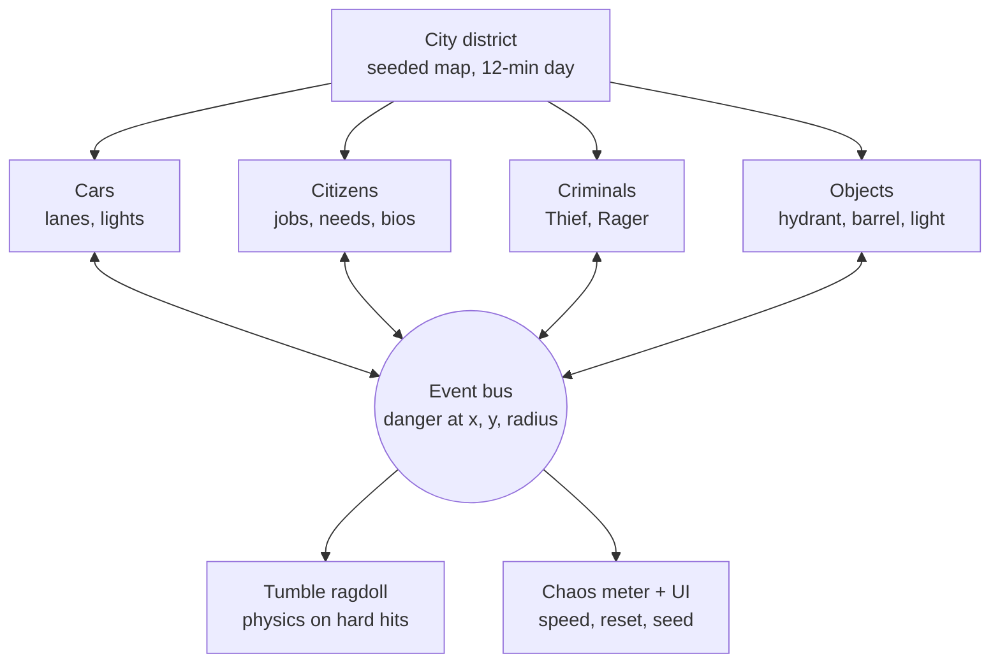

# Emergent Chaos Simulator — Project Spec
Mode: Full · Type: Software · Level: Comfortable · Version: 2 · Date: Oct 15, 2026

## 1. The idea
A top-down 2D "god view" simulation of a small city district, played in a desktop browser. Forty citizens with jobs, schedules, needs, and quirky bios go about their day while twenty cars obey (mostly) the traffic lights. The player drops criminals into the city from a menu and watches unscripted chain reactions — stolen cars, road rage, burst hydrants, exploding fuel barrels, and citizens sent tumbling ragdoll-style across the street. Built in Godot with Claude Code, released free on itch.io before GTA 6 launches (Nov 19, 2026), with a Substack devlog documenting the build.

## 2. It's done when…
- [ ] A friend can open the itch.io link on a laptop and the city runs smoothly in Chrome and Firefox
- [ ] Citizens visibly commute: leave home, go to work, stop at the bank or café, head home — with two rush hours in a 12-minute day
- [ ] Clicking any citizen shows their name, profession, current goal, needs, and bio
- [ ] A citizen hit by a car or caught in an explosion tumbles, skids, and bounces, then fades out and later reappears at home
- [ ] Spawning a Car Thief or Road Rager causes an unscripted chain reaction in 3 of 5 tries
- [ ] The chaos meter climbs during chaos and Reset brings the city back to calm; the same seed replays the same starting city
- [ ] Four Substack posts are published, the last one being the launch post

## 3. What's in version 1
**Must have:**
- Scrolling district (~2–3 screens) with drag-to-pan and scroll-to-zoom
- 8 destinations: 2 housing blocks, office tower, bank, café, shop, gas station, park
- 40 citizens, one of six professions: office worker, bank teller, barista, shop clerk, delivery driver, retiree
- Each citizen has a home, workplace, schedule, needs (money, hunger, patience), a car or not, and a bio from a pre-written pool of ~300
- 20 cars that follow lanes, obey lights, brake, and queue
- 12-real-minute sim day (two rush hours per typical session)
- Reactive objects: hydrants (burst → slippery water), fuel barrels and gas pumps (explode, chain), traffic lights (knocked out → flash yellow)
- Tumble ragdolls for citizens and spinouts for cars on hard impacts; citizens fade out and respawn at home
- Criminal menu: **Car Thief** and **Road Rager**, click to place
- Chaos meter, pause / 1× / 3×, Reset, New Seed, visible seed
- Desktop browser only; phones see a "best on desktop" note

**Later (v2+):** Arsonist and spreading fire (first post-launch update), police response, live AI-driven NPC decisions, typed criminal prompts, phone/touch support, bigger map, day/night lighting, more professions, sound design pass, replay/GIF capture.

**Not doing:** a playable driving character, 3D, multiplayer, Steam release, jointed-limb ragdolls, anything using GTA names or art.

## 4. Your starting point
- Coding: comfortable. Godot: one tutorial done.
- Tools: a computer; Claude Code for the code.
- Time: under 5 hours/week → about 22 hours before Nov 19.
- Budget: $25–100.
- Release: itch.io, playable in desktop browsers. Blog: Substack.
- **Assumptions made for you:** Godot 4.7 (latest stable line) with GDScript; Kenney's free CC0 art from day one; single-threaded web export; one random-number seed drives the whole simulation; violence stays cartoonish (tumbles and dazed stars, no blood).

## 5. What it should do
- [ ] It should build the district from a fixed layout and spawn 40 citizens and 20 cars at start
- [ ] It should give each citizen a profession, home, matching workplace, schedule, needs, car ownership, and a bio
- [ ] It should run a sim clock where 1 real second = 2 sim minutes (a full day in 12 real minutes), starting at 6:00
- [ ] It should cycle traffic lights; cars stop on red, brake for obstacles, and queue
- [ ] It should let citizens pick their next goal by scoring options from needs and schedule
- [ ] It should broadcast "danger" events (crash, explosion, theft, ragdoll) with position, radius, and kind; nearby agents and objects react by their own rules
- [ ] It should switch an agent to a physics body on a hard impact (ragdoll or spinout), then hand control back or respawn
- [ ] It should let the player pick a criminal type from a menu and click to place one
- [ ] It should raise the chaos meter on crashes, explosions, thefts, ragdolls, and fleeing citizens, and decay it over time
- [ ] It should show an inspector card when a citizen is clicked
- [ ] It should hold a steady frame rate with 60 agents in Chrome and Firefox on a typical laptop

## 6. How it works

The two-way arrows are the design: every agent and object both announces events and reacts to them. Nothing is scripted end to end — a crash just broadcasts "danger here," a nearby citizen flees into the road, a swerving car clips a hydrant, the water makes the next car spin out. That's where emergent chaos comes from.

**Main choices and why:**
- **Godot 4.7 + GDScript** — free, strong at 2D, exports to the browser.
- **AStarGrid2D pathfinding** — cheap enough for 60 agents in a browser; a natural fit for city blocks.
- **Path-following movement, physics only on impact** — agents glide along paths (fast); a hard hit swaps them to a RigidBody2D for the tumble ragdoll or spinout. Keeps the browser build smooth.
- **Utility scoring for citizen brains** — each errand gets a score from needs and the clock; highest wins. Easy to tune, great blog material.
- **Small state machines for cars and criminals** — a few clear states each.
- **One event bus (autoload)** — decouples everything so chain reactions emerge.
- **One seed** — the same seed rebuilds the same starting city, so funny runs can be replayed and shared.
- **Kenney CC0 art from day one** — free, consistent top-down style, no risky late art swap.

## 7. Shopping list (prices checked Oct 15, 2026)

| What it is | Search for | Qty | Price | Where | Backup |
|---|---|---|---|---|---|
| Claude plan with Claude Code | Claude Pro (monthly) | 2 months | $20/mo | claude.com/pricing | Annual Pro is $17/mo but $200 upfront — not worth it here |
| Game engine | Godot 4.7 stable (standard, not .NET) + web export templates | 1 | $0 | godotengine.org | — |
| City tiles | Kenney "Roguelike Modern City" | 1 | $0 (CC0) | kenney.nl | Kenney "Racing Pack" road tiles |
| Cars | Kenney "Racing Pack" | 1 | $0 (CC0) | kenney.nl | Any CC0 top-down car pack on itch.io |
| People | Kenney "Top-down Shooter" characters | 1 | $0 (CC0) | kenney.nl | Colored circles with a heading line |
| Sound effects | Kenney "Impact Sounds" + "Interface Sounds" | 1 | $0 (CC0) | kenney.nl | Skip sound for v1 |
| Hosting | itch.io HTML5 game page | 1 | $0 | itch.io | GitHub Pages |
| Blog | Substack | 1 | $0 | substack.com | — |

- Already have: a computer.
- Buffer (15%): ~$6.
- **Total: ~$46 vs your $25–100 budget.** Room left for a Kenney donation or a paid sound pack later.
- If you hit Claude Pro usage limits, wait for the reset rather than upgrading — Max starts at $100/month.

## 8. Step-by-step plan

| # | Step | Who | How you'll know it worked | Time | Tutorial |
|---|---|---|---|---|---|
| 1 | Install Godot 4.7 + web export templates and Claude Code; create project, git repo, CLAUDE.md, DEVLOG.md | You + AI | Empty project runs; Claude Code reads the folder; first commit pushed | 1 h | [Claude Code quickstart](https://docs.claude.com/en/docs/claude-code/quickstart) · [Godot: your first 2D game](https://docs.godotengine.org/en/stable/getting_started/first_2d_game/index.html) |
| 2 | **Biggest unknown first:** 60 placeholder agents pathing on a road grid, exported to the browser | AI | Steady frame rate in Chrome *and* Firefox on a draft itch.io page | 1.5 h | [Exporting for the Web](https://docs.godotengine.org/en/stable/tutorials/export/exporting_for_web.html) · [itch.io HTML5 docs](https://itch.io/docs/creators/html5) |
| 3 | District: tiles, roads, sidewalks, crosswalks, 8 destinations, pan/zoom camera | AI | You can scroll everywhere; every destination has a marked entrance | 1.5 h | [AStarGrid2D](https://docs.godotengine.org/en/stable/classes/class_astargrid2d.html) |
| 4 | Cars + traffic lights | AI | 20 cars drive 5 minutes with no pile-ups when nothing goes wrong | 2 h | [Finite state machines (GDQuest)](https://www.gdquest.com/tutorial/godot/design-patterns/finite-state-machine/) |
| 5 | Citizens: six professions, 12-min day clock, needs, utility scoring, walk/drive, flee | AI | Debug labels show goals changing; two visible rush hours per day; people scatter from a test danger | 2.5 h | — |
| 6 | Bio pool (~300) + click-to-inspect card | AI + You | Click any citizen → full card. You skim the bios once | 45 min | — |
| 7 | Event bus + reactive objects | AI | A debug car hitting a hydrant makes a puddle that spins out the next car | 2 h | — |
| 8 | Tumble ragdoll + car spinout + respawn | AI | A hit citizen launches, spins, skids, bounces, lies dazed, fades, and reappears at home later | 1 h | [RigidBody2D](https://docs.godotengine.org/en/stable/classes/class_rigidbody2d.html) |
| 9 | Criminal menu: Car Thief + Road Rager | AI | One criminal causes an unscripted chain reaction in 3 of 5 tries | 2 h | — |
| 10 | Chaos meter, speed controls, Reset, New Seed, seed display | AI | Meter rises and decays; same seed → same starting city | 1 h | — |
| 11 | Tuning + playtest with 2 friends | You | Friends laugh at least once and use the menu without help | 1.5 h | — |
| 12 | itch.io page (screenshots, GIF, "best on desktop" note, cartoon violence tag) + public launch | You | Public link works in a fresh browser on a second computer | 1 h | [itch.io HTML5 docs](https://itch.io/docs/creators/html5) |
| B1–B4 | Substack posts | You | Published and linked from the itch page | ~40 min each | — |

## 9. AI agent prompts

**How to use these:** open a terminal in your project folder, run `claude`, and paste the prompt. When it finishes, press Play in Godot (F5) and check the "how you'll know" column. If something breaks, paste the error from Godot's Output or Debugger panel back to Claude Code. Commit after every step that works. At the end of each session, say "update DEVLOG.md" — that file becomes your Substack draft.

**Step 1 — project setup**
> Set up this folder as a Godot 4.7 project using GDScript for a top-down 2D emergent chaos simulator that runs in desktop browsers. Create a `CLAUDE.md` with project conventions: GDScript with static typing; one script per scene; folders `scenes/ scripts/ data/ art/`; all randomness goes through a single seeded RandomNumberGenerator in an autoload called `Sim` (which also owns the sim clock); agents communicate through an autoload `EventBus` with a `danger(position: Vector2, radius: float, kind: StringName)` signal instead of direct references; agents move by following paths and only become physics bodies on hard impacts; keep everything web-export friendly and single-threaded; target 60 agents at a steady frame rate. Also create `DEVLOG.md` and add a rule to CLAUDE.md: at the end of each session, append a dated entry with what we built, what broke, and one interesting decision. Add a Godot `.gitignore`. Don't build gameplay yet.

**Step 2 — biggest unknown (performance spike)**
> Build a throwaway performance test in `scenes/spike/`: a 64×40 grid of 32px cells with a simple block-and-street road pattern drawn with `_draw()`, an AStarGrid2D over the road cells, and 60 agents (colored circles, not physics bodies) that each path to a random road cell and pick another on arrival. Show an FPS counter and agent count, and add a key that doubles the agent count. Configure a Web export preset with Thread Support OFF and tell me exactly how to export and test locally and on a draft itch.io page. Test: steady frame rate at 60 agents in Chrome and Firefox.

**Step 3 — the district**
> Replace the spike with the real district in `scenes/world/`. Use a TileMapLayer with the Kenney Roguelike Modern City tiles in `art/city/` (I'll add them). Layout: about 3 screens wide, a grid of streets with two-way lanes, sidewalks, crosswalks at intersections, and 4 signalized intersections. Place 8 destinations as buildings with a marked entrance cell: 2 housing blocks, office tower, bank, café, shop, gas station, park. Expose destinations by type through a helper the agents can query. Build separate AStarGrid2D grids for road lanes and sidewalks. Add a camera with drag-to-pan and scroll-to-zoom, clamped to the map. On touch devices or narrow screens, show a small "best on desktop" banner. Test: I can scroll the whole district and see debug markers on every entrance.

**Step 4 — cars and traffic lights**
> Add `Car` (CharacterBody2D, Kenney Racing Pack sprite) with a state machine: DRIVING, STOPPED_AT_LIGHT, BRAKING, CRASHED, FLEEING. Cars follow lane paths from the road grid, stop for red lights, and use a forward raycast to brake for anything ahead and queue. Add `TrafficLight` nodes at the 4 intersections cycling green/yellow/red with offsets so cross traffic alternates, plus a KNOCKED_OUT state that flashes yellow (cars slow down but don't stop). On a collision above a speed threshold, emit `EventBus.danger` and enter CRASHED. Spawn 20 cars with random routes from the `Sim` seed. Test: 5 minutes with no pile-ups when nothing goes wrong.

**Step 5 — citizens with jobs and goals**
> Add `Citizen` agents. Run a sim clock in `Sim`: 1 real second = 2 sim minutes (full day = 12 real minutes), day starts at 6:00, with shifts timed so there's a morning and evening rush hour. On spawn, generate from the seed: name, profession (office worker, bank teller, barista, shop clerk, delivery driver, retiree), home, a workplace matching the profession, car ownership (~40%), and needs money, hunger, patience (0–100). Each citizen picks its next goal by utility scoring: work during their shift, bank if money is low, café if hungry, shop sometimes, park if retiree or off-shift, home at night. Delivery drivers hop between shop, café, and homes during their shift. Car owners drive (their car is parked at home); others walk on sidewalks and use crosswalks. Patience drops when stuck; low patience makes drivers run yellows and walkers jaywalk. Citizens listen to `EventBus.danger` and flee if inside the radius, then resume their goal. Add a toggleable debug label with the current goal. Spawn 40. Test: two visible rush hours per day, and people scatter from a test danger I trigger with right-click.

**Step 6 — bios and inspector**
> Generate `data/bios.json` with 300 short, funny, PG-13 bios (one or two sentences, max 30 words), tagged by the six professions, in the voice of a quirky small city. No real people, brands, or game franchises. Assign bios at random by profession on spawn. Add a click-to-inspect card (CanvasLayer UI) showing name, profession, current goal, needs bars, and bio; it follows the selected citizen until closed. Test: clicking any citizen shows a filled card.

**Step 7 — event bus and reactive objects**
> Add objects that respond to collisions and `EventBus.danger`: `Hydrant` (hit hard → bursts into a water puddle Area2D for 60 sim minutes; cars inside lose grip and drift; emits a small danger), `FuelBarrel` plus gas pumps at the gas station (hit hard or inside an explosion → explode after a short fuse with a knockback impulse, a large-radius danger, and chaining to other barrels in range), and traffic lights become KNOCKED_OUT when hit. Place ~6 hydrants and ~5 barrels plus the pumps. Add a debug key that drops a speeding car at the mouse aimed at the nearest object. Test: hitting one barrel near another causes a double explosion and nearby citizens flee.

**Step 8 — tumble ragdoll, spinout, respawn**
> Add a tumble ragdoll: when a citizen is hit by a car above a speed threshold or caught in an explosion's knockback radius, swap it for a `RagdollBody` (RigidBody2D, no gravity, moderate linear and angular damping, bouncy physics material) at the same position, apply an impulse from the impact direction plus random spin, and let it skid and bounce off cars and walls. Emit a small danger so bystanders react. Once it settles, show dazed stars for 3 seconds, fade out, and respawn the same citizen (same name, bio, and profession) at their home after 60 sim minutes. Do the same for cars as a spinout: switch to RigidBody2D with spin, then return to path-following from the nearest lane once settled, or stay CRASHED if speed was very high. Test: a hit citizen launches, spins, skids, bounces, lies dazed, fades, and reappears at home later.

**Step 9 — criminals**
> Add a bottom menu with two criminal types; select one and click the map to place it. `CarThief`: walks to the nearest stopped car, pulls the driver out (driver becomes a fleeing citizen; emit a theft danger), then drives at high speed toward a random map exit ignoring lights and braking late; despawns at the map edge. `RoadRager`: a driver with an anger meter that rises when blocked; above thresholds he tailgates, then overtakes into oncoming lanes, then deliberately rams the car ahead. Both emit EventBus events so the rest of the sim reacts. Test: placing one criminal causes at least one unscripted chain reaction in 3 of 5 tries.

**Step 10 — chaos meter and controls**
> Add a chaos meter (top bar) that rises on crashes, explosions, thefts, ragdolls, and the number of currently fleeing citizens, and decays slowly toward zero. Add pause / 1× / 3× speed, a Reset button that rebuilds the city with the same seed, a New Seed button, the current seed on screen, and the sim clock time. Test: the same seed produces the same starting layout and citizen list.

## 10. Timeline & milestones
Available: ~4.5 h/week × 5 weeks ≈ 22 hours. Planned: ~18 hours of building + ~2.5 hours of posts ≈ 20.5 hours. Projects like this usually run long, so week 5 is your safety valve.

| Week | Dates | Steps | Milestone you can show | Substack post |
|---|---|---|---|---|
| 1 | Oct 16–22 | 1–3 | "60 dots drive around a real city in my browser" | 1: Why I'm building a chaos sim before GTA 6 + the stress test |
| 2 | Oct 23–29 | 4–5 | "The city commutes to work by itself" | 2: Giving 40 NPCs jobs, needs, and a clock |
| 3 | Oct 30–Nov 5 | 6–8 | "First accidental chain reaction — with ragdolls" (record GIFs!) | 3: The event bus and the first chain reaction |
| 4 | Nov 6–12 | 9–10 | "Drop a criminal, watch it unravel" | (draft the launch post) |
| 5 | Nov 13–18 | 11–12 | **Public launch target: Mon Nov 16. Hard cutoff: Wed Nov 18** | 4: Meet the criminals + it's live |

**Checkpoint rule:** if Step 8 isn't done by Thu Nov 5, launch with the Car Thief only and ship the Road Rager as the first update.

**Substack tips:** GIFs and short screen recordings carry these posts; Substack's code formatting is basic, so show code as short snippets or screenshots and link the repo if it's public. Put the itch.io link at the top of every post from week 4 on.

## 11. Safety notes
- **Trademarks:** keep "GTA", "Grand Theft Auto", "Vice City", Rockstar logos, and look-alike art out of the game's title, itch page, and thumbnails. Saying "built for the GTA 6 hype" inside your Substack posts is fine.
- **AI-written bios:** skim the bio file once before launch; keep them about fictional people only.
- **No API keys in the build:** v1 has no live AI, so nothing secret ships. Anything inside a web build is readable by players.
- **itch.io content tags:** mark the game as containing cartoon violence.

## 12. What could go wrong (and plan B)
1. **Browser performance (biggest unknown):** 60 agents stutter on the web. *Plan B:* drop to 30 citizens + 15 cars, update paths less often, limit simultaneous ragdolls to ~5.
2. **Not enough time:** *Plan B:* the checkpoint rule; the itch page can say "early build, updated weekly" — GTA 6 launch-week traffic lasts past day one.
3. **Chaos doesn't "emerge" — just random crashes:** *Plan B:* tune reactions so every event can trigger a second one (fleeing walkers step into roads; swerving cars steer away from danger and toward objects).
4. **Gridlock instead of chaos:** *Plan B:* a stuck timer that lets cars reverse or reroute after a few seconds.
5. **Ragdolls fly off the map or jitter:** *Plan B:* cap impulse strength, clamp to map bounds, and force-settle after 4 seconds.
6. **Web export audio glitches (single-threaded):** *Plan B:* keep sound minimal or off for v1.

## 13. What you'll learn
Godot's scene/node structure, grid pathfinding, state machines, utility-based AI, switching between kinematic movement and physics, decoupled systems with signals, seeded randomness for reproducible simulations, web export and itch.io publishing, working effectively with an AI coding agent, and writing a devlog in public.

**Good next project:** the v2 you already have — live LLM-driven NPC decisions (like the "generative agents" research idea) in a desktop build, where API keys can stay on the player's machine.

## 14. Glossary
- **Emergent behavior** — complex outcomes from simple rules interacting, not from a script.
- **Godot** — a free, open-source game engine.
- **GDScript** — Godot's Python-like scripting language.
- **Scene / node** — Godot's building blocks; a scene is a reusable tree of nodes.
- **TileMapLayer** — a Godot node for painting grid-based maps from tiles.
- **AStarGrid2D** — Godot's built-in grid pathfinder.
- **Raycast** — an invisible line that reports what it hits; used for "is something ahead of me?"
- **CharacterBody2D** — a node you move yourself (used for normal driving and walking).
- **RigidBody2D** — a node moved by the physics engine (used for ragdolls and spinouts).
- **Tumble ragdoll** — a fake top-down ragdoll: the body is launched, spins, skids, and bounces, without jointed limbs.
- **State machine** — an agent is in one state at a time with rules for switching.
- **Utility scoring / utility AI** — scoring each possible goal and picking the highest.
- **Autoload** — a script that's always loaded and reachable from anywhere (`Sim`, `EventBus`).
- **Signal / event bus** — a broadcast system; agents announce events and anyone interested reacts.
- **Seed** — a number that makes "random" results repeat exactly.
- **Web export / HTML5** — building the game to run in a browser.
- **Single-threaded export** — a web build that doesn't need special server headers, so it runs reliably on itch.io.
- **CC0** — public-domain license; free to use for anything, no credit required.
- **CLAUDE.md** — a file Claude Code reads automatically for project rules.

## 15. Open questions
- Game title (placeholder: Emergent Chaos Simulator) — keep it GTA-free.
- Public or private code repo? A public repo makes Substack code links easy.

## 16. Change log
- v1 (Oct 15, 2026): Initial Quick-mode spec. Citizen NPCs with professions, schedules, needs, and pre-written AI bios; scrolling small district; Arsonist moved to post-launch.
- v2 (Oct 15, 2026): Full-mode review with three check-ins. Added tumble ragdolls with respawn at home and car spinouts (new Step 8); set desktop-only, 40 citizens / 20 cars, the six professions, a 12-minute day, and path-following with physics only on impact; chose Substack; merged the criminals post into the launch post (4 posts instead of 5); renumbered steps and updated prompts, timeline, glossary, risks, and open questions.
